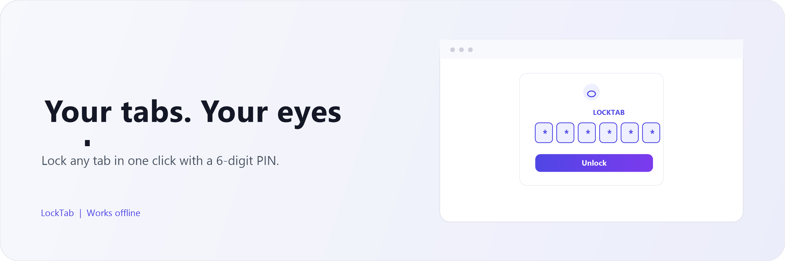

<p align="center">
  
</p>

<h1 align="center">LockTab v{{VERSION}}</h1>

<p align="center">Lock any tab in one click with a 6-digit PIN. Private PINs per site, one-time recovery, zero cloud. Your tabs, your eyes only.</p>

<p align="center">
  <a href="https://github.com/el9a7rawi/LockTab/releases"></a>
  <a href="https://github.com/el9a7rawi/LockTab/blob/main/LICENSE"></a>
  <a href="https://github.com/el9a7rawi/LockTab/pulls"></a>
  <a href="https://developer.chrome.com/docs/extensions"></a>
  
  
</p>

## 1. Release files

| File | Browser |
| --- | --- |
| `locktab-chrome-v{{VERSION}}.zip` | Chrome, Chromium |
| `locktab-edge-v{{VERSION}}.zip` | Microsoft Edge |
| `locktab-brave-v{{VERSION}}.zip` | Brave |
| `locktab-opera-v{{VERSION}}.zip` | Opera |
| `locktab-firefox-v{{VERSION}}.zip` | Firefox 121+ |
| `SHA256SUMS.txt` | Checksums for all archives |
| Source code (zip / tar.gz) | Automatically attached by GitHub |

Every archive contains the extension only: no development tools, test files, governance documents or
secrets. Firefox ships a dedicated manifest with a classic background script.

## 2. Installation — one minute

**Chrome, Edge, Brave and Opera**

1. Download your browser's archive above and extract it into a folder.
2. Open `chrome://extensions`.
3. Enable **Developer mode**.
4. Click **Load unpacked** and select the extracted folder.

**Firefox 121+**

1. Download `locktab-firefox-v{{VERSION}}.zip` and extract it.
2. Open `about:debugging#/runtime/this-firefox`.
3. Click **Load Temporary Add-on** and select `manifest.json` in the extracted folder.

## 3. Requirements

| Browser | Minimum version |
| --- | --- |
| Chrome / Chromium | 121+ |
| Edge | 121+ |
| Brave | 121+ |
| Opera | 121+ |
| Firefox | 121+ |

## 4. Verify file integrity

```powershell
Get-FileHash .\locktab-chrome-v{{VERSION}}.zip -Algorithm SHA256
```

```bash
sha256sum -c SHA256SUMS.txt
```

## 5. What's changed

See [CHANGELOG.md](https://github.com/el9a7rawi/LockTab/blob/main/CHANGELOG.md) for the full
release history.

## 6. Source code and license

Open source under Apache-2.0. Bundled fonts are licensed separately under SIL OFL 1.1.

<p align="center">Made with care ❤️ <b>Ahmed Yousry</b> · <a href="https://github.com/el9a7rawi/LockTab">LockTab</a> · <a href="https://github.com/el9a7rawi/LockTab/blob/main/LICENSE">Apache-2.0</a></p>
