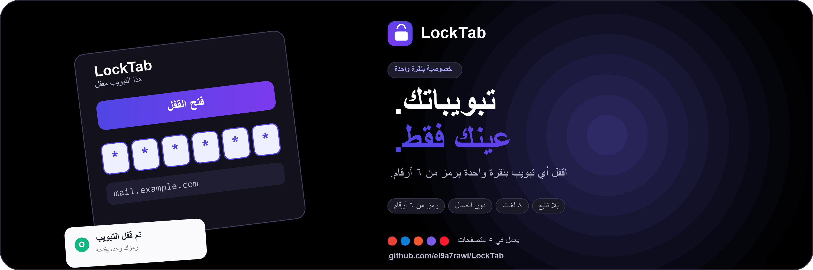
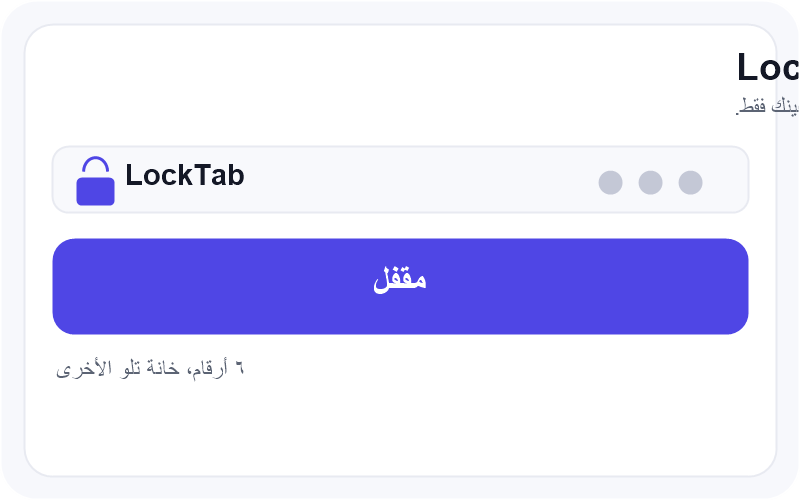
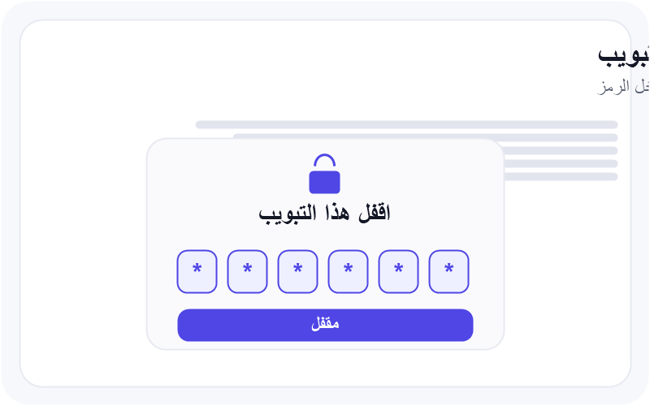
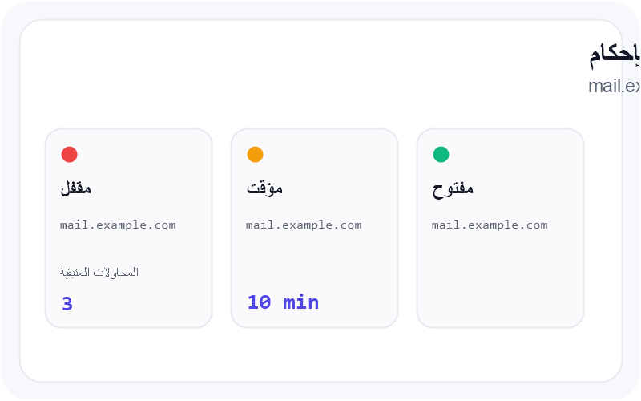
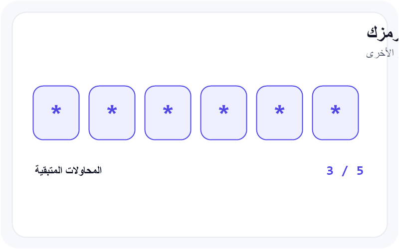
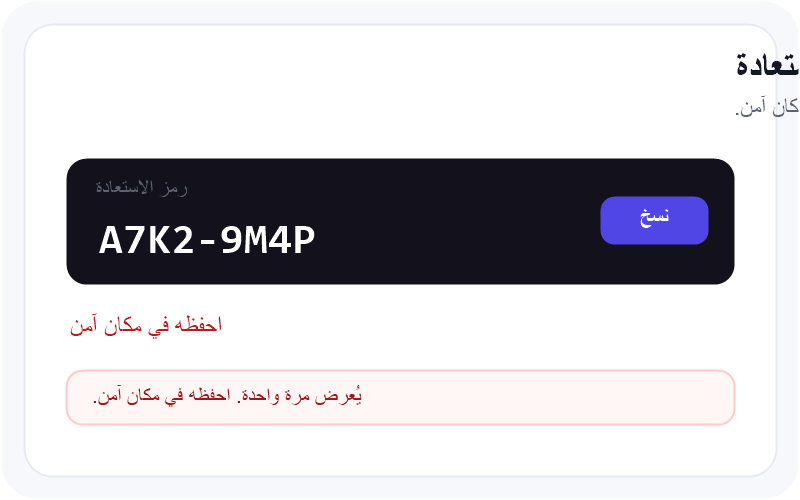
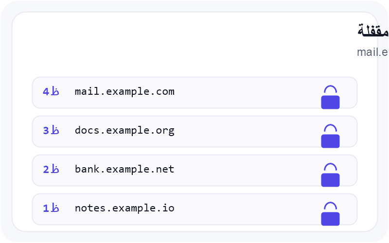
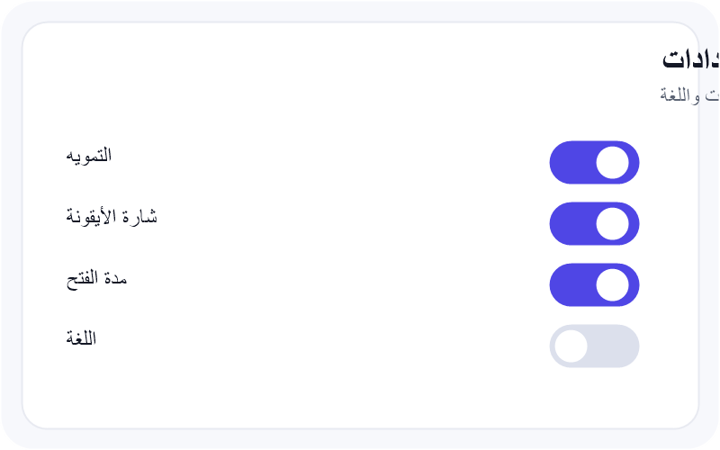

<p align="center">
  
</p>

<h1 align="center">LockTab — تبويباتك، عينك فقط</h1>

<p align="center">اقفل أي تبويب بنقرة واحدة برمز من ٦ أرقام. خصّص رمزاً لموقع بعينه، واحصل على رمز استعادة لمرة واحدة، واترك جهازك وأنت تعلم أن أحداً لا يستطيع قراءة ما على شاشتك. ثماني لغات، ودعم RTL كامل، ولا أي اتصال بالإنترنت.</p>

<p align="center">
  <a href="https://github.com/el9a7rawi/LockTab/releases"></a>
  <a href="https://github.com/el9a7rawi/LockTab/blob/main/LICENSE"></a>
  <a href="https://github.com/el9a7rawi/LockTab/pulls"></a>
  <a href="https://developer.chrome.com/docs/extensions"></a>
  
  
</p>

<p align="center">
  <a href="README.md">English</a> · <a href="README.es.md">Español</a> · <a href="README.fr.md">Français</a> · <a href="README.de.md">Deutsch</a> · <a href="README.pt-BR.md">Português (Brasil)</a> · <a href="README.ru.md">Русский</a> · <a href="README.zh-CN.md">中文（简体）</a>
</p>

<h3 align="center">نزّل لمتصفحك — اضغط الأيقونة</h3>

<div align="center">

| [<br><b>Chrome</b>](https://github.com/el9a7rawi/LockTab/releases/latest) | [<br><b>Edge</b>](https://github.com/el9a7rawi/LockTab/releases/latest) | [<br><b>Firefox</b>](https://github.com/el9a7rawi/LockTab/releases/latest) | [<br><b>Brave</b>](https://github.com/el9a7rawi/LockTab/releases/latest) | [<br><b>Opera</b>](https://github.com/el9a7rawi/LockTab/releases/latest) |
|---|---|---|---|---|

</div>

Firefox 121 فأحدث يستخدم أرشيفاً منفصلاً بمانيفست مخصص.

---

## 1. لماذا LockTab؟

| Without LockTab | With LockTab |
| --- | --- |
| أي شخص يستطيع قراءة تبويب مفتوح | تبويبك مغطى حتى يُدخل الرمز |
| كلمة مرور واحدة لكل المواقع | رمز خاص بالصفحات التي تهمك |
| نسيان الرمز يعني فقدان الوصول | رمز استعادة لمرة واحدة يفتح كل شيء |
| إضافات ترسل بياناتك للخارج | يعمل دون اتصال تماماً، بلا حساب وتتبع |

يظل التبويب المقفل مغطى حتى يُدخل الرمز. بلا حساب سحابي أو كلمة مرور مشتركة أو طلب يخرج من الجهاز.

---

## 2. كيف يعمل — ثلاث خطوات

1. أنشئ رمزاً من ٦ أرقام واحفظ رمز الاستعادة الذي يُعرض مرة واحدة.
2. افتح التبويب الذي تريد حمايته واضغط «اقفل هذا التبويب».
3. أدخل الرمز للقراءة مجدداً، أو امنح فتحاً مؤقتاً.

---

## 3. جولة في الواجهة — كل جزء من الإضافة

### 3.1 الرأس — كل شيء في متناولك
<p align="center"></p>

العنوان ومفتاح الثيم واللغة ورابط GitHub في صفّ واحد هادئ.

### 3.2 إجراء رئيسي واحد
<p align="center"></p>

زر واحد بتدرج لوني يغطي الصفحة النشطة. الفتح المؤقت وإزالة القفل يطلبان الرمز أولاً.

### 3.3 حالة التبويب
<p align="center"></p>

لوحة مسطّحة تُظهر ما إذا كان التبويب مقفلاً أو مفتوحاً أو مفتوحاً لفترة.

### 3.4 إدخال الرمز
<p align="center"></p>

ست خانات تظهر واحدة تلو الأخرى، وتتوقف عند السادسة، وتوسّط النجمة.

### 3.5 رمز الاستعادة
<p align="center"></p>

يُعرض مرة واحدة بعد الإعداد. احفظه في مكان آمن؛ لا يمكن إعادة استخدام رمز مستهلك.

### 3.6 المواقع المقفلة
<p align="center"></p>

صفوف مرقّمة تعرض كل دومين مقفل. بعد خمسة مواقع تظهر أسهم للتنقل.

### 3.7 الإعدادات
<p align="center"></p>

التمويه بثلاث درجات، شارة الأيقونة، مدة الفتح، الثيم واللغة — في مكان واحد.

### 3.8 الدعم
<p align="center"></p>

LockTab مجاني ومفتوح المصدر. PayPal وInstaPay يساعدان في إبقائه مستقلاً.

---

## 4. ما الذي يحميه الرمز

لا يخرج الرمز من جهازك أبداً. يُخزَّن كـ hash عبر PBKDF2 مع ملح فريد، ويُعاد لصق الحاجز في مكانه بدل إعادة تحميل الصفحة.

<div dir="ltr">

```text
PBKDF2-HMAC-SHA256 · 600,000 تكرار · ملح 16 بايت · shadow root مغلق · تأخير ٣٠/٦٠/٣٠٠/٩٠٠ ثانية
```

</div>

The query string and fragment are ignored, so a redirect cannot shed a lock. Every action that widens
access asks for the PIN again, including the temporary unlock and lock removal.

---

## 5. التثبيت

1. Download the release archive for your browser from [Releases](https://github.com/el9a7rawi/LockTab/releases).
2. Extract it into a folder.
3. Chrome, Edge, Brave and Opera: open `chrome://extensions`, enable **Developer mode**, choose **Load unpacked** and select the folder.
4. Firefox 121+: open `about:debugging#/runtime/this-firefox`, choose **Load Temporary Add-on** and select `manifest.json` in the folder.

الخصوصية موضحة في القسم ٧ أدناه وفي privacy.html.

---

## 6. التطوير

No bundler and no npm dependencies. Run `python tools/build.py` to validate all eight
locale bundles and write the release archives, then `node --test tests/core.test.mjs` for the
unit tests. The interface follows a fixed visual contract in the design reference.

---

## 7. الخصوصية

راجع privacy.html. يُخزَّن الرمز كـ hash عبر PBKDF2 مع ملح فريد. يُهمل الاستعلام والجزء، ولا تُقرأ محتويات الصفحة، ولا يخرج أي طلب من الإضافة. الخطوط مضمّنة محلياً.

---

## 8. الترخيص

المشروع مفتوح المصدر ومجاني للجميع بموجب Apache-2.0 — استخدمه وعدّله وشاركه بحرية؛ النص الكامل في LICENSE. الخطوط مرخّصة منفصلة بموجب SIL OFL 1.1. سجل الإصدارات في CHANGELOG.md.

<p align="center">صُنع بعناية ❤️ <b>Ahmed Yousry</b> · <a href="https://github.com/el9a7rawi/LockTab">LockTab</a> · <a href="LICENSE">Apache-2.0</a></p>
