

  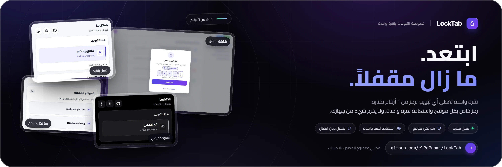

<h1 align="center">LockTab — تبويباتك، عيونك فقط</h1>

اقفل أي تبويب بنقرة واحدة برمز من ٦ أرقام. خصّص رمزاً لموقع بعينه، واحصل على رمز استعادة لمرة واحدة، واترك جهازك وأنت تعلم أن أحداً لا يستطيع قراءة ما على شاشتك. ثماني لغات، ودعم RTL كامل، ولا أي اتصال بالإنترنت.

  
  
  
  
  
  

<h4 align="center">
  <a href="README.md">English</a> · <a href="README.es.md">Español</a> · <a href="README.fr.md">Français</a> · <a href="README.de.md">Deutsch</a> · <a href="README.pt-BR.md">Português (Brasil)</a> · <a href="README.ru.md">Русский</a> · <a href="README.zh-CN.md">中文（简体）</a>
</h4>

<h3 align="center">حمّل الإضافة لمتصفحك — انقر الأيقونة</h3>

| [ <b>Chrome</b>](https://github.com/el9a7rawi/LockTab/releases/latest) | [ <b>Edge</b>](https://github.com/el9a7rawi/LockTab/releases/latest) | [ <b>Firefox</b>](https://github.com/el9a7rawi/LockTab/releases/latest) | [ <b>Brave</b>](https://github.com/el9a7rawi/LockTab/releases/latest) | [ <b>Opera</b>](https://github.com/el9a7rawi/LockTab/releases/latest) |
|---|---|---|---|---|

Chrome ومتصفحات Chromium هي الهدف الأساسي. يدعم Firefox 121 فأحدث عبر أرشيف مخصص بمانيفست خاص به (سكربت خلفي كلاسيكي وإعدادات Gecko).

---

## 1. لماذا LockTab؟

| بلا LockTab | مع LockTab |
|---|---|
| أي شخص يستطيع قراءة تبويب مفتوح | تبويبك مغطى حتى يُدخل الرمز |
| كلمة مرور واحدة لكل المواقع | رمز خاص بالصفحات التي تهمك |
| نسيان الرمز يعني فقدان الوصول | رمز استعادة لمرة واحدة يفتح كل شيء |
| إضافات ترسل بياناتك للخارج | يعمل دون اتصال تماماً، بلا حساب وتتبع |

يخفي LockTab التبويب عن شخص يجلس على جهازك. ليس تشفيراً للقرص ولا يستطيع حمايتك من متصفح مخترق أو مسؤول يزيل الإضافة.

---

## 2. كيف يعمل — ثلاث خطوات

1. أنشئ رمزاً من ٦ أرقام واحفظ رمز الاستعادة الذي يُعرض مرة واحدة.
2. افتح التبويب الذي تريد حمايته واضغط «اقفل هذا التبويب».
3. أدخل الرمز للقراءة مجدداً، أو امنح فتحاً مؤقتاً.

---

## 3. جولة في الواجهة — كل جزء من الإضافة

### 3.1 الرأس — كل شيء في متناولك

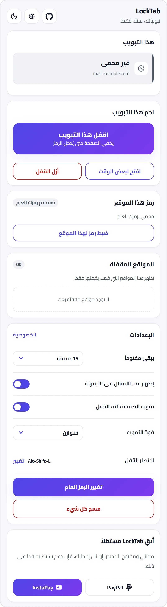

العنوان ومفتاح الثيم ورابط GitHub واختيار اللغة في صفّ واحد مدمج.

### 3.2 إجراء رئيسي واحد

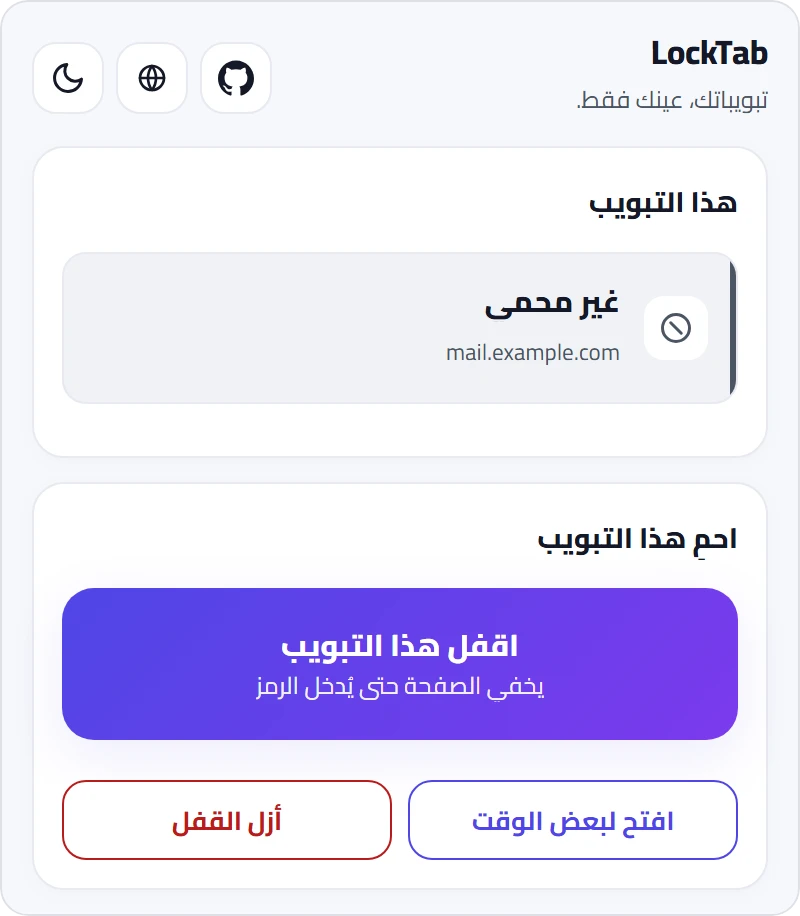

زر واحد بتدرج لوني يغطي الصفحة النشطة. الفتح المؤقت وإزالة القفل يطلبان الرمز أولاً.

### 3.3 حالة التبويب

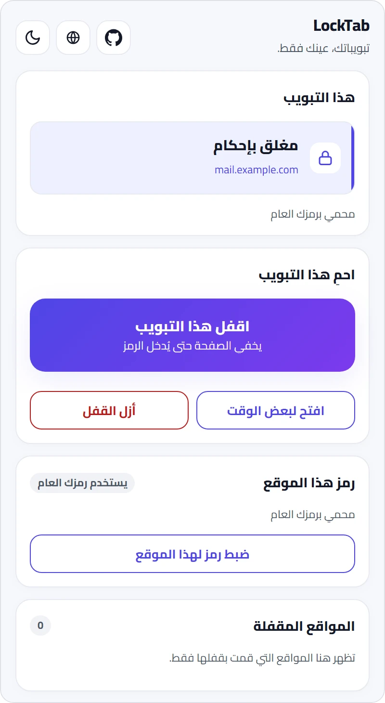

لوحة مسطّحة تُظهر ما إذا كان التبويب مقفلاً أو مفتوحاً أو مفتوحاً لفترة.

### 3.4 أول تشغيل — أنشئ رمزك

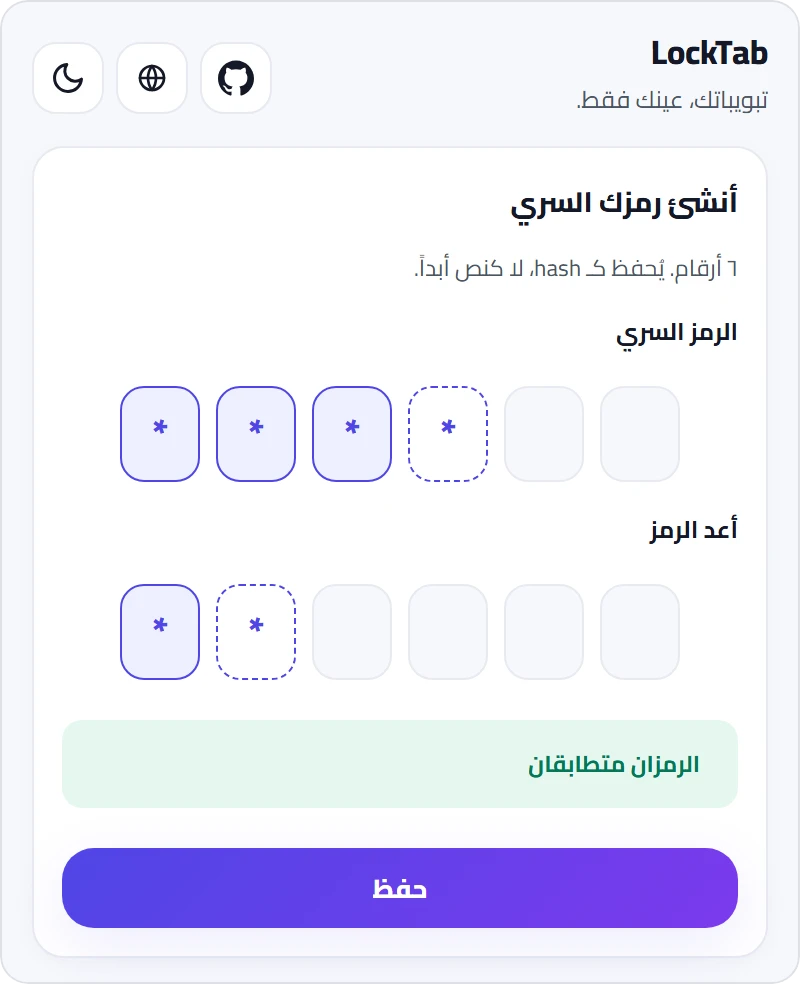

ست خانات تظهر واحدة تلو الأخرى، وتتوقف عند السادسة، وتوسّط النجمة.

### 3.5 رمز الاستعادة يُعرض مرة واحدة

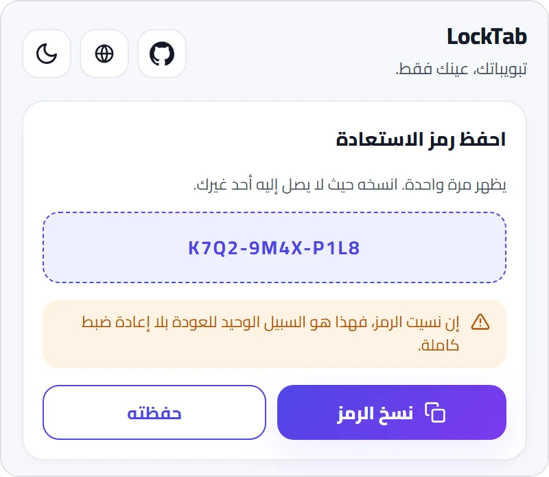

يظهر الرمز أثناء الإعداد فقط. احفظه في مكان آمن؛ لا يمكن إعادة استخدام رمز مستهلك.

### 3.6 رمز لموقع واحد

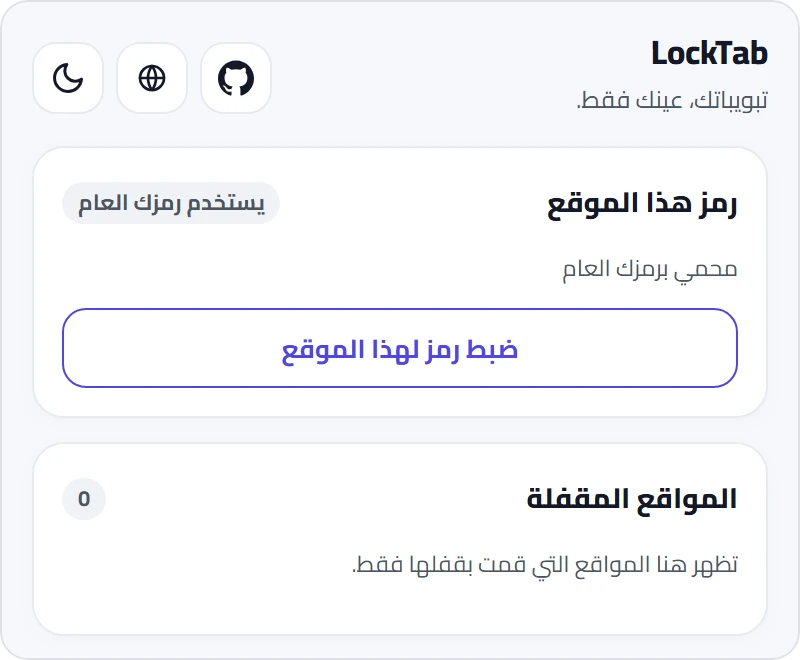

رمز الموقع يتجاوز الرمز العام على ذلك النطاق، فتبقى الصفحات الحساسة منفصلة.

### 3.7 المواقع المقفلة

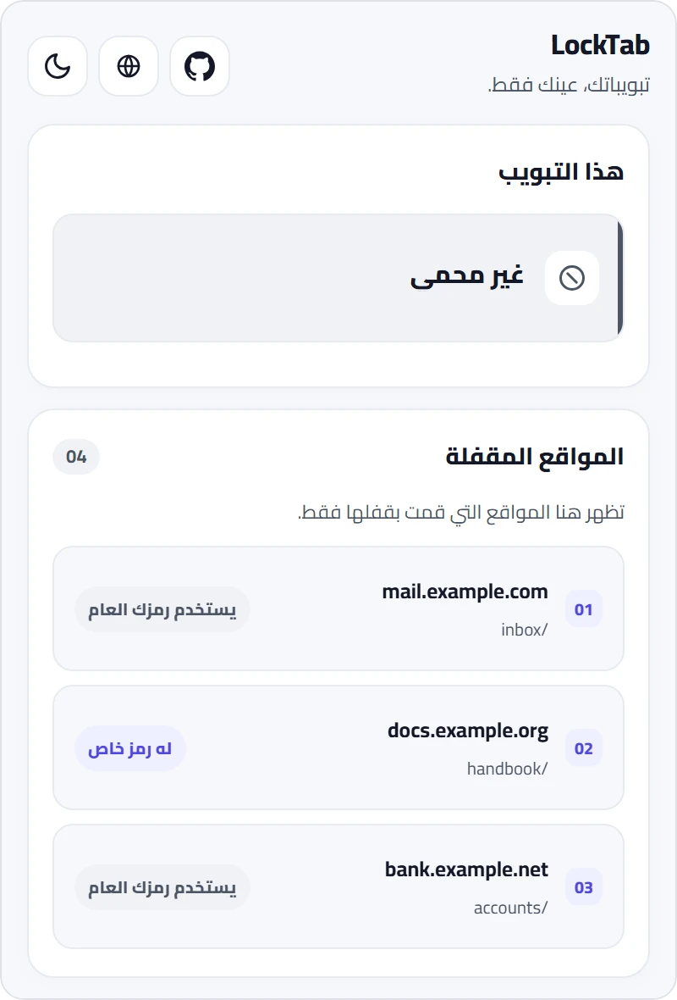

صفوف مرقّمة تعرض كل نطاق مقفل. بعد خمسة مواقع تظهر أسهم للتنقل.

### 3.8 القفل من أي مكان
اختصار الاختصار المضبوط يقفل التبويب الحالي دون فتح النافذة المنبثقة.

### 3.9 الإعدادات

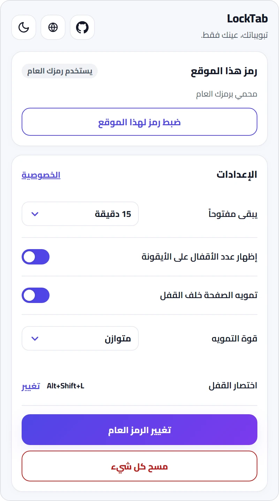

التمويه وشارة الأيقونة ومدة الفتح والاختصار والثيم واللغة في كرت واحد.

### 3.10 ثماني لغات وRTL حقيقي

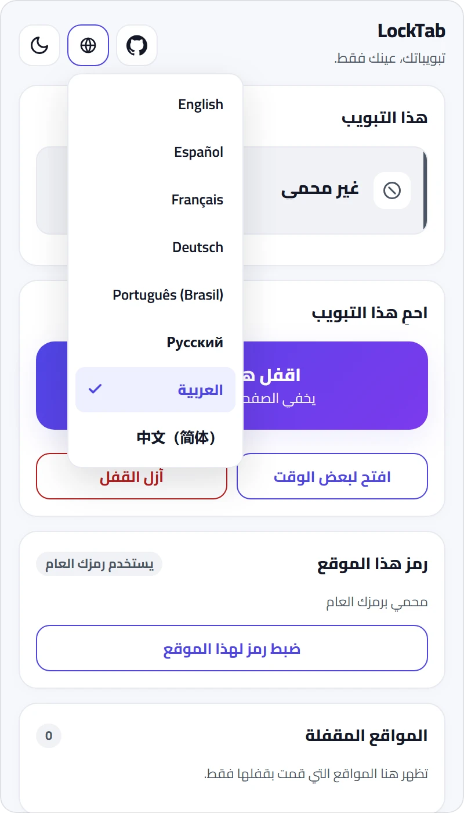

تبدّل فوري بين الحزم الثماني. العربية تعكس التخطيط منطقياً، وتبقى عناوين URL من اليسار إلى اليمين.

### 3.11 ثيم داكن أسود حقيقي

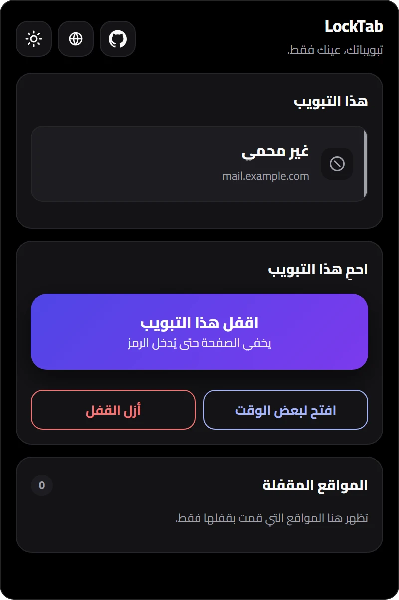

خلفية سوداء فعلية بتباين مضبوط، تُبدّل من الرأس وتُحفظ بين الجلسات.

### 3.12 إدخال الرمز على شاشة القفل

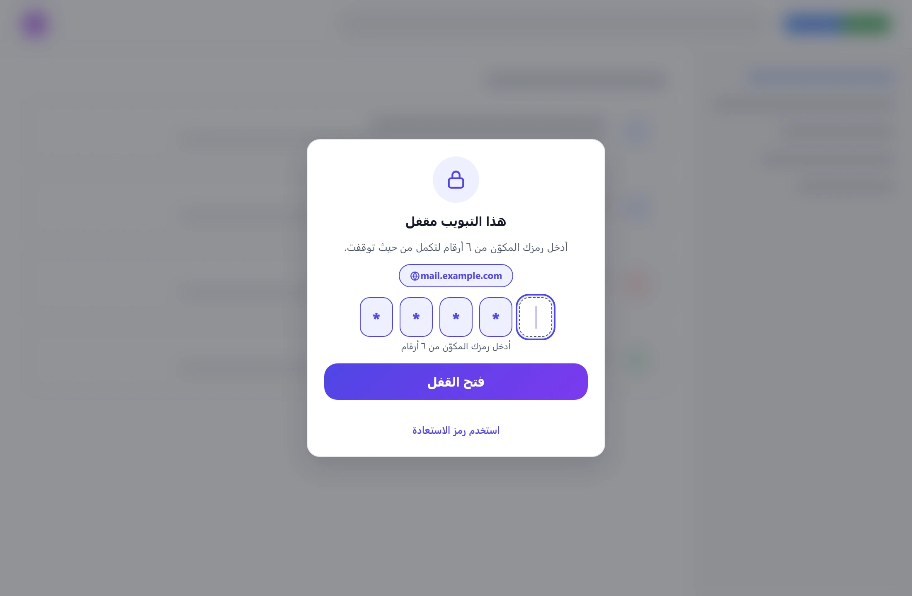

الحاجز shadow root مغلق: يبقى التركيز داخله، ولا تستطيع الصفحة التمرير، والمحاولة الخاطئة ترفع مدة الحظر.

### 3.13 الحالة الفارغة

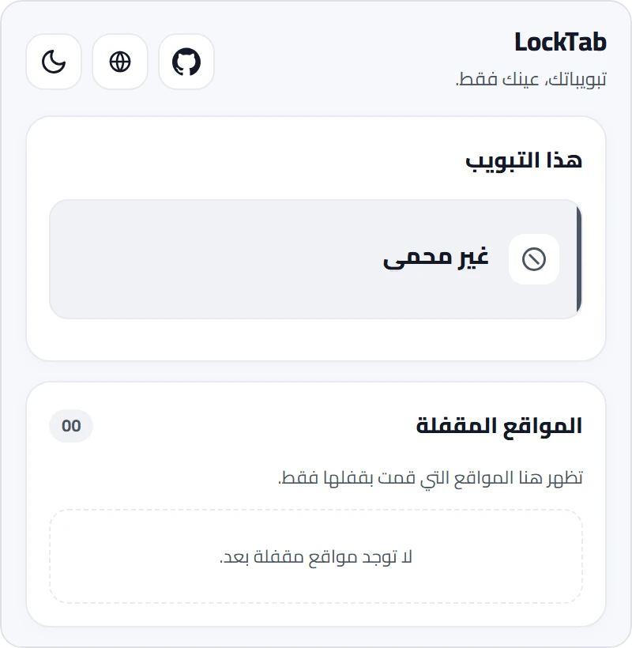

دعوة صادقة لقفل تبويب بدل صندوق فارغ.

### 3.14 دعم التطوير المستمر

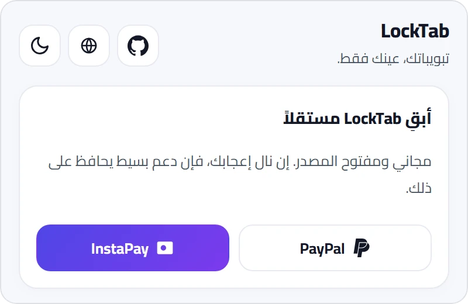

LockTab مجاني ومفتوح المصدر. PayPal وInstaPay يساعدان في إبقائه مستقلاً؛ كلاهما يفتح في تبويب جديد ولا ترسل الإضافة أي بيانات.

## 4. ما الذي يحميه القفل

1. رمز من ٦ أرقام. يُخزَّن كقيمة مُجزّأة عبر PBKDF2 مع ملح فريد، ولا يُكتب الرمز الأصلي على القرص أبداً.
2. حاجز مغلق. تعمل الطبقة داخل shadow root مغلق، وتبقي التركيز داخلها وتمنع تمرير الصفحة.
3. عداد مشترك. تتصاعد المحاولات الخاطئة إلى ٣٠ و٦٠ و٣٠٠ و٩٠٠ ثانية، ولا يؤدي تغيير التبويب إلى إعادة ضبطه.
4. استعادة لمرة واحدة. يُعرض الرمز مرة واحدة ويُستهلك مرة واحدة ويمسح كل الأقفال.

---

## 5. التثبيت (غير مجمّع)

1. افتح `chrome://extensions`.
2. فعّل **وضع المطوّر**.
3. انقر **تحميل غير مجمّع** واختر مجلد الإصدار المستخرج.
4. انقر أيقونة LockTab في شريط الأدوات.

الخصوصية موضحة في القسم ٧ أدناه وفي `privacy.html`.

---

## 6. التطوير

المستودع المنشور يحتوي على الإضافة ووثائقها فقط. أدوات التطوير وسكربتات التصوير والاختبارات المحلية مستبعدة قصداً؛ يتحقق GitHub Actions من الـ manifest وCSP وتطابق اللغات والملفات المضمّنة مع كل دفع.

---

## 7. الخصوصية

راجع `privacy.html`. يُخزَّن الرمز كـ hash عبر PBKDF2 مع ملح فريد، ولا يخرج النص الأصلي من الـ popup. يُهمل الاستعلام والجزء، ولا تُقرأ محتويات الصفحة، ولا يخرج أي طلب من الإضافة. الخطوط مضمّنة محلياً.

---

## 8. الترخيص

المشروع مفتوح المصدر ومجاني للجميع بموجب ترخيص **Apache-2.0** — استخدمه، وعدّله، وشاركه بحرية؛ والنص الكامل في [LICENSE](LICENSE). الخطوط مرخّصة منفصلة بموجب [SIL OFL 1.1](fonts/OFL.txt). سجل الإصدارات في [CHANGELOG.md](CHANGELOG.md).

---

صُنع بعناية ❤️ <b>Ahmed Yousry</b> · <a href="https://github.com/el9a7rawi/LockTab">LockTab</a> · <a href="LICENSE">Apache-2.0</a>

