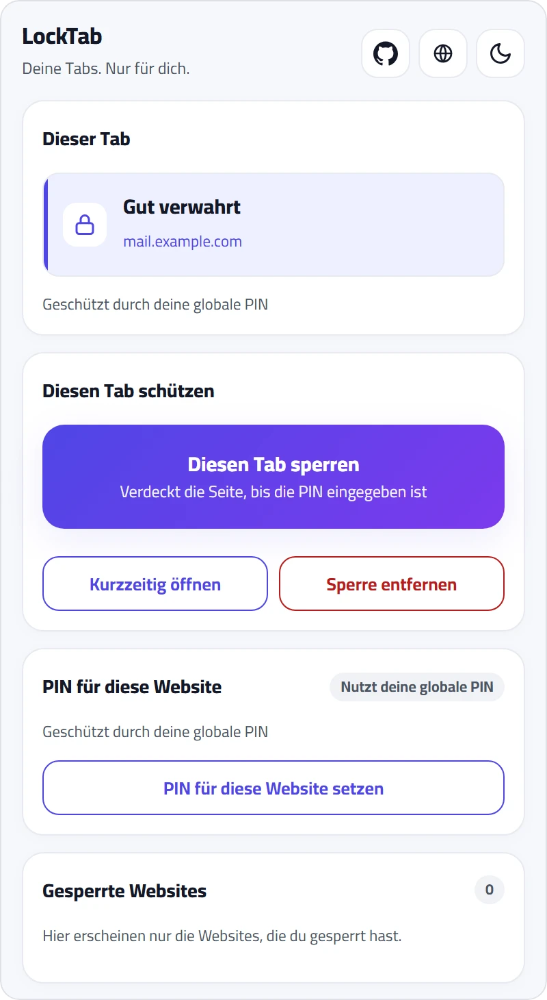
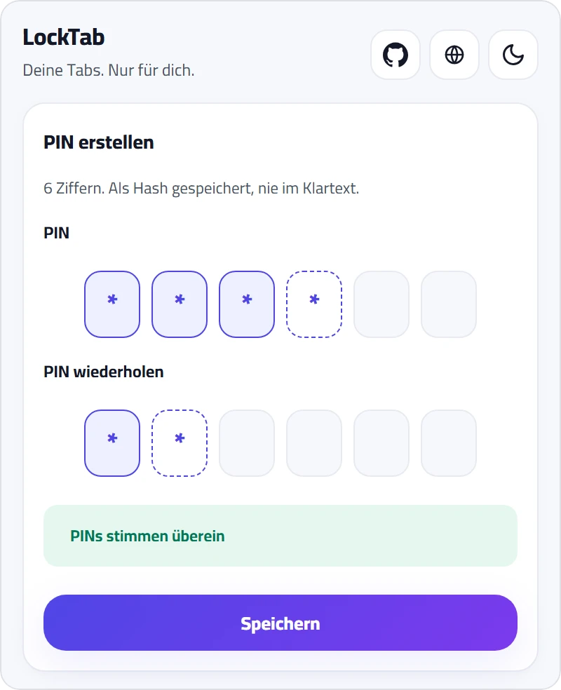
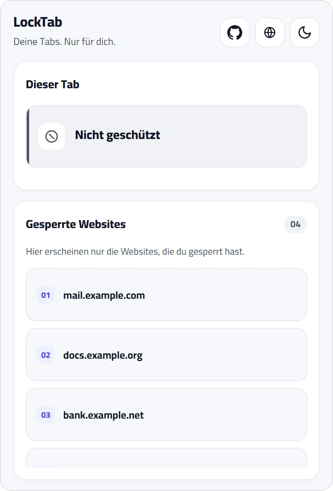
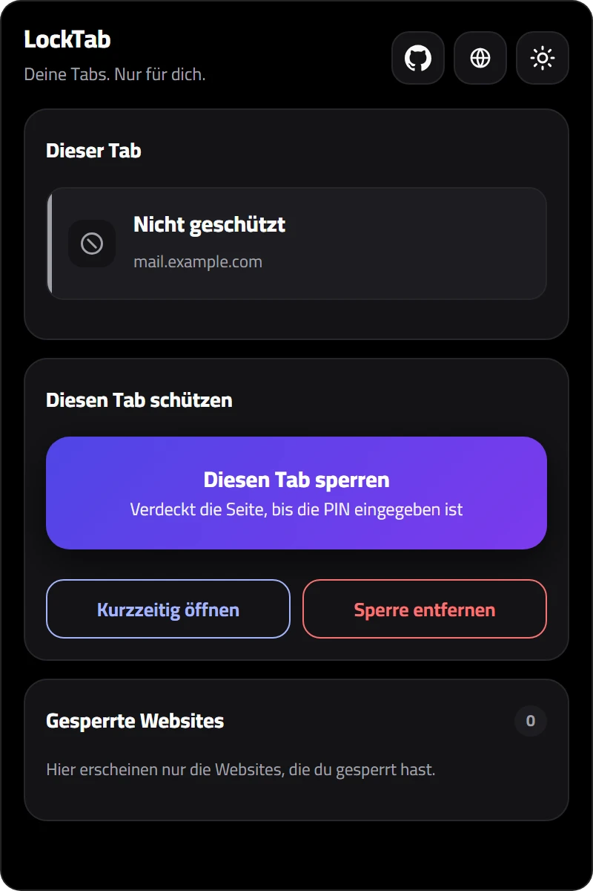
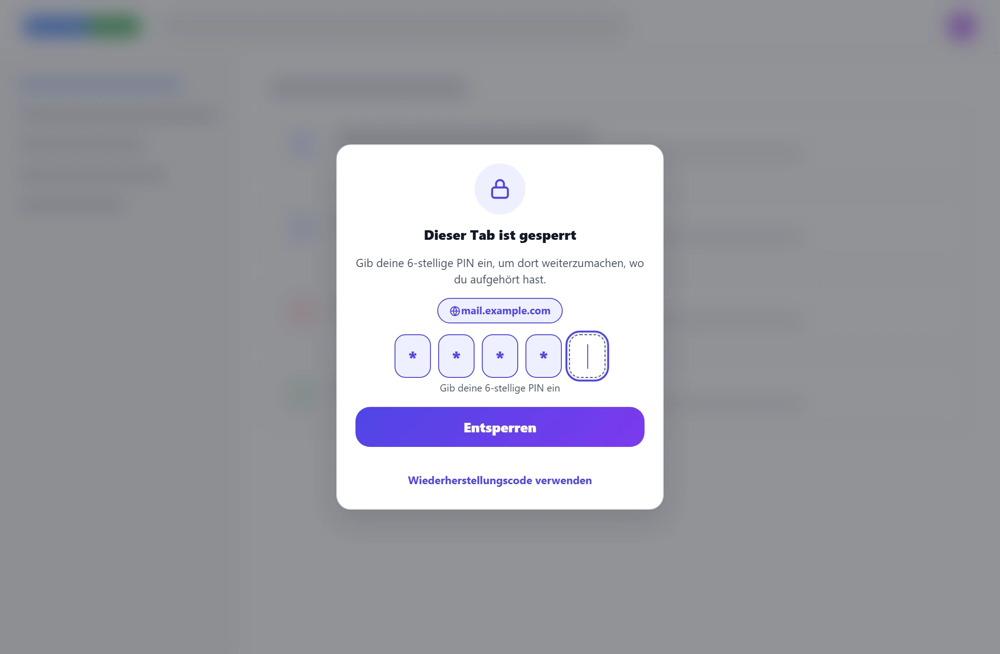
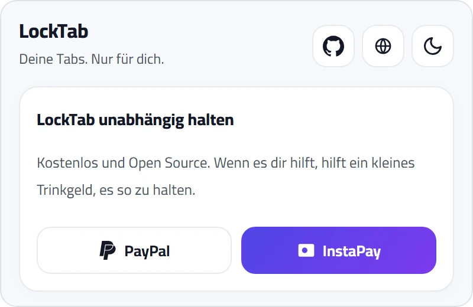

  

<h1 align="center">LockTab — Deine Tabs. Nur für dich.</h1>

Sperre jeden Tab mit einem Klick und einer 6-stelligen PIN. Vergib eine eigene PIN für eine Website, sichere einen einmaligen Wiederherstellungscode und geh weg, ohne dass jemand deinen Bildschirm lesen kann. Acht Sprachen, volles Arabisch-RTL und keinerlei Cloud.

  
  
  
  
  
  

<h4 align="center">
  <a href="README.md">English</a> · <a href="README.es.md">Español</a> · <a href="README.fr.md">Français</a> · <a href="README.pt-BR.md">Português (Brasil)</a> · <a href="README.ru.md">Русский</a> · <a href="README.ar.md">العربية</a> · <a href="README.zh-CN.md">中文（简体）</a>
</h4>

<h3 align="center">Für deinen Browser herunterladen — Symbol anklicken</h3>

| [ <b>Chrome</b>](https://github.com/el9a7rawi/LockTab/releases/latest) | [ <b>Edge</b>](https://github.com/el9a7rawi/LockTab/releases/latest) | [ <b>Firefox</b>](https://github.com/el9a7rawi/LockTab/releases/latest) | [ <b>Brave</b>](https://github.com/el9a7rawi/LockTab/releases/latest) | [ <b>Opera</b>](https://github.com/el9a7rawi/LockTab/releases/latest) |
|---|---|---|---|---|

Chrome und Chromium-Browser sind das Hauptziel. Firefox 121+ wird über ein eigenes Archiv mit Firefox-spezifischem Manifest unterstützt.

---

## 1. Warum LockTab?

| Ohne LockTab | Mit LockTab |
|---|---|
| Jeder kann einen offenen Tab lesen | Dein Tab bleibt bis zur PIN-Eingabe verdeckt |
| Ein Passwort für alle Seiten | Eine eigene PIN für die Seiten, die zählen |
| PIN vergessen bedeutet Zugriff verlieren | Ein einmaliger Code hebt alle Sperren auf |
| Erweiterungen, die nach Hause telefonieren | Völlig offline, ohne Konto und Tracking |

LockTab verdeckt einen Tab vor jemandem, der sich an dein Gerät setzt. Es ist keine Festplattenverschlüsselung und schützt nicht vor einem kompromittierten Browser oder einem Administrator, der die Erweiterung entfernt.

---

## 2. So funktioniert es — drei Schritte

1. Erstelle eine 6-stellige PIN und sichere den einmal angezeigten Wiederherstellungscode.
2. Öffne den zu schützenden Tab und klicke auf Diesen Tab sperren.
3. Gib die PIN ein, um ihn wieder zu lesen, oder erlaube eine kurzzeitige Entsperrung.

---

## 3. Oberflächen-Rundgang — jeder Teil der Erweiterung

### 3.1 Kopfzeile — alles griffbereit

Titel, Theme, Sprache und GitHub-Link teilen eine ruhige Zeile.

### 3.2 Eine Hauptaktion

Eine einzige Gradient-Schaltfläche verdeckt die aktive Seite. Entsperren und Entfernen fragen zuerst nach der PIN.

### 3.3 Tab-Status

Eine flache Platte zeigt, ob der Tab gesperrt, offen oder zeitweise offen ist.

### 3.4 PIN-Eingabe

Sechs OTP-Felder erscheinen nacheinander, enden bei sechs und zentrieren den Stern.

### 3.5 Wiederherstellungscode

Wird nach der Einrichtung einmal gezeigt. Ein verbrauchter Code lässt sich nicht wiederverwenden.

### 3.6 Gesperrte Websites

Nummerierte Zeilen listen jede gesperrte Domain. Ab fünf Seiten blättern Pfeile durch die Liste.

### 3.7 Einstellungen

Blur in drei Stufen, Symbolzähler, Entsperrdauer, Theme und Sprache — an einem Ort.

### 3.8 Unterstützung
LockTab ist kostenlos und Open Source. PayPal und ein hervorgehobenes InstaPay halten es unabhängig.

### 3.9 Einstellungen

Blur, Zähler, Dauer, Theme und Sprache in einer Karte.

### 3.10 Acht Sprachen, echtes RTL

Sofortiger Wechsel; Arabisch spiegelt das Layout logisch.

### 3.11 Tiefschwarzes Dunkeldesign

Echter schwarzer Hintergrund mit abgestimmtem Kontrast.

### 3.12 PIN-Eingabe

Die Sperre nutzt eine geschlossene Shadow Root; der Fokus bleibt innen.

### 3.13 Leerer Zustand

Eine ehrliche Einladung, einen Tab zu sperren.

### 3.14 Unterstützung

PayPal und InstaPay halten das Projekt unabhängig.

## 4. Was die Sperre schützt

1. Eine 6-stellige PIN. Als PBKDF2-Hash mit eindeutigem Salt gespeichert; die PIN im Klartext wird nie auf die Platte geschrieben.
2. Eine geschlossene Abdeckung. Die Sperre nutzt eine geschlossene Shadow Root, hält den Fokus innen und blockiert das Scrollen der Seite.
3. Ein gemeinsamer Zähler. Fehler steigen auf 30, 60, 300 und 900 Sekunden; ein Tab-Wechsel setzt den Zähler nicht zurück.
4. Einmalige Wiederherstellung. Der Code wird einmal gezeigt, einmal verbraucht und entfernt alle Sperren.

---

## 5. Installation (entpackt)

1. Öffne `chrome://extensions`.
2. Aktiviere den **Entwicklermodus**.
3. Klicke auf **Entpackte Erweiterung laden** und wähle den entpackten Ordner.
4. Klicke auf das LockTab-Symbol in der Symbolleiste.

Datenschutz steht in Abschnitt 7 und in `privacy.html`.

---

## 6. Entwicklung

Das veröffentlichte Repository enthält nur die Erweiterung und ihre Dokumentation. Aufnahme-Skripte und lokale Tests bleiben außen vor; GitHub Actions prüft Manifest, CSP und Sprachabdeckung.

---

## 7. Datenschutz

Siehe `privacy.html`. Die PIN wird nur als PBKDF2-Hash mit eindeutigem Salt gespeichert; Seiteninhalte werden nie gelesen, keine Anfrage verlässt die Erweiterung.

---

## 8. Lizenz

Das Projekt ist Open Source unter **Apache-2.0**; vollständiger Text in [LICENSE](LICENSE). Schriften unter [SIL OFL 1.1](fonts/OFL.txt). Historie in [CHANGELOG.md](CHANGELOG.md).

---

Mit Sorgfalt erstellt ❤️ <b>Ahmed Yousry</b> · <a href="https://github.com/el9a7rawi/LockTab">LockTab</a> · <a href="LICENSE">Apache-2.0</a>

