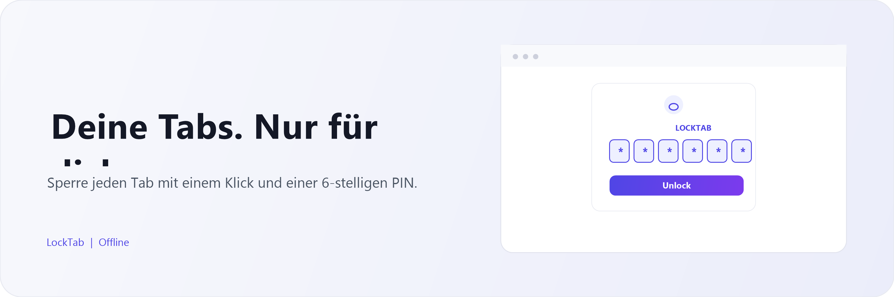
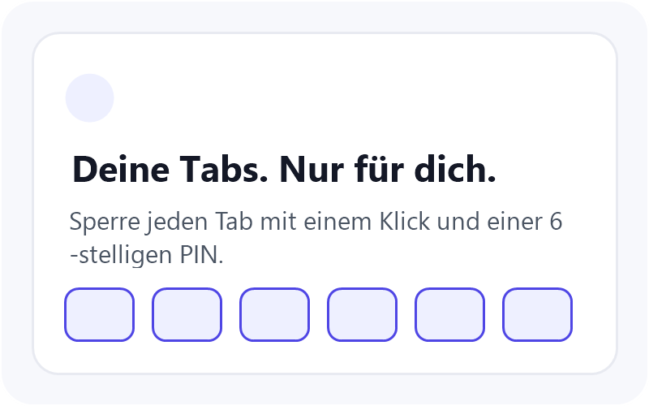
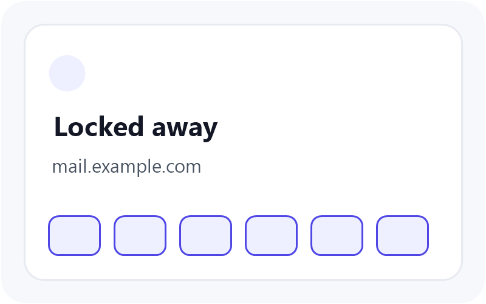
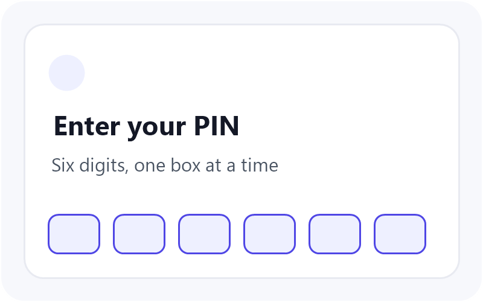
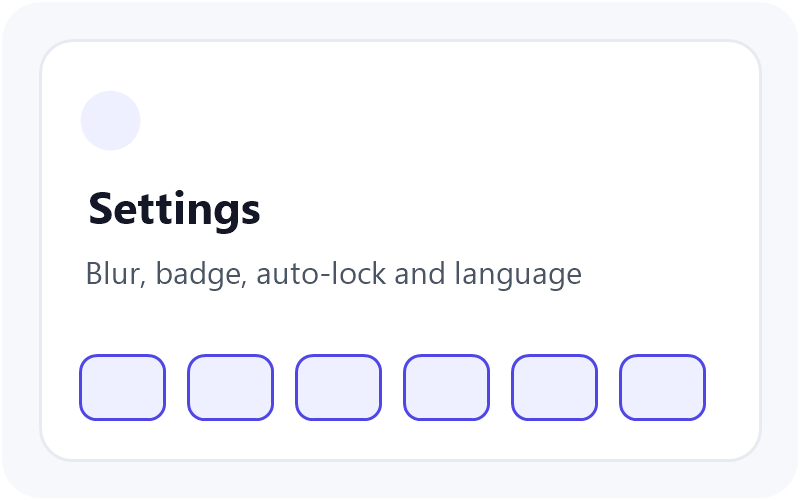

  

<h1 align="center">LockTab — Deine Tabs. Nur für dich.</h1>

Sperre jeden Tab mit einem Klick und einer 6-stelligen PIN. Vergib eine eigene PIN für eine Website, sichere einen einmaligen Wiederherstellungscode und geh weg, ohne dass jemand deinen Bildschirm lesen kann. Acht Sprachen, volles Arabisch-RTL und keinerlei Cloud.

  
  
  
  
  
  

<h4 align="center">
  <a href="README.md">English</a> · <a href="README.ar.md">العربية</a> · <a href="README.es.md">Español</a> · <a href="README.fr.md">Français</a> · <a href="README.de.md"><b>Deutsch</b></a> · <a href="README.pt-BR.md">Português (Brasil)</a> · <a href="README.ru.md">Русский</a> · <a href="README.zh-CN.md">中文（简体）</a>
</h4>

<h3 align="center">Für deinen Browser herunterladen — Symbol anklicken</h3>

| [ <b>Chrome</b>](https://github.com/el9a7rawi/LockTab/releases/latest) | [ <b>Edge</b>](https://github.com/el9a7rawi/LockTab/releases/latest) | [ <b>Firefox</b>](https://github.com/el9a7rawi/LockTab/releases/latest) | [ <b>Brave</b>](https://github.com/el9a7rawi/LockTab/releases/latest) | [ <b>Opera</b>](https://github.com/el9a7rawi/LockTab/releases/latest) |
|---|---|---|---|---|

Firefox 121 oder neuer nutzt ein eigenes Archiv mit einem Firefox-spezifischen Manifest.

---

## 1. Warum LockTab?

| Without LockTab | With LockTab |
| --- | --- |
| Jeder kann einen offenen Tab lesen | Dein Tab bleibt bis zur PIN-Eingabe verdeckt |
| Ein Passwort für alle Seiten | Eine eigene PIN für die Seiten, die zählen |
| PIN vergessen bedeutet Zugriff verlieren | Ein einmaliger Code hebt alle Sperren auf |
| Erweiterungen, die nach Hause telefonieren | Völlig offline, ohne Konto und Tracking |

The page you left open stays private without a shared password or a cloud account. Nothing leaves
the device, so the promise holds even when you are offline.

---

## 2. So funktioniert es — drei Schritte

1. Erstelle eine 6-stellige PIN und sichere den einmal angezeigten Wiederherstellungscode.
2. Öffne den zu schützenden Tab und klicke auf Diesen Tab sperren.
3. Gib die PIN ein, um ihn wieder zu lesen, oder erlaube eine kurzzeitige Entsperrung.

---

## 3. Oberflächenrundgang — jeder Teil der Erweiterung

### 3.1 Kopfzeile — alles griffbereit

Titel, Theme, Sprache und GitHub-Link teilen eine ruhige Zeile.

### 3.2 Eine Hauptaktion

Eine einzige Gradient-Schaltfläche verdeckt die aktive Seite. Entsperren und Entfernen fragen zuerst nach der PIN.

### 3.3 Tab-Status

Eine flache Platte zeigt, ob der Tab gesperrt, offen oder zeitweise offen ist.

### 3.4 PIN-Eingabe

Sechs OTP-Felder erscheinen nacheinander, enden bei sechs und zentrieren den Stern.

### 3.5 Wiederherstellungscode

Wird nach der Einrichtung einmal gezeigt. Ein verbrauchter Code lässt sich nicht wiederverwenden.

### 3.6 Gesperrte Websites

Nummerierte Zeilen listen jede gesperrte Domain. Ab fünf Seiten blättern Pfeile durch die Liste.

### 3.7 Einstellungen

Blur in drei Stufen, Symbolzähler, Entsperrdauer, Theme und Sprache — an einem Ort.

### 3.8 Unterstützung

LockTab ist kostenlos und Open Source. PayPal und ein hervorgehobenes InstaPay halten es unabhängig.

---

## 4. What the PIN protects

PBKDF2-HMAC-SHA256 with 600,000 iterations and a unique 16-byte salt — the plaintext PIN is never
stored. The overlay runs in a closed shadow root, focus stays inside it, and the page underneath
cannot scroll. Wrong guesses escalate through 30s, 60s, 300s and 900s lock-outs, and opening another
tab does not reset the counter while the global PIN is in use. The query string and fragment are
dropped, so a redirect cannot shed a lock.

---

## 5. Install

1. Download the release archive for your browser from [Releases](https://github.com/el9a7rawi/LockTab/releases).
2. Extract it into a folder.
3. Chrome, Edge, Brave and Opera: open `chrome://extensions`, enable **Developer mode**, choose **Load unpacked** and select the folder.
4. Firefox 121+: open `about:debugging#/runtime/this-firefox`, choose **Load Temporary Add-on** and select `manifest.json` in the folder.

Datenschutz steht in Abschnitt 7 und in privacy.html.

---

## 6. Development

No bundler and no npm dependencies. Run `python tools/build.py` to validate all eight
locale bundles and write the release archives, then `node --test tests/core.test.mjs` for the
unit tests. The interface follows a fixed visual contract in the design reference.

---

## 7. Privacy

Siehe privacy.html. Die PIN wird nur als PBKDF2-Hash mit einem eindeutigen Salt gespeichert. Query und Fragment werden verworfen, Seiteninhalte nie gelesen, keine Anfrage verlässt die Erweiterung. Schriften sind lokal.

---

## 8. License

Das Projekt ist Open Source und kostenlos unter Apache-2.0 — nutze, ändere und teile es frei; der vollständige Text steht in LICENSE. Die Schriften stehen unter SIL OFL 1.1. Die Historie steht in CHANGELOG.md.

Mit Sorgfalt erstellt ❤️ <b>Ahmed Yousry</b> · <a href="https://github.com/el9a7rawi/LockTab">LockTab</a> · <a href="LICENSE">Apache-2.0</a>

