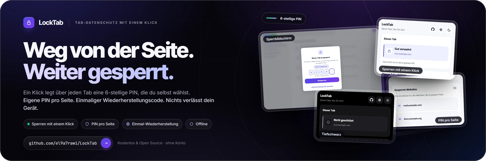
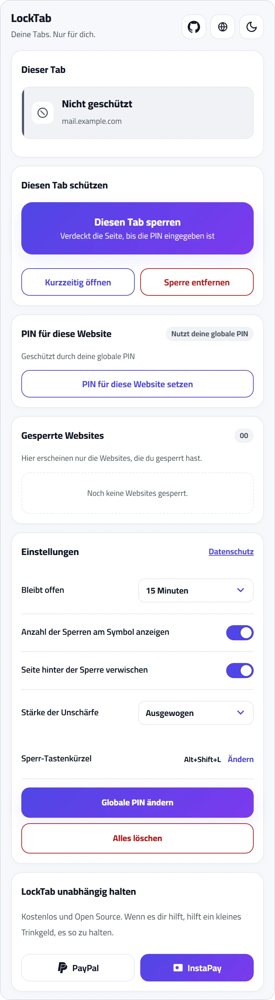
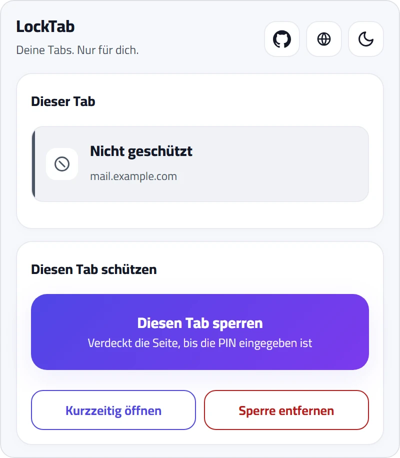
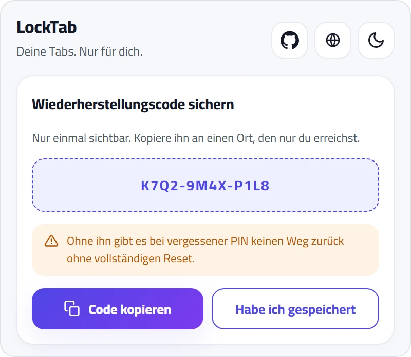
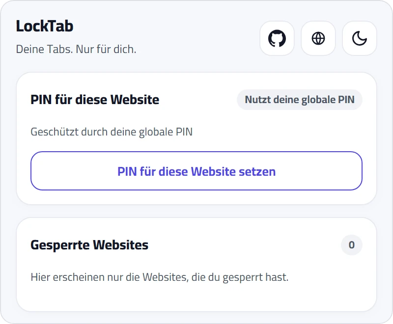
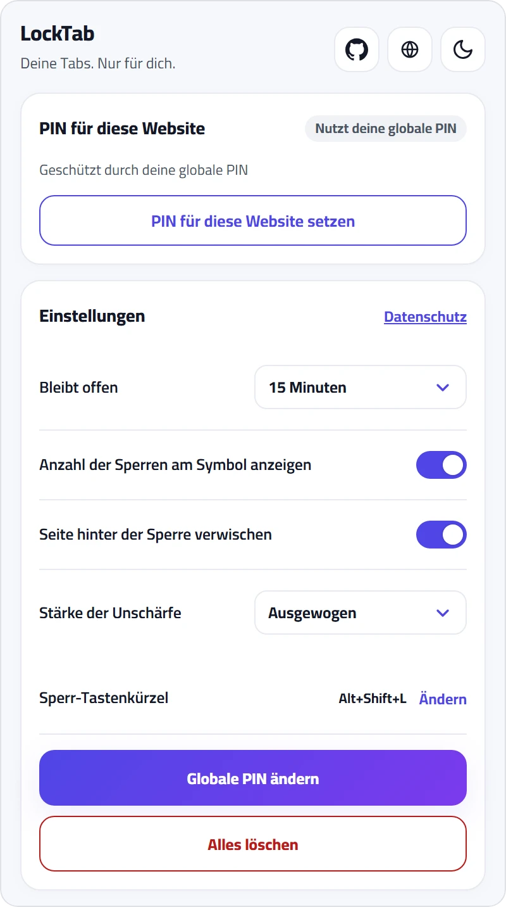
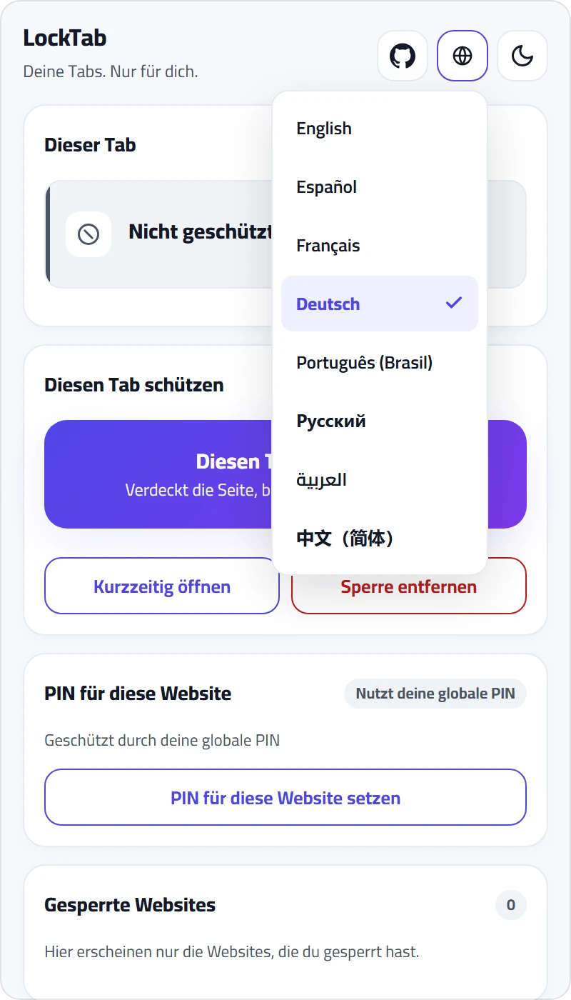
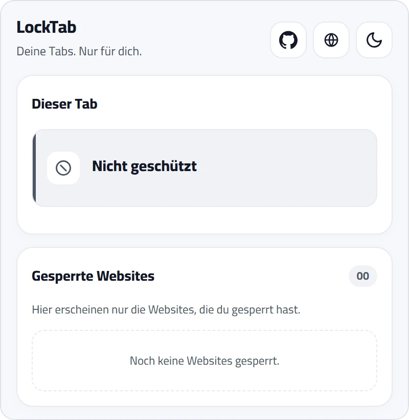

  

<h1 align="center">LockTab — Deine Tabs. Nur für dich.</h1>

Sperre jeden Tab mit einem Klick und einer 6-stelligen PIN. Vergib eine eigene PIN für eine Website, sichere einen einmaligen Wiederherstellungscode und geh weg, ohne dass jemand deinen Bildschirm lesen kann. Acht Sprachen, volles Arabisch-RTL und keinerlei Cloud.

  
  
  
  
  
  

<h4 align="center">
  <a href="README.md">English</a> · <a href="README.es.md">Español</a> · <a href="README.fr.md">Français</a> · <a href="README.pt-BR.md">Português (Brasil)</a> · <a href="README.ru.md">Русский</a> · <a href="README.ar.md">العربية</a> · <a href="README.zh-CN.md">中文（简体）</a>
</h4>

<h3 align="center">Download for your browser — click the icon</h3>

| [ <b>Chrome</b>](https://github.com/el9a7rawi/LockTab/releases/latest) | [ <b>Edge</b>](https://github.com/el9a7rawi/LockTab/releases/latest) | [ <b>Firefox</b>](https://github.com/el9a7rawi/LockTab/releases/latest) | [ <b>Brave</b>](https://github.com/el9a7rawi/LockTab/releases/latest) | [ <b>Opera</b>](https://github.com/el9a7rawi/LockTab/releases/latest) |
|---|---|---|---|---|

Chrome und Chromium-Browser sind das Hauptziel. Firefox 121+ wird über ein eigenes Archiv mit Firefox-spezifischem Manifest unterstützt.

---

## 1. Warum LockTab?

| Without LockTab | With LockTab |
|---|---|
| Jeder kann einen offenen Tab lesen | Dein Tab bleibt bis zur PIN-Eingabe verdeckt |
| Ein Passwort für alle Seiten | Eine eigene PIN für die Seiten, die zählen |
| PIN vergessen bedeutet Zugriff verlieren | Ein einmaliger Code hebt alle Sperren auf |
| Erweiterungen, die nach Hause telefonieren | Völlig offline, ohne Konto und Tracking |

undefined

---

## 2. So funktioniert es — drei Schritte

1. Erstelle eine 6-stellige PIN und sichere den einmal angezeigten Wiederherstellungscode.
2. Öffne den zu schützenden Tab und klicke auf Diesen Tab sperren.
3. Gib die PIN ein, um ihn wieder zu lesen, oder erlaube eine kurzzeitige Entsperrung.

---

## 3. Oberflächen-Rundgang — jeder Teil der Erweiterung

### 3.1 Header — everything in reach

The title, theme toggle, GitHub link and language picker share one compact row.

### 3.2 One primary action

A single gradient button covers the active page. Temporary unlock and lock removal ask for the PIN first.

### 3.3 Tab status

A flat status plate shows whether the tab is locked, open, or open for a while.

### 3.4 First run — create your PIN

Six boxes appear one after another, stop exactly at six, and centre the asterisk.

### 3.5 Recovery code shown once

The code is displayed only at setup. Store it somewhere safe; a used code can never be replayed.

### 3.6 A PIN for one site

A site PIN overrides the global one on that domain, so sensitive pages can stay separate.

### 3.7 Locked sites

Numbered rows list every locked domain. Past five sites, arrows page through the list.

### 3.8 Lock from anywhere
The Alt+Shift+L shortcut locks the current tab without opening the popup.

### 3.9 Einstellungen

Blur, Zähler, Dauer, Theme und Sprache in einer Karte.

### 3.10 Acht Sprachen, echtes RTL

Sofortiger Wechsel; Arabisch spiegelt das Layout logisch.

### 3.11 Tiefschwarzes Dunkeldesign

Echter schwarzer Hintergrund mit abgestimmtem Kontrast.

### 3.12 PIN-Eingabe

Die Sperre nutzt eine geschlossene Shadow Root; der Fokus bleibt innen.

### 3.13 Leerer Zustand

Eine ehrliche Einladung, einen Tab zu sperren.

### 3.14 Unterstützung

PayPal und InstaPay halten das Projekt unabhängig.

## 4. Was die Sperre schützt

1. **A 6-digit PIN.** Stored as a PBKDF2 hash with a unique 16-byte salt; the plaintext is never written to disk.
2. **A closed gate.** The overlay runs in a closed shadow root, traps focus and blocks scrolling underneath.
3. **A shared counter.** Wrong guesses escalate through 30, 60, 300 and 900 second lock-outs; switching tabs does not reset it.
4. **One-time recovery.** The code is shown once, consumed once, and clears every lock.

---

## 5. Installation (entpackt)

1. Open `chrome://extensions`.
2. Enable **Developer mode**.
3. Click **Load unpacked** and select the extracted release folder.
4. Click the LockTab icon in the toolbar.

Datenschutz steht in Abschnitt 7 und in `privacy.html`.

---

## 6. Entwicklung

Das veröffentlichte Repository enthält nur die Erweiterung und ihre Dokumentation. Aufnahme-Skripte und lokale Tests bleiben außen vor; GitHub Actions prüft Manifest, CSP und Sprachabdeckung.

---

## 7. Datenschutz

Siehe `privacy.html`. Die PIN wird nur als PBKDF2-Hash mit eindeutigem Salt gespeichert; Seiteninhalte werden nie gelesen, keine Anfrage verlässt die Erweiterung.

---

## 8. Lizenz

Das Projekt ist Open Source unter **Apache-2.0**; vollständiger Text in [LICENSE](LICENSE). Schriften unter [SIL OFL 1.1](fonts/OFL.txt). Historie in [CHANGELOG.md](CHANGELOG.md).

---

Mit Sorgfalt erstellt ❤️ <b>Ahmed Yousry</b> · <a href="https://github.com/el9a7rawi/LockTab">LockTab</a> · <a href="LICENSE">Apache-2.0</a>

