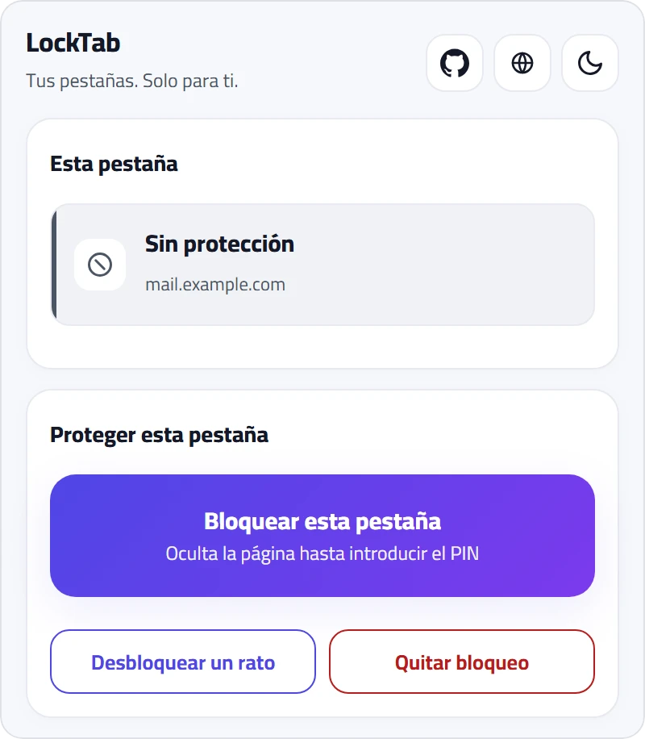
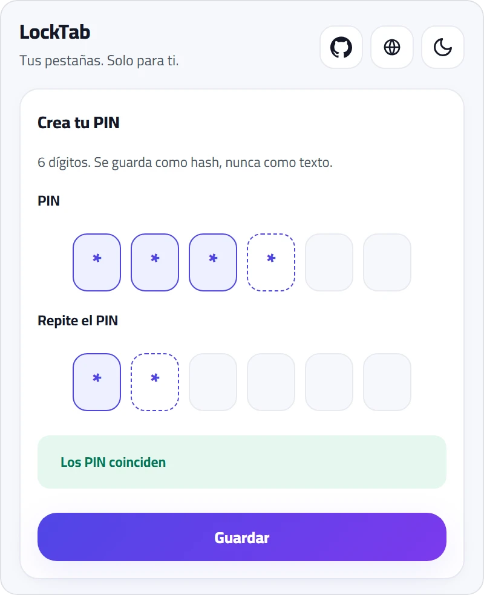
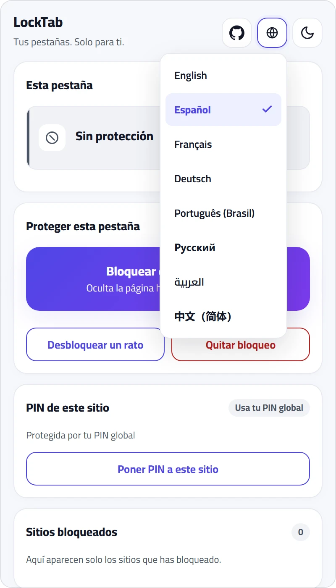
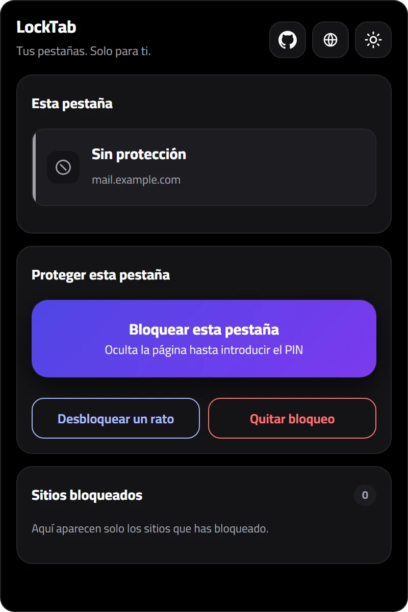
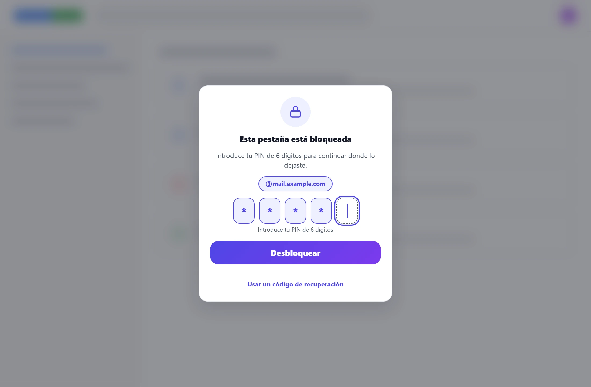
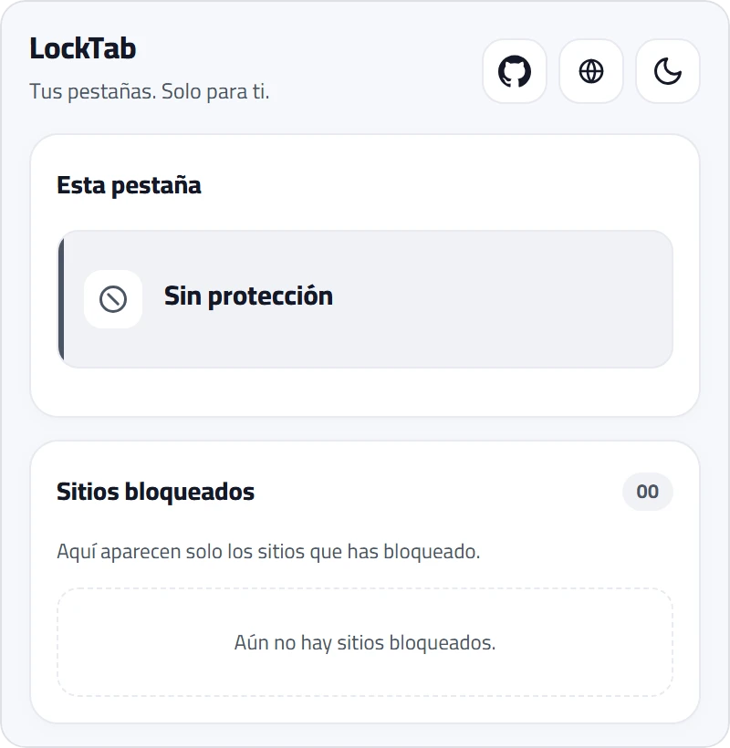
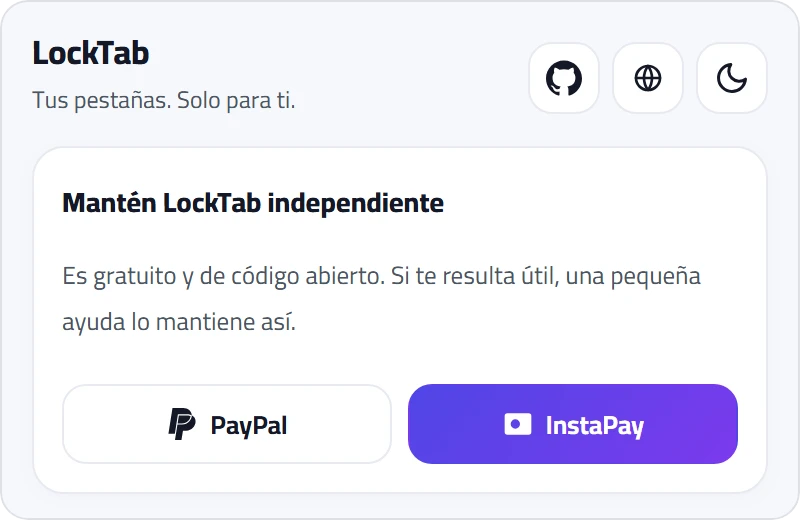

  

<h1 align="center">LockTab — Tus pestañas, solo para ti</h1>

Bloquea cualquier pestaña con un clic y un PIN de 6 dígitos. Añade un PIN privado para un sitio, guarda un código de recuperación de un solo uso y aléjate sabiendo que nadie puede leer tu pantalla. Ocho idiomas, RTL árabe completo y cero conexiones a la nube.

  
  
  
  
  
  

<h4 align="center">
  <a href="README.md">English</a> · <a href="README.fr.md">Français</a> · <a href="README.de.md">Deutsch</a> · <a href="README.pt-BR.md">Português (Brasil)</a> · <a href="README.ru.md">Русский</a> · <a href="README.ar.md">العربية</a> · <a href="README.zh-CN.md">中文（简体）</a>
</h4>

<h3 align="center">Download for your browser — click the icon</h3>

| [ <b>Chrome</b>](https://github.com/el9a7rawi/LockTab/releases/latest) | [ <b>Edge</b>](https://github.com/el9a7rawi/LockTab/releases/latest) | [ <b>Firefox</b>](https://github.com/el9a7rawi/LockTab/releases/latest) | [ <b>Brave</b>](https://github.com/el9a7rawi/LockTab/releases/latest) | [ <b>Opera</b>](https://github.com/el9a7rawi/LockTab/releases/latest) |
|---|---|---|---|---|

Chrome y los navegadores Chromium son el objetivo principal. Firefox 121 o posterior se admite mediante un archivo dedicado con su propio manifiesto.

---

## 1. Por qué LockTab

| Without LockTab | With LockTab |
|---|---|
| Cualquiera puede leer una pestaña abierta | Tu pestaña queda cubierta hasta introducir el PIN |
| Una contraseña compartida por todos los sitios | Un PIN dedicado para las páginas importantes |
| Olvidar el PIN significa perder el acceso | Un código de recuperación de un solo uso lo desbloquea todo |
| Extensiones que envían datos a casa | Completamente sin conexión, sin cuenta ni seguimiento |

undefined

---

## 2. Cómo funciona — tres pasos

1. Crea un PIN de 6 dígitos y guarda el código de recuperación que se muestra una vez.
2. Abre la pestaña que quieres proteger y pulsa Bloquear esta pestaña.
3. Introduce el PIN para leerla de nuevo, o concede un desbloqueo temporal.

---

## 3. Recorrido por la interfaz — cada parte de la extensión

### 3.1 Header — everything in reach

The title, theme toggle, GitHub link and language picker share one compact row.

### 3.2 One primary action

A single gradient button covers the active page. Temporary unlock and lock removal ask for the PIN first.

### 3.3 Tab status

A flat status plate shows whether the tab is locked, open, or open for a while.

### 3.4 First run — create your PIN

Six boxes appear one after another, stop exactly at six, and centre the asterisk.

### 3.5 Recovery code shown once

The code is displayed only at setup. Store it somewhere safe; a used code can never be replayed.

### 3.6 A PIN for one site

A site PIN overrides the global one on that domain, so sensitive pages can stay separate.

### 3.7 Locked sites

Numbered rows list every locked domain. Past five sites, arrows page through the list.

### 3.8 Lock from anywhere
The Alt+Shift+L shortcut locks the current tab without opening the popup.

### 3.9 Ajustes

Desenfoque, contador, duración, tema e idioma en una sola tarjeta.

### 3.10 Ocho idiomas, RTL real

Cambia al instante entre los ocho paquetes; el árabe invierte el diseño.

### 3.11 Tema oscuro negro real

Fondo negro auténtico con contraste ajustado y recordado entre sesiones.

### 3.12 Entrada del PIN

La cubierta usa una shadow root cerrada: el foco permanece dentro.

### 3.13 Estado vacío

Una invitación honesta a bloquear una pestaña.

### 3.14 Apoyar el desarrollo

PayPal e InstaPay ayudan a mantenerlo independiente; no se envían datos.

## 4. Qué protege el bloqueo

1. **A 6-digit PIN.** Stored as a PBKDF2 hash with a unique 16-byte salt; the plaintext is never written to disk.
2. **A closed gate.** The overlay runs in a closed shadow root, traps focus and blocks scrolling underneath.
3. **A shared counter.** Wrong guesses escalate through 30, 60, 300 and 900 second lock-outs; switching tabs does not reset it.
4. **One-time recovery.** The code is shown once, consumed once, and clears every lock.

---

## 5. Instalación (sin empaquetar)

1. Open `chrome://extensions`.
2. Enable **Developer mode**.
3. Click **Load unpacked** and select the extracted release folder.
4. Click the LockTab icon in the toolbar.

La privacidad se explica en la sección 7 y en `privacy.html`.

---

## 6. Desarrollo

El repositorio publicado contiene solo la extensión y su documentación. Los scripts de captura y las pruebas locales se mantienen fuera; GitHub Actions valida el manifiesto, el CSP y la cobertura de idiomas.

---

## 7. Privacidad

Consulta `privacy.html`. El PIN se guarda solo como hash PBKDF2 con una sal única; no se lee el contenido de la página y ninguna petición sale de la extensión.

---

## 8. Licencia

El proyecto es de código abierto y gratuito bajo **Apache-2.0**; el texto completo está en [LICENSE](LICENSE). Las fuentes usan [SIL OFL 1.1](fonts/OFL.txt). Historial en [CHANGELOG.md](CHANGELOG.md).

---

Hecho con cariño ❤️ <b>Ahmed Yousry</b> · <a href="https://github.com/el9a7rawi/LockTab">LockTab</a> · <a href="LICENSE">Apache-2.0</a>

