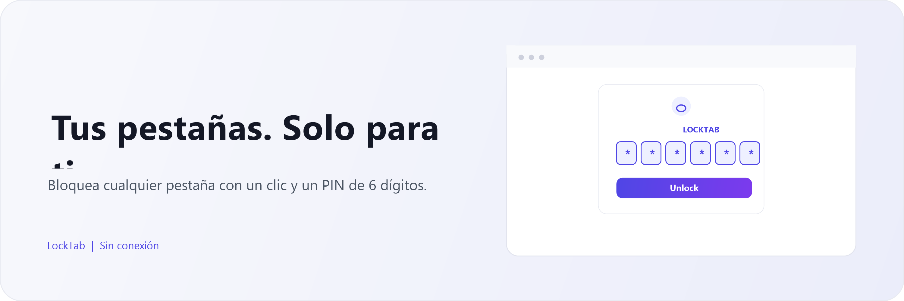
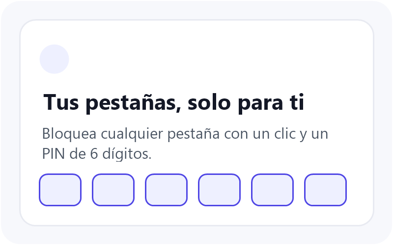
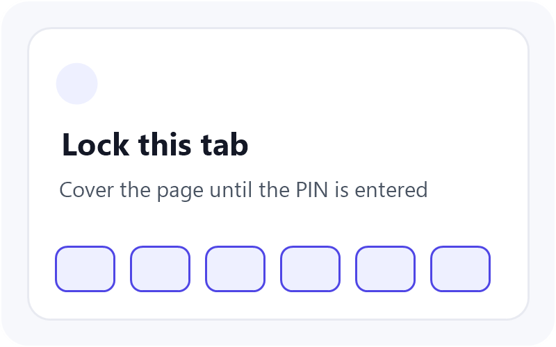
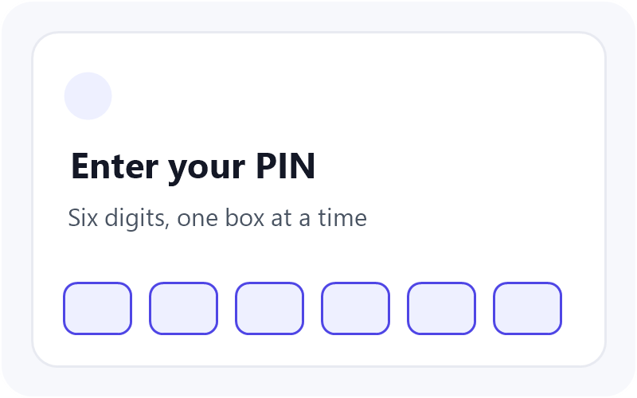
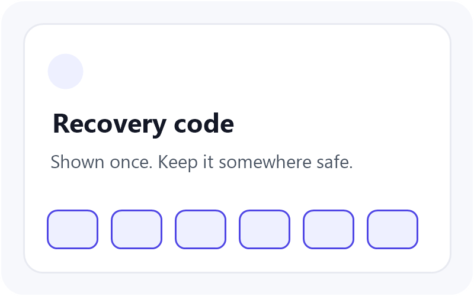
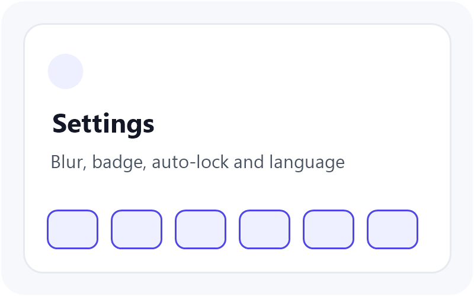
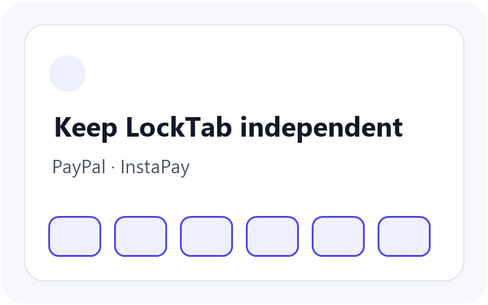

  

<h1 align="center">LockTab — Tus pestañas, solo para ti</h1>

Bloquea cualquier pestaña con un clic y un PIN de 6 dígitos. Añade un PIN privado para un sitio, guarda un código de recuperación de un solo uso y aléjate sabiendo que nadie puede leer tu pantalla. Ocho idiomas, RTL árabe completo y cero conexiones a la nube.

  
  
  
  
  
  

<h4 align="center">
  <a href="README.md">English</a> · <a href="README.ar.md">العربية</a> · <a href="README.es.md"><b>Español</b></a> · <a href="README.fr.md">Français</a> · <a href="README.de.md">Deutsch</a> · <a href="README.pt-BR.md">Português (Brasil)</a> · <a href="README.ru.md">Русский</a> · <a href="README.zh-CN.md">中文（简体）</a>
</h4>

<h3 align="center">Descarga para tu navegador — pulsa el icono</h3>

| [ <b>Chrome</b>](https://github.com/el9a7rawi/LockTab/releases/latest) | [ <b>Edge</b>](https://github.com/el9a7rawi/LockTab/releases/latest) | [ <b>Firefox</b>](https://github.com/el9a7rawi/LockTab/releases/latest) | [ <b>Brave</b>](https://github.com/el9a7rawi/LockTab/releases/latest) | [ <b>Opera</b>](https://github.com/el9a7rawi/LockTab/releases/latest) |
|---|---|---|---|---|

Firefox 121 o posterior usa un archivo dedicado con un manifiesto específico.

---

## 1. ¿Por qué LockTab?

| Without LockTab | With LockTab |
| --- | --- |
| Cualquiera puede leer una pestaña abierta | Tu pestaña queda cubierta hasta introducir el PIN |
| Una contraseña compartida por todos los sitios | Un PIN dedicado para las páginas importantes |
| Olvidar el PIN significa perder el acceso | Un código de recuperación de un solo uso lo desbloquea todo |
| Extensiones que envían datos a casa | Completamente sin conexión, sin cuenta ni seguimiento |

The page you left open stays private without a shared password or a cloud account. Nothing leaves
the device, so the promise holds even when you are offline.

---

## 2. Cómo funciona — tres pasos

1. Crea un PIN de 6 dígitos y guarda el código de recuperación que se muestra una vez.
2. Abre la pestaña que quieres proteger y pulsa Bloquear esta pestaña.
3. Introduce el PIN para leerla de nuevo, o concede un desbloqueo temporal.

---

## 3. Recorrido por la interfaz — cada parte de la extensión

### 3.1 Cabecera — todo a mano

El título, el tema, el idioma y el enlace de GitHub comparten una fila sobria.

### 3.2 Una acción principal

Un solo botón con degradado cubre la página activa. El desbloqueo temporal y la eliminación piden el PIN antes.

### 3.3 Estado de la pestaña

Una placa plana indica si la pestaña está bloqueada, abierta o abierta temporalmente.

### 3.4 Entrada del PIN

Seis casillas aparecen una tras otra, se detienen en la sexta y centran el asterisco.

### 3.5 Código de recuperación

Se muestra una sola vez tras la configuración. Guárdalo bien; un código usado no se reutiliza.

### 3.6 Sitios bloqueados

Filas numeradas listan cada dominio bloqueado. Pasando cinco sitios, unas flechas recorren la lista.

### 3.7 Ajustes

Desenfoque con tres intensidades, contador en el icono, duración del desbloqueo, tema e idioma en un solo lugar.

### 3.8 Apoyo

LockTab es gratuito y de código abierto. PayPal y un InstaPay destacado ayudan a mantenerlo independiente.

---

## 4. What the PIN protects

PBKDF2-HMAC-SHA256 with 600,000 iterations and a unique 16-byte salt — the plaintext PIN is never
stored. The overlay runs in a closed shadow root, focus stays inside it, and the page underneath
cannot scroll. Wrong guesses escalate through 30s, 60s, 300s and 900s lock-outs, and opening another
tab does not reset the counter while the global PIN is in use. The query string and fragment are
dropped, so a redirect cannot shed a lock.

---

## 5. Install

1. Download the release archive for your browser from [Releases](https://github.com/el9a7rawi/LockTab/releases).
2. Extract it into a folder.
3. Chrome, Edge, Brave and Opera: open `chrome://extensions`, enable **Developer mode**, choose **Load unpacked** and select the folder.
4. Firefox 121+: open `about:debugging#/runtime/this-firefox`, choose **Load Temporary Add-on** and select `manifest.json` in the folder.

La privacidad se explica en la sección 7 y en privacy.html.

---

## 6. Development

No bundler and no npm dependencies. Run `python tools/build.py` to validate all eight
locale bundles and write the release archives, then `node --test tests/core.test.mjs` for the
unit tests. The interface follows a fixed visual contract in the design reference.

---

## 7. Privacy

Consulta privacy.html. El PIN solo se guarda como hash PBKDF2 con una sal única. Se descartan la consulta y el fragmento, nunca se lee el contenido de la página y ninguna petición sale de la extensión. Las fuentes son locales.

---

## 8. License

El proyecto es de código abierto y gratuito bajo Apache-2.0 — úsalo, modifícalo y compártelo libremente; el texto completo está en LICENSE. Las fuentes incluidas tienen licencia SIL OFL 1.1. El historial está en CHANGELOG.md.

Hecho con cariño ❤️ <b>Ahmed Yousry</b> · <a href="https://github.com/el9a7rawi/LockTab">LockTab</a> · <a href="LICENSE">Apache-2.0</a>

