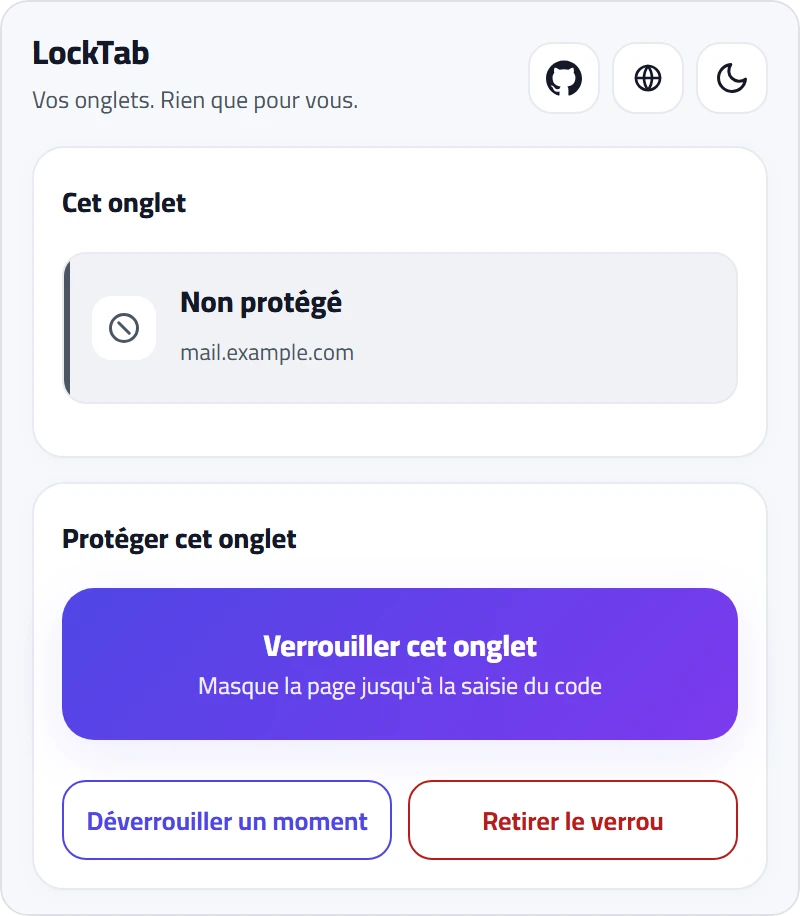
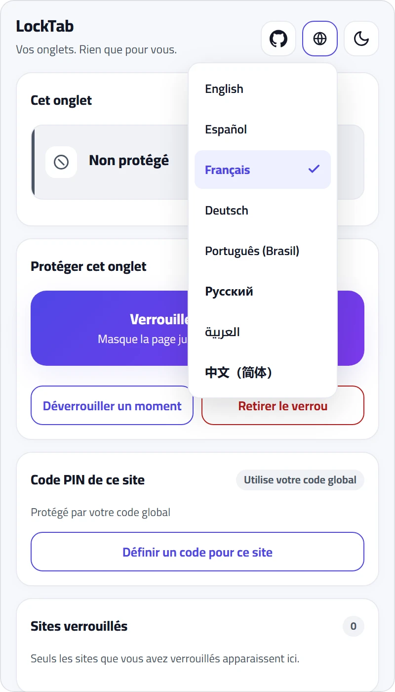
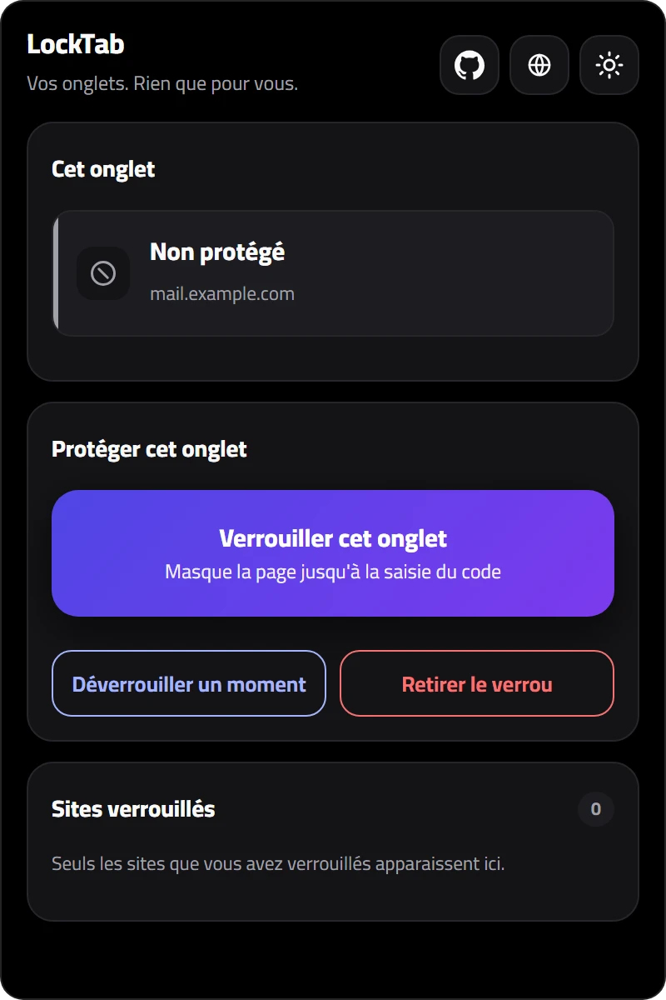
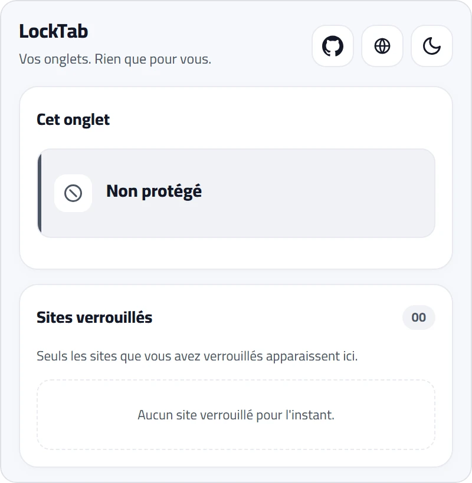
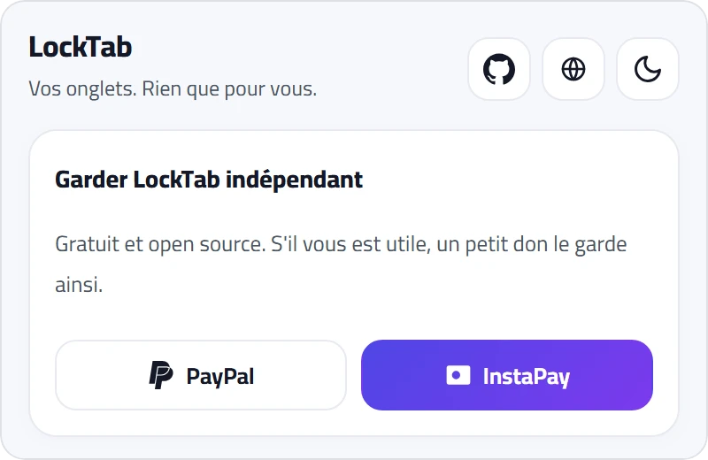

  

<h1 align="center">LockTab — Vos onglets, rien que pour vous</h1>

Verrouillez n'importe quel onglet en un clic avec un code à 6 chiffres. Ajoutez un code privé pour un site, conservez un code de récupération à usage unique et éloignez-vous en sachant que personne ne peut lire votre écran. Huit langues, RTL arabe complet et aucun cloud.

  
  
  
  
  
  

<h4 align="center">
  <a href="README.md">English</a> · <a href="README.es.md">Español</a> · <a href="README.de.md">Deutsch</a> · <a href="README.pt-BR.md">Português (Brasil)</a> · <a href="README.ru.md">Русский</a> · <a href="README.ar.md">العربية</a> · <a href="README.zh-CN.md">中文（简体）</a>
</h4>

<h3 align="center">Téléchargez pour votre navigateur — cliquez sur l'icône</h3>

| [ <b>Chrome</b>](https://github.com/el9a7rawi/LockTab/releases/latest) | [ <b>Edge</b>](https://github.com/el9a7rawi/LockTab/releases/latest) | [ <b>Firefox</b>](https://github.com/el9a7rawi/LockTab/releases/latest) | [ <b>Brave</b>](https://github.com/el9a7rawi/LockTab/releases/latest) | [ <b>Opera</b>](https://github.com/el9a7rawi/LockTab/releases/latest) |
|---|---|---|---|---|

Chrome et les navigateurs Chromium sont la cible principale. Firefox 121+ est pris en charge via une archive dédiée avec son propre manifeste.

---

## 1. Pourquoi LockTab ?

| Sans LockTab | Avec LockTab |
|---|---|
| N'importe qui peut lire un onglet ouvert | Votre onglet est masqué jusqu'à la saisie du code |
| Un mot de passe partagé pour tous les sites | Un code dédié aux pages qui comptent |
| Perdre le code, c’est perdre l’accès | Un code de récupération à usage unique efface tout |
| Des extensions qui envoient vos données | Entièrement hors ligne, sans compte ni suivi |

LockTab masque un onglet de toute personne qui s'assoit devant votre appareil. Ce n'est pas un chiffrement de disque et ne protège pas contre un navigateur compromis ou un administrateur qui retire l'extension.

---

## 2. Comment ça marche — trois étapes

1. Créez un code à 6 chiffres et conservez le code de récupération affiché une seule fois.
2. Ouvrez l'onglet à protéger et cliquez sur Verrouiller cet onglet.
3. Saisissez le code pour le relire, ou accordez un déverrouillage temporaire.

---

## 3. Visite de l'interface — toutes les parties de l'extension

### 3.1 En-tête — tout à portée

Le titre, le thème, la langue et le lien GitHub partagent une même rangée discrète.

### 3.2 Une action principale

Un seul bouton dégradé masque la page active. Le déverrouillage temporaire et la suppression demandent le code.

### 3.3 État de l'onglet

Une plaque plate indique si l'onglet est verrouillé, ouvert ou ouvert temporairement.

### 3.4 Saisie du code

Six cases apparaissent les unes après les autres, s'arrêtent à six et centrent l'astérisque.

### 3.5 Code de récupération

Affiché une seule fois après la configuration. Un code déjà utilisé ne peut jamais être rejoué.

### 3.6 Sites verrouillés

Des lignes numérotées listent chaque domaine. Au-delà de cinq sites, des flèches parcourent la liste.

### 3.7 Réglages

Flou sur trois niveaux, badge, durée de déverrouillage, thème et langue — au même endroit.

### 3.8 Soutien
LockTab est gratuit et open source. PayPal et un InstaPay mis en avant le gardent indépendant.

### 3.9 Paramètres

Flou, badge, durée, thème et langue dans une seule carte.

### 3.10 Huit langues, vrai RTL

Basculez instantanément ; l’arabe inverse la mise en page.

### 3.11 Thème sombre noir profond

Un vrai fond noir au contraste réglé, mémorisé entre les sessions.

### 3.12 Saisie du code

Le volet utilise une shadow root fermée : le focus reste à l’intérieur.

### 3.13 État vide

Une invitation honnête à verrouiller un onglet.

### 3.14 Soutien

PayPal et InstaPay aident à garder le projet indépendant.

## 4. Ce que protège le verrou

1. Un code à 6 chiffres. Stocké comme hachage PBKDF2 avec un sel unique ; le code en clair nest jamais écrit sur le disque.
2. Une couverture fermée. Le volet utilise une shadow root fermée, garde le focus à lintérieur et bloque le défilement de la page.
3. Un compteur partagé. Les erreurs passent à 30, 60, 300 et 900 secondes ; changer donglet ne réinitialise pas le compteur.
4. Une récupération à usage unique. Le code saffiche une fois, est consommé une fois et efface tous les verrous.

---

## 5. Installation (non empaquetée)

1. Ouvrez `chrome://extensions`.
2. Activez le **mode développeur**.
3. Cliquez sur **Charger l'extension non empaquetée** et sélectionnez le dossier extrait.
4. Cliquez sur l'icône LockTab dans la barre d'outils.

La confidentialité est détaillée à la section 7 et dans `privacy.html`.

---

## 6. Développement

Le dépôt publié ne contient que l’extension et sa documentation. Les scripts de capture et les tests locaux sont exclus ; GitHub Actions valide le manifeste, le CSP et les langues.

---

## 7. Confidentialité

Voir `privacy.html`. Le code est stocké uniquement comme hachage PBKDF2 avec un sel unique ; aucun contenu de page n’est lu et aucune requête ne quitte l’extension.

---

## 8. Licence

Le projet est open source sous **Apache-2.0** ; texte intégral dans [LICENSE](LICENSE). Polices sous [SIL OFL 1.1](fonts/OFL.txt). Historique dans [CHANGELOG.md](CHANGELOG.md).

---

Fait avec soin ❤️ <b>Ahmed Yousry</b> · <a href="https://github.com/el9a7rawi/LockTab">LockTab</a> · <a href="LICENSE">Apache-2.0</a>

