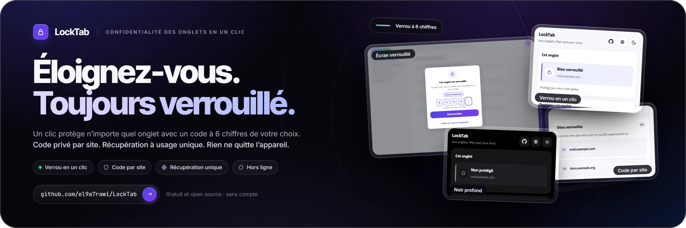
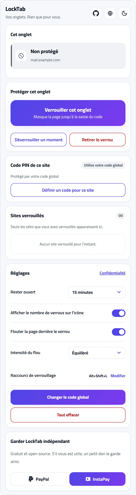
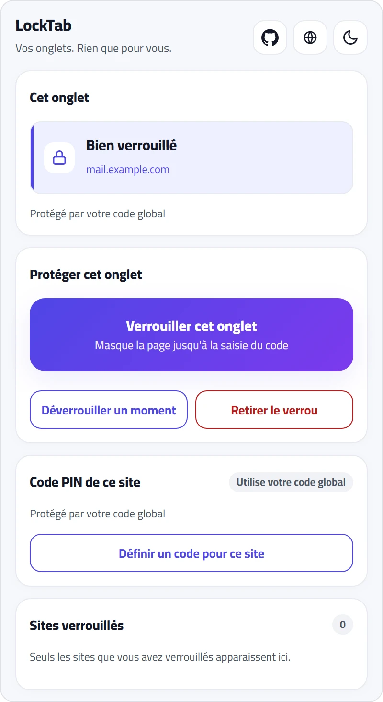
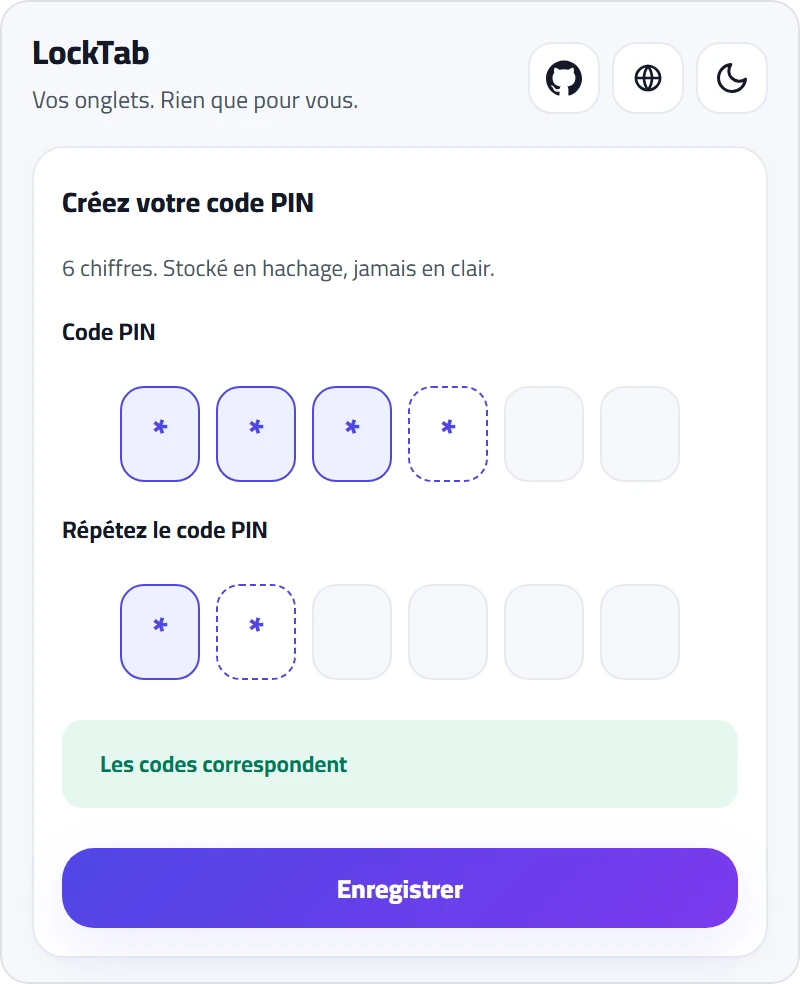
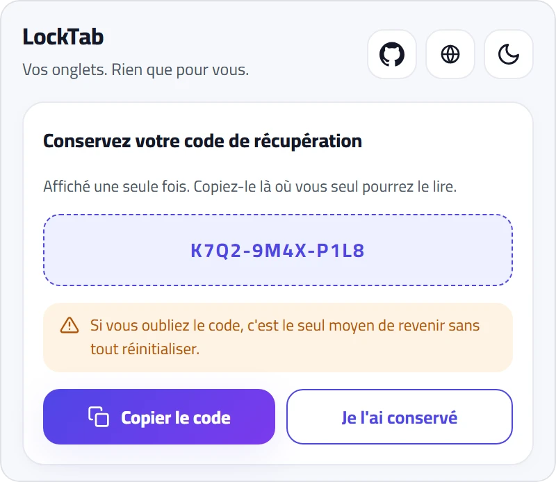
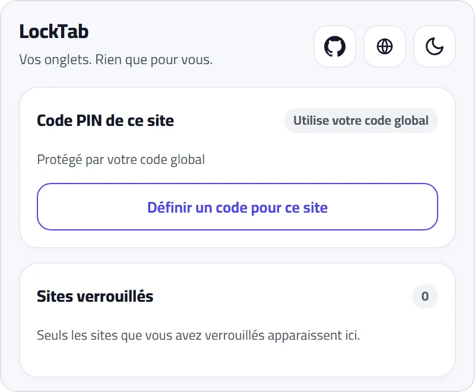
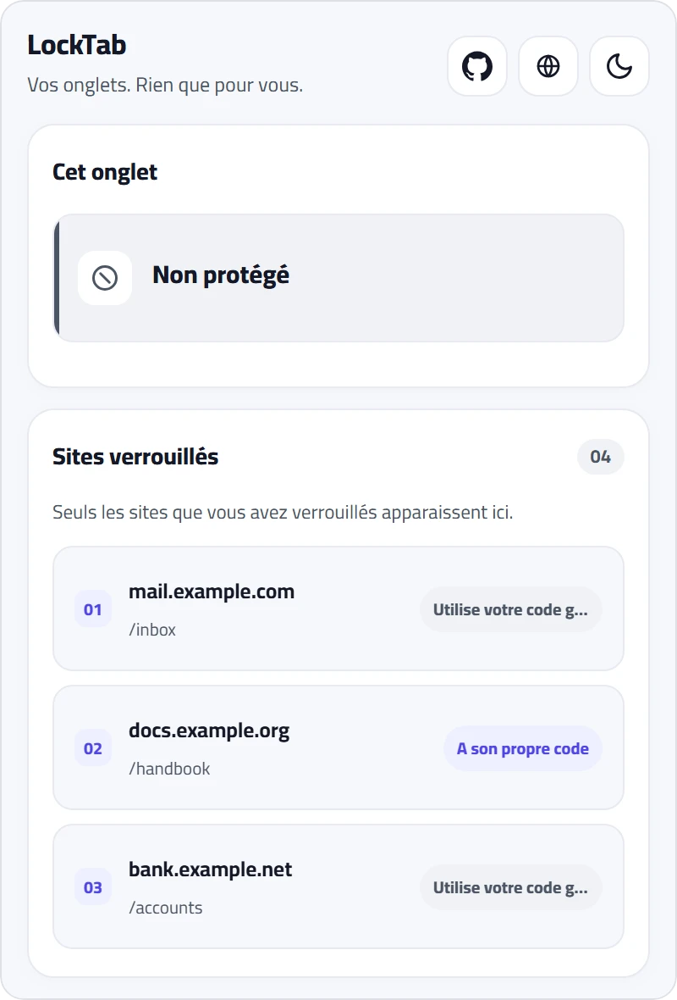
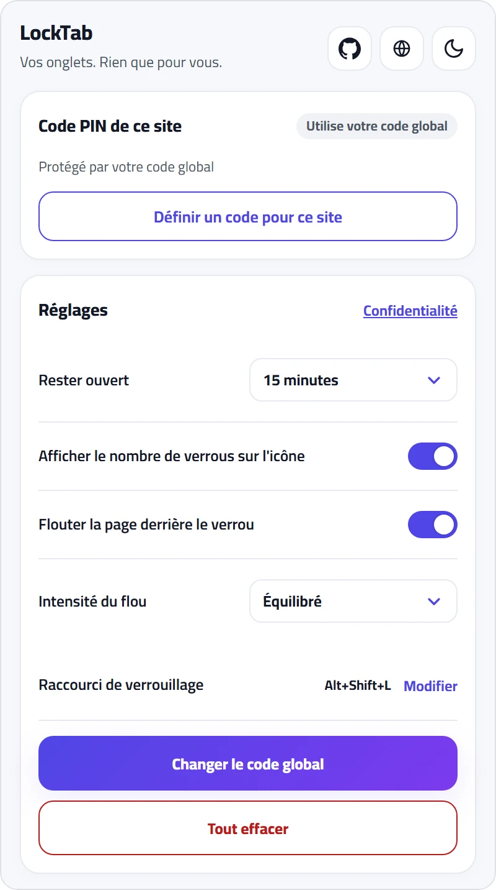
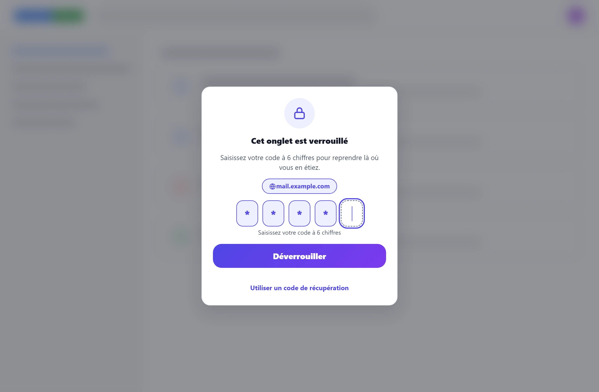

  

<h1 align="center">LockTab — Vos onglets, rien que pour vous</h1>

Verrouillez n'importe quel onglet en un clic avec un code à 6 chiffres. Ajoutez un code privé pour un site, conservez un code de récupération à usage unique et éloignez-vous en sachant que personne ne peut lire votre écran. Huit langues, RTL arabe complet et aucun cloud.

  
  
  
  
  
  

<h4 align="center">
  <a href="README.md">English</a> · <a href="README.es.md">Español</a> · <a href="README.de.md">Deutsch</a> · <a href="README.pt-BR.md">Português (Brasil)</a> · <a href="README.ru.md">Русский</a> · <a href="README.ar.md">العربية</a> · <a href="README.zh-CN.md">中文（简体）</a>
</h4>

<h3 align="center">Download for your browser — click the icon</h3>

| [ <b>Chrome</b>](https://github.com/el9a7rawi/LockTab/releases/latest) | [ <b>Edge</b>](https://github.com/el9a7rawi/LockTab/releases/latest) | [ <b>Firefox</b>](https://github.com/el9a7rawi/LockTab/releases/latest) | [ <b>Brave</b>](https://github.com/el9a7rawi/LockTab/releases/latest) | [ <b>Opera</b>](https://github.com/el9a7rawi/LockTab/releases/latest) |
|---|---|---|---|---|

Chrome et les navigateurs Chromium sont la cible principale. Firefox 121+ est pris en charge via une archive dédiée avec son propre manifeste.

---

## 1. Pourquoi LockTab ?

| Without LockTab | With LockTab |
|---|---|
| N'importe qui peut lire un onglet ouvert | Votre onglet est masqué jusqu'à la saisie du code |
| Un mot de passe partagé pour tous les sites | Un code dédié aux pages qui comptent |
| Perdre le code, c’est perdre accès | Un code de récupération à usage unique efface tout |
| Des extensions qui envoient vos données | Entièrement hors ligne, sans compte ni suivi |

undefined

---

## 2. Comment ça marche — trois étapes

1. Créez un code à 6 chiffres et conservez le code de récupération affiché une seule fois.
2. Ouvrez l'onglet à protéger et cliquez sur Verrouiller cet onglet.
3. Saisissez le code pour le relire, ou accordez un déverrouillage temporaire.

---

## 3. Visite de l'interface — toutes les parties de l'extension

### 3.1 Header — everything in reach

The title, theme toggle, GitHub link and language picker share one compact row.

### 3.2 One primary action

A single gradient button covers the active page. Temporary unlock and lock removal ask for the PIN first.

### 3.3 Tab status

A flat status plate shows whether the tab is locked, open, or open for a while.

### 3.4 First run — create your PIN

Six boxes appear one after another, stop exactly at six, and centre the asterisk.

### 3.5 Recovery code shown once

The code is displayed only at setup. Store it somewhere safe; a used code can never be replayed.

### 3.6 A PIN for one site

A site PIN overrides the global one on that domain, so sensitive pages can stay separate.

### 3.7 Locked sites

Numbered rows list every locked domain. Past five sites, arrows page through the list.

### 3.8 Lock from anywhere
The Alt+Shift+L shortcut locks the current tab without opening the popup.

### 3.9 Paramètres

Flou, badge, durée, thème et langue dans une seule carte.

### 3.10 Huit langues, vrai RTL

Basculez instantanément ; l’arabe inverse la mise en page.

### 3.11 Thème sombre noir profond

Un vrai fond noir au contraste réglé, mémorisé entre les sessions.

### 3.12 Saisie du code

Le volet utilise une shadow root fermée : le focus reste à l’intérieur.

### 3.13 État vide

Une invitation honnête à verrouiller un onglet.

### 3.14 Soutien

PayPal et InstaPay aident à garder le projet indépendant.

## 4. Ce que protège le verrou

1. **A 6-digit PIN.** Stored as a PBKDF2 hash with a unique 16-byte salt; the plaintext is never written to disk.
2. **A closed gate.** The overlay runs in a closed shadow root, traps focus and blocks scrolling underneath.
3. **A shared counter.** Wrong guesses escalate through 30, 60, 300 and 900 second lock-outs; switching tabs does not reset it.
4. **One-time recovery.** The code is shown once, consumed once, and clears every lock.

---

## 5. Installation (non empaquetée)

1. Open `chrome://extensions`.
2. Enable **Developer mode**.
3. Click **Load unpacked** and select the extracted release folder.
4. Click the LockTab icon in the toolbar.

La confidentialité est détaillée à la section 7 et dans `privacy.html`.

---

## 6. Développement

Le dépôt publié ne contient que l’extension et sa documentation. Les scripts de capture et les tests locaux sont exclus ; GitHub Actions valide le manifeste, le CSP et les langues.

---

## 7. Confidentialité

Voir `privacy.html`. Le code est stocké uniquement comme hachage PBKDF2 avec un sel unique ; aucun contenu de page n’est lu et aucune requête ne quitte l’extension.

---

## 8. Licence

Le projet est open source sous **Apache-2.0** ; texte intégral dans [LICENSE](LICENSE). Polices sous [SIL OFL 1.1](fonts/OFL.txt). Historique dans [CHANGELOG.md](CHANGELOG.md).

---

Fait avec soin ❤️ <b>Ahmed Yousry</b> · <a href="https://github.com/el9a7rawi/LockTab">LockTab</a> · <a href="LICENSE">Apache-2.0</a>

