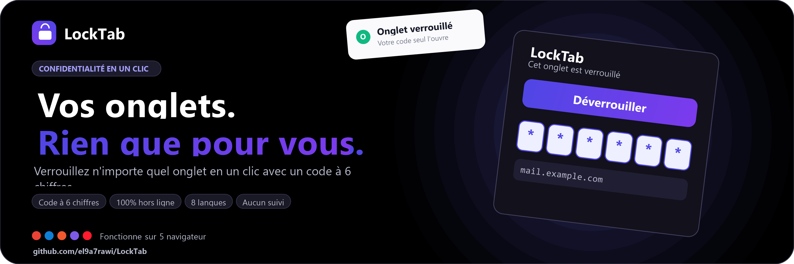
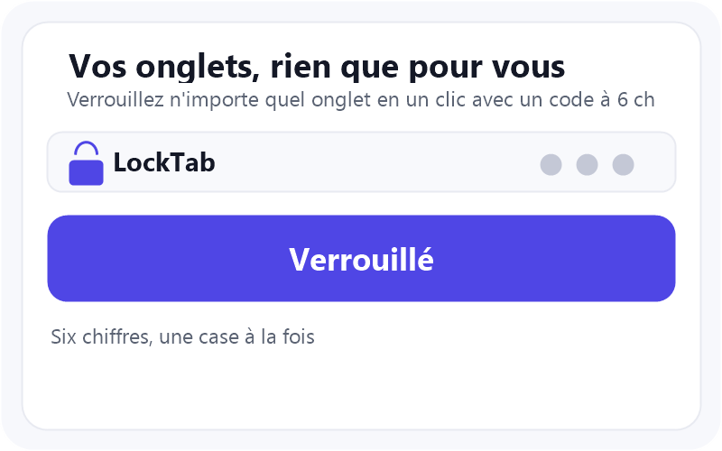
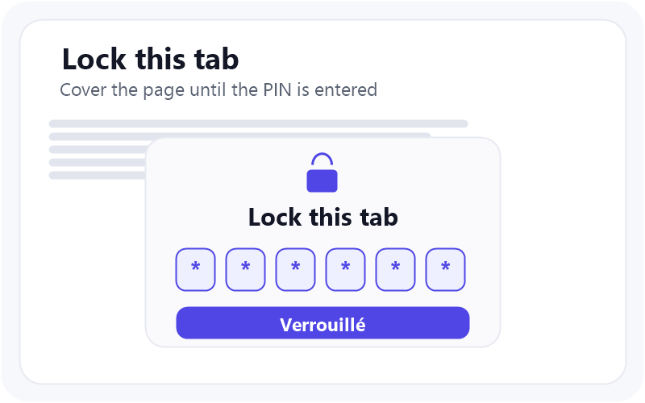
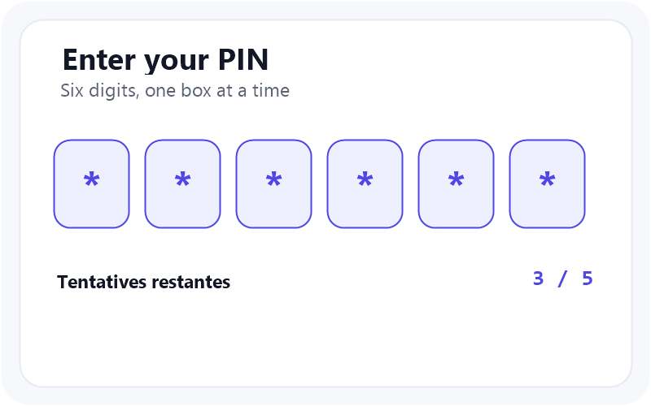
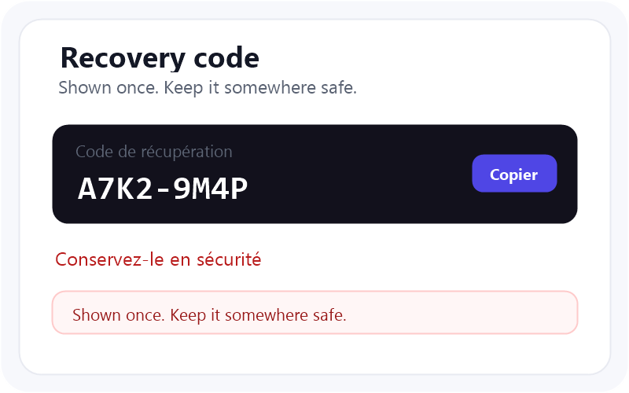
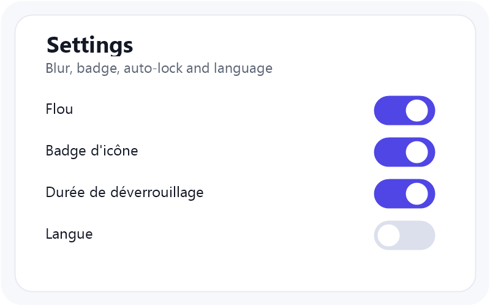

<p align="center">
  
</p>

<h1 align="center">LockTab — Vos onglets, rien que pour vous</h1>

<p align="center">Verrouillez n'importe quel onglet en un clic avec un code à 6 chiffres. Ajoutez un code privé pour un site, conservez un code de récupération à usage unique et éloignez-vous en sachant que personne ne peut lire votre écran. Huit langues, RTL arabe complet et aucun cloud.</p>

<p align="center">
  <a href="https://github.com/el9a7rawi/LockTab/releases"></a>
  <a href="https://github.com/el9a7rawi/LockTab/blob/main/LICENSE"></a>
  <a href="https://github.com/el9a7rawi/LockTab/pulls"></a>
  <a href="https://developer.chrome.com/docs/extensions"></a>
  
  
</p>

<p align="center">
  <a href="README.md">English</a> · <a href="README.ar.md">العربية</a> · <a href="README.es.md">Español</a> · <a href="README.de.md">Deutsch</a> · <a href="README.pt-BR.md">Português (Brasil)</a> · <a href="README.ru.md">Русский</a> · <a href="README.zh-CN.md">中文（简体）</a>
</p>

<h3 align="center">Téléchargez pour votre navigateur — cliquez sur l’icône</h3>

<div align="center">

| [<br><b>Chrome</b>](https://github.com/el9a7rawi/LockTab/releases/latest) | [<br><b>Edge</b>](https://github.com/el9a7rawi/LockTab/releases/latest) | [<br><b>Firefox</b>](https://github.com/el9a7rawi/LockTab/releases/latest) | [<br><b>Brave</b>](https://github.com/el9a7rawi/LockTab/releases/latest) | [<br><b>Opera</b>](https://github.com/el9a7rawi/LockTab/releases/latest) |
|---|---|---|---|---|

</div>

Firefox 121 ou plus récent utilise une archive dédiée avec un manifeste spécifique.

---

## 1. Pourquoi LockTab ?

| Without LockTab | With LockTab |
| --- | --- |
| N'importe qui peut lire un onglet ouvert | Votre onglet est masqué jusqu'à la saisie du code |
| Un mot de passe partagé pour tous les sites | Un code dédié aux pages qui comptent |
| Perdre le code, c’est perdre accès | Un code de récupération à usage unique efface tout |
| Des extensions qui envoient vos données | Entièrement hors ligne, sans compte ni suivi |

L'onglet verrouillé reste masqué jusqu'à la saisie du code. Aucun compte cloud, aucun mot de passe partagé, aucune requête sortante.

---

## 2. Comment ça marche — trois étapes

1. Créez un code à 6 chiffres et conservez le code de récupération affiché une seule fois.
2. Ouvrez l'onglet à protéger et cliquez sur Verrouiller cet onglet.
3. Saisissez le code pour le relire, ou accordez un déverrouillage temporaire.

---

## 3. Visite de l'interface — chaque partie de l'extension

### 3.1 En-tête — tout à portée
<p align="center"></p>

Le titre, le thème, la langue et le lien GitHub partagent une même rangée discrète.

### 3.2 Une action principale
<p align="center"></p>

Un seul bouton dégradé masque la page active. Le déverrouillage temporaire et la suppression demandent le code.

### 3.3 État de l'onglet
<p align="center"></p>

Une plaque plate indique si l'onglet est verrouillé, ouvert ou ouvert temporairement.

### 3.4 Saisie du code
<p align="center"></p>

Six cases apparaissent les unes après les autres, s'arrêtent à six et centrent l'astérisque.

### 3.5 Code de récupération
<p align="center"></p>

Affiché une seule fois après la configuration. Un code déjà utilisé ne peut jamais être rejoué.

### 3.6 Sites verrouillés
<p align="center"></p>

Des lignes numérotées listent chaque domaine. Au-delà de cinq sites, des flèches parcourent la liste.

### 3.7 Réglages
<p align="center"></p>

Flou sur trois niveaux, badge, durée de déverrouillage, thème et langue — au même endroit.

### 3.8 Soutien
<p align="center"></p>

LockTab est gratuit et open source. PayPal et un InstaPay mis en avant le gardent indépendant.

---

## 4. Ce que protège le code

Le code ne quitte jamais votre appareil. Il est stocké comme hash PBKDF2 avec un sel unique, et le volet est remis en place sans recharger la page.

<div dir="ltr">

```text
PBKDF2-HMAC-SHA256 · 600 000 itérations · sel de 16 octets · shadow root fermé · délai 30/60/300/900 s
```

</div>

The query string and fragment are ignored, so a redirect cannot shed a lock. Every action that widens
access asks for the PIN again, including the temporary unlock and lock removal.

---

## 5. Installation

1. Download the release archive for your browser from [Releases](https://github.com/el9a7rawi/LockTab/releases).
2. Extract it into a folder.
3. Chrome, Edge, Brave and Opera: open `chrome://extensions`, enable **Developer mode**, choose **Load unpacked** and select the folder.
4. Firefox 121+: open `about:debugging#/runtime/this-firefox`, choose **Load Temporary Add-on** and select `manifest.json` in the folder.

La confidentialité est détaillée à la section 7 et dans privacy.html.

---

## 6. Développement

No bundler and no npm dependencies. Run `python tools/build.py` to validate all eight
locale bundles and write the release archives, then `node --test tests/core.test.mjs` for the
unit tests. The interface follows a fixed visual contract in the design reference.

---

## 7. Confidentialité

Voir privacy.html. Le code est stocké uniquement comme hash PBKDF2 avec un sel unique. La query et le fragment sont écartés, le contenu de la page jamais lu, et aucune requête ne quitte l’extension. Les polices sont locales.

---

## 8. Licence

Le projet est open source et gratuit sous Apache-2.0 — utilisez-le, modifiez-le et partagez-le librement ; le texte intégral est dans LICENSE. Les polices ont une licence SIL OFL 1.1. L'historique est dans CHANGELOG.md.

<p align="center">Fait avec soin ❤️ <b>Ahmed Yousry</b> · <a href="https://github.com/el9a7rawi/LockTab">LockTab</a> · <a href="LICENSE">Apache-2.0</a></p>
