

  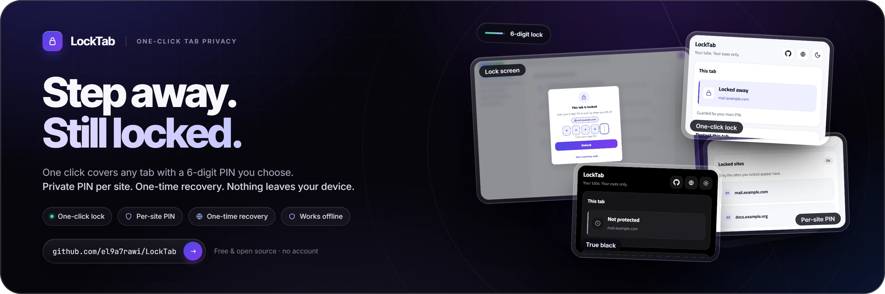

<h1 align="center">LockTab — Your Tabs, Your Eyes Only</h1>

Lock any tab in one click with a 6-digit PIN. Add a private PIN for one site, get a one-time recovery code, and walk away knowing no one can read what is on your screen. Eight interface languages, full Arabic RTL, and absolutely no cloud.

  
  
  
  
  
  

<h4 align="center">
  <a href="README.es.md">Español</a> · <a href="README.fr.md">Français</a> · <a href="README.de.md">Deutsch</a> · <a href="README.pt-BR.md">Português (Brasil)</a> · <a href="README.ru.md">Русский</a> · <a href="README.ar.md">العربية</a> · <a href="README.zh-CN.md">中文（简体）</a>
</h4>

<h3 align="center">Download for your browser — click the icon</h3>

| [ <b>Chrome</b>](https://github.com/el9a7rawi/LockTab/releases/latest) | [ <b>Edge</b>](https://github.com/el9a7rawi/LockTab/releases/latest) | [ <b>Firefox</b>](https://github.com/el9a7rawi/LockTab/releases/latest) | [ <b>Brave</b>](https://github.com/el9a7rawi/LockTab/releases/latest) | [ <b>Opera</b>](https://github.com/el9a7rawi/LockTab/releases/latest) |
|---|---|---|---|---|

Chrome and Chromium browsers are the primary target. Firefox 121+ is supported through a dedicated archive with a Firefox-specific manifest (classic background script and Gecko settings).

---

## 1. Why LockTab?

| Without LockTab | With LockTab |
|---|---|
| Anyone can read an open tab | Your tab is covered until the PIN is entered |
| One shared password for every site | A dedicated PIN for the pages that matter |
| Lose the PIN, lose access | One-time recovery code clears every lock |
| Extensions that phone home | Fully offline, no account, no tracking |

LockTab hides a tab from someone who sits down at your device. It is not disk encryption and cannot defend against a compromised browser or an administrator who removes the extension.

---

## 2. How it works — three steps

1. Create a 6-digit PIN and save the recovery code it shows once.
2. Open the tab you want to protect and press Lock this tab.
3. Enter the PIN to read it again, or grant a temporary unlock.

---

## 3. Interface tour — every part of the extension

### 3.1 Header — everything in reach

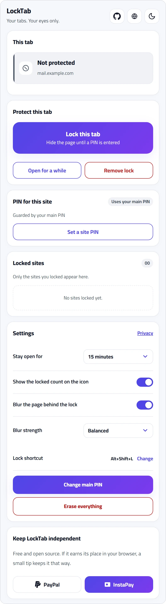

The title, theme toggle, GitHub link and language picker share one compact row.

### 3.2 One primary action

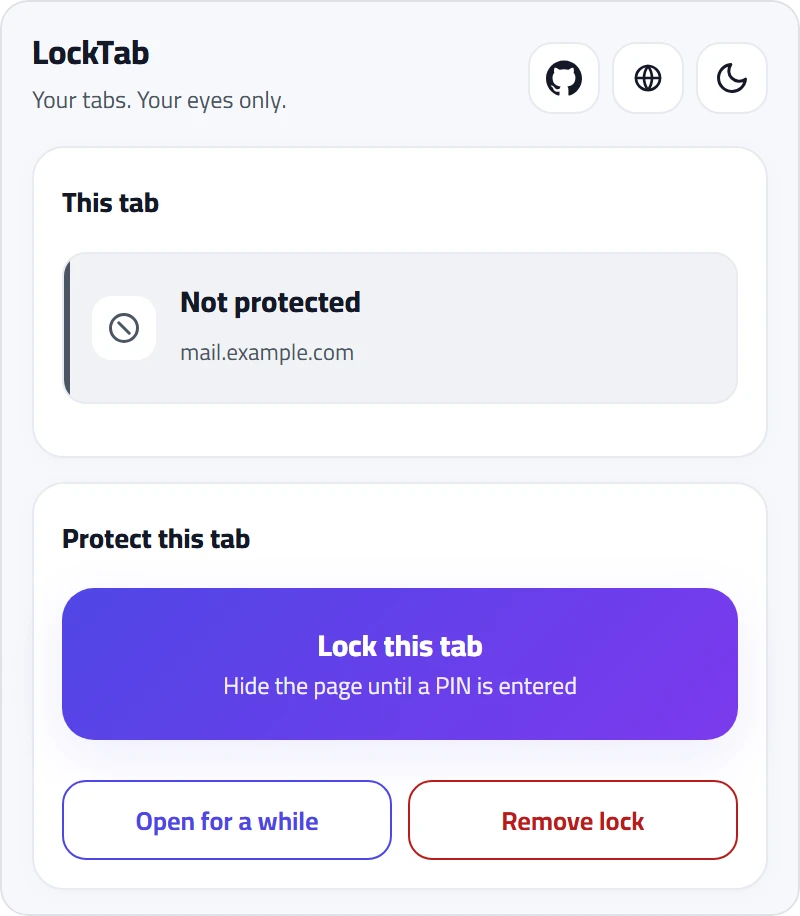

A single gradient button covers the active page. Temporary unlock and lock removal ask for the PIN first.

### 3.3 Tab status

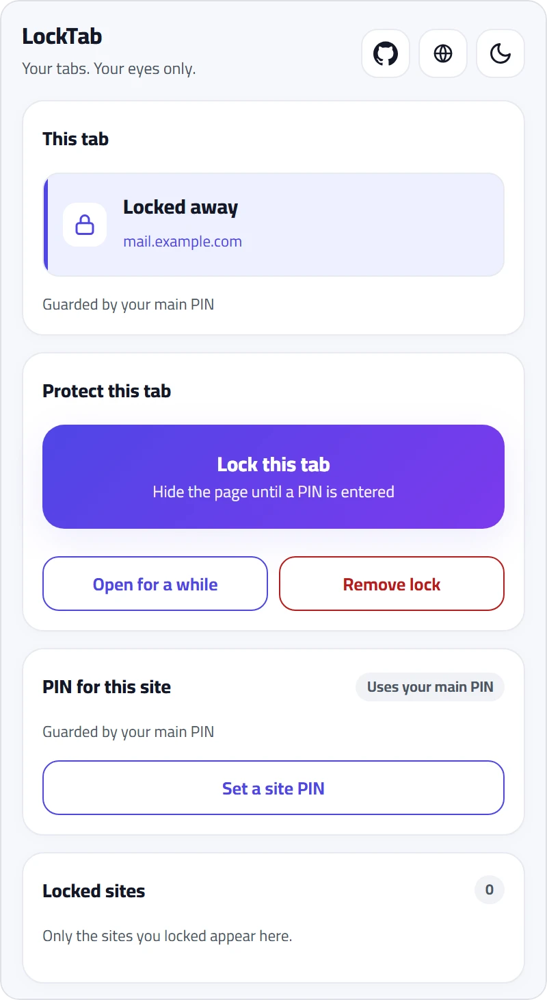

A flat status plate shows whether the tab is locked, open, or open for a while.

### 3.4 First run — create your PIN

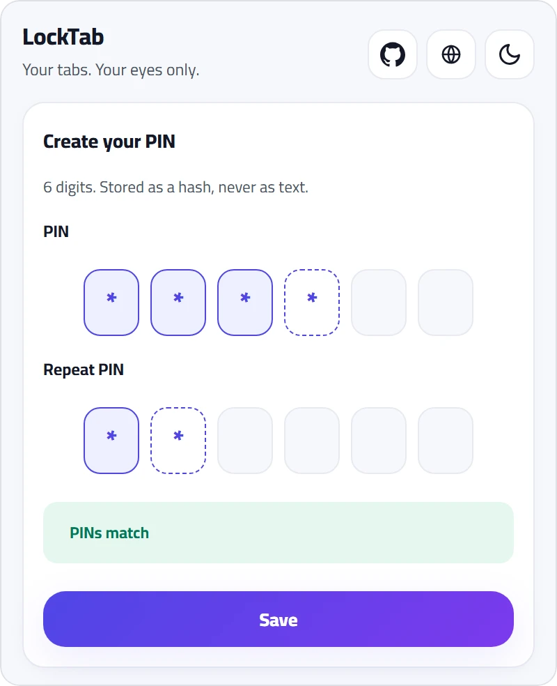

Six boxes appear one after another, stop exactly at six, and centre the asterisk.

### 3.5 Recovery code shown once

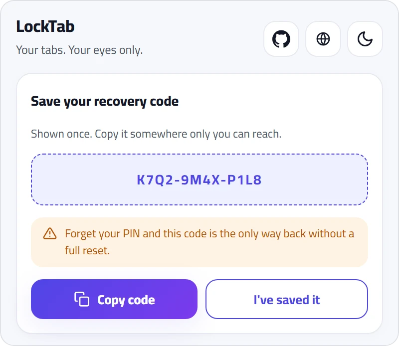

The code is displayed only at setup. Store it somewhere safe; a used code can never be replayed.

### 3.6 A PIN for one site

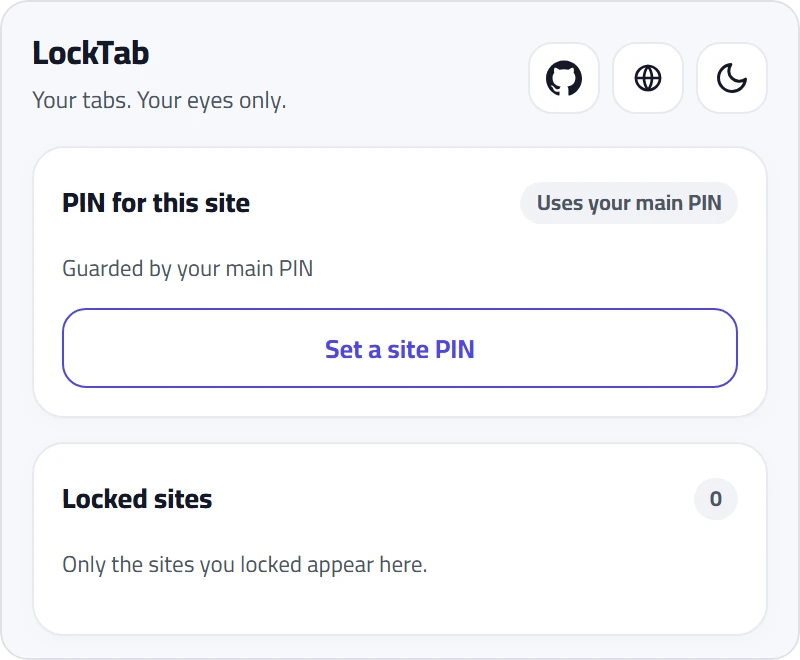

A site PIN overrides the global one on that domain, so sensitive pages can stay separate.

### 3.7 Locked sites

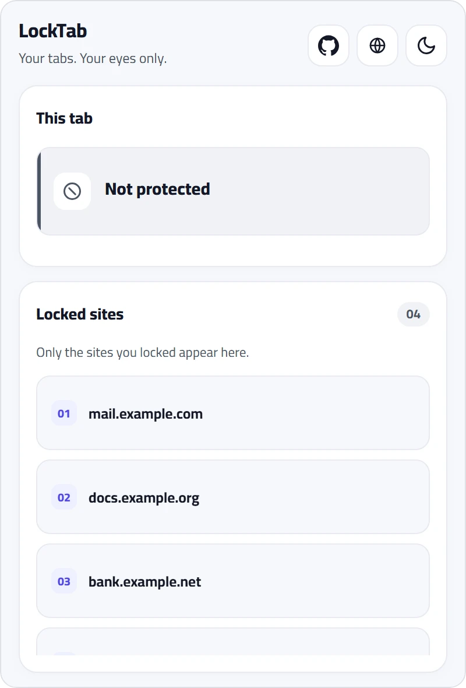

Numbered rows list every locked domain. Past five sites, arrows page through the list.

### 3.8 Lock from anywhere
The the configured shortcut shortcut locks the current tab without opening the popup.

### 3.9 Settings

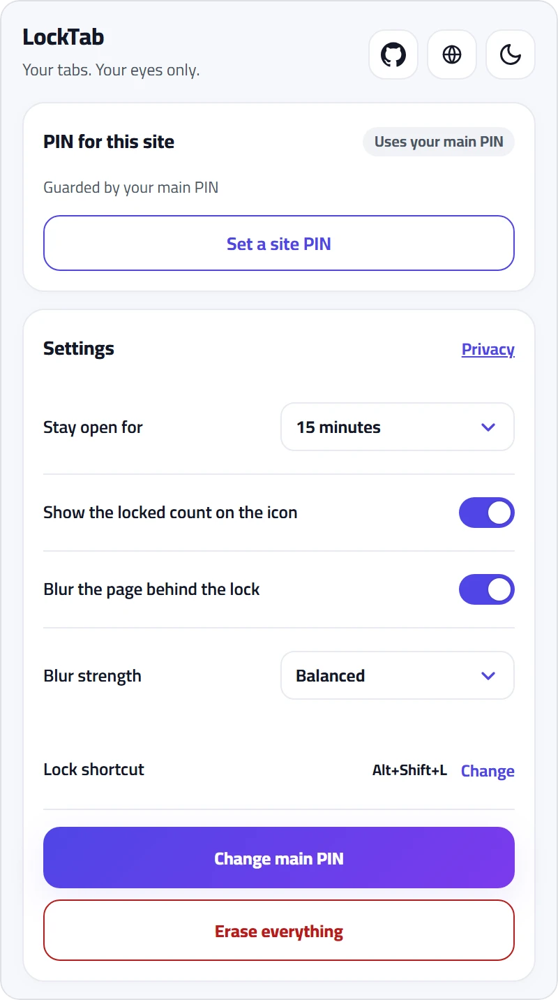

Blur strength, icon badge, unlock duration, shortcut, theme and language live in one card.

### 3.10 Eight languages, real RTL

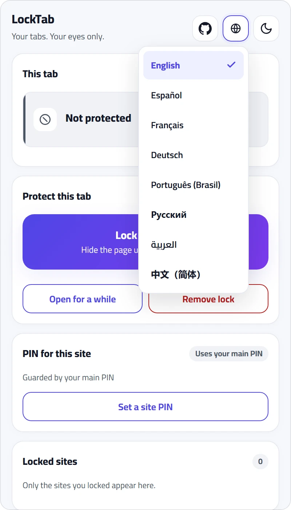

Switch instantly between all eight bundles. Arabic flips the layout logically, and URLs stay left-to-right.

### 3.11 True black dark theme

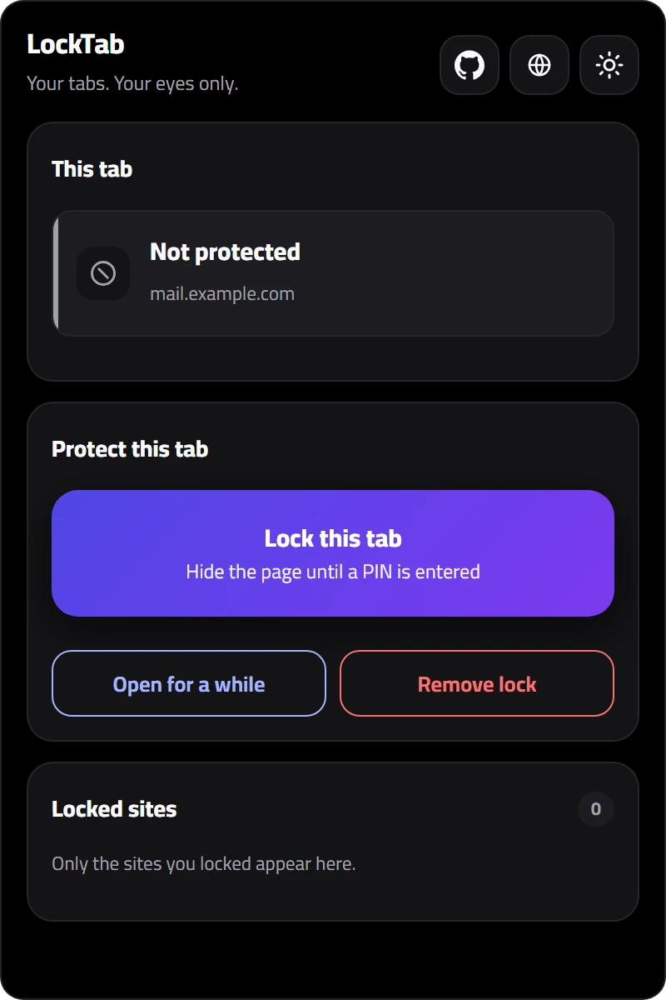

A real black background with tuned contrast, toggled from the header and remembered between sessions.

### 3.12 PIN entry on the lock screen

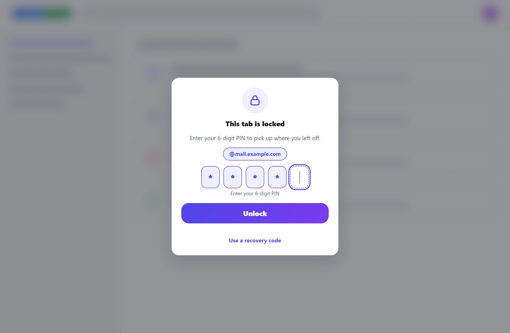

The gate is a closed shadow root: focus stays inside, the page underneath cannot scroll, and a wrong guess escalates the lock-out.

### 3.13 Empty state

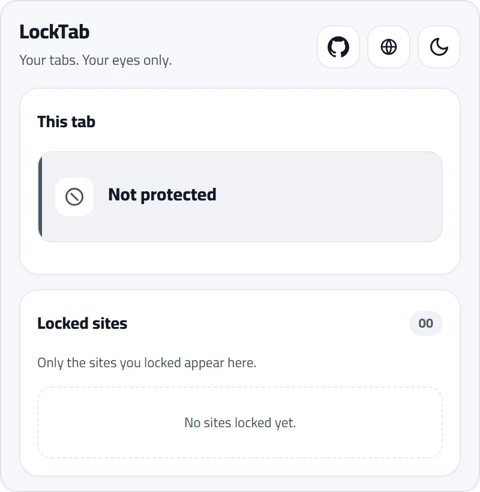

An honest invitation to lock a tab instead of a blank box.

### 3.14 Support continued development

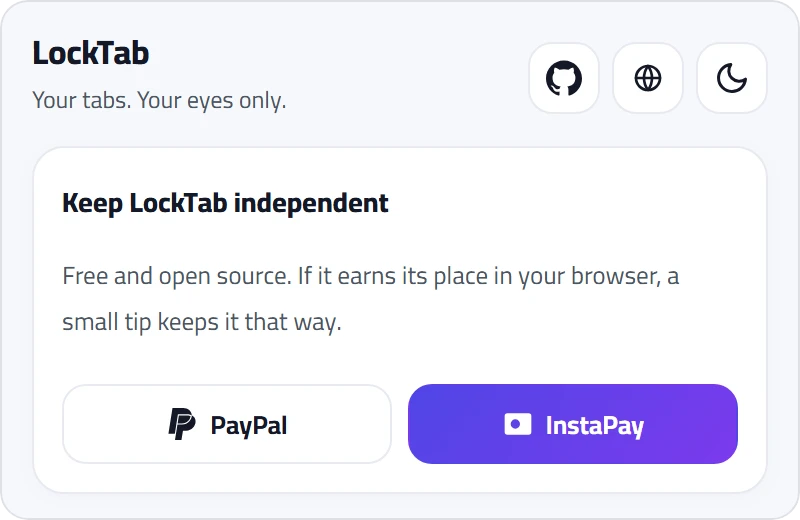

LockTab is free and open source. PayPal and a highlighted InstaPay option help keep it independent; both open in a new tab and the extension sends no data.

---

## 4. What the lock protects

1. A 6-digit PIN. Stored as a PBKDF2 hash with a unique 16-byte salt; the plaintext is never written to disk.
2. A closed gate. The overlay runs in a closed shadow root, traps focus and blocks scrolling underneath.
3. A shared counter. Wrong guesses escalate through 30, 60, 300 and 900 second lock-outs; switching tabs does not reset it.
4. One-time recovery. The code is shown once, consumed once, and clears every lock.

---

## 5. Install (unpacked)

1. Open `chrome://extensions`.
2. Enable **Developer mode**.
3. Click **Load unpacked** and select the extracted release folder.
4. Click the LockTab icon in the toolbar.

Privacy is covered in section 7 below and in `privacy.html`.

---

## 6. Development

The published repository contains the extension and its documentation only. Development fixtures, capture scripts and the local test suite are intentionally kept out of the repository; GitHub Actions validates the manifest, CSP, locale coverage and bundled assets on every push.

---

## 7. Privacy

See `privacy.html`. The PIN is stored only as a PBKDF2 hash with a unique salt; the plaintext never leaves the popup. Query strings and fragments are ignored, page content is never read, and no request leaves the extension. Fonts are bundled locally, so no font request goes out either.

---

## 8. License

The project is open source and free for everyone under the **Apache-2.0** license — use it, modify it, and share it freely; the full text is in [LICENSE](LICENSE). Bundled fonts are licensed separately under [SIL OFL 1.1](fonts/OFL.txt). See [CHANGELOG.md](CHANGELOG.md) for the release history.

---

Made with care ❤️ <b>Ahmed Yousry</b> · <a href="https://github.com/el9a7rawi/LockTab">LockTab</a> · <a href="LICENSE">Apache-2.0</a>

