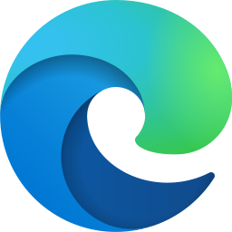
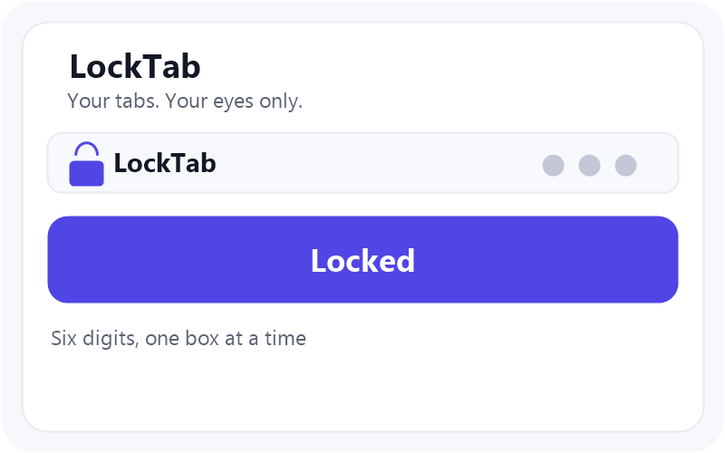
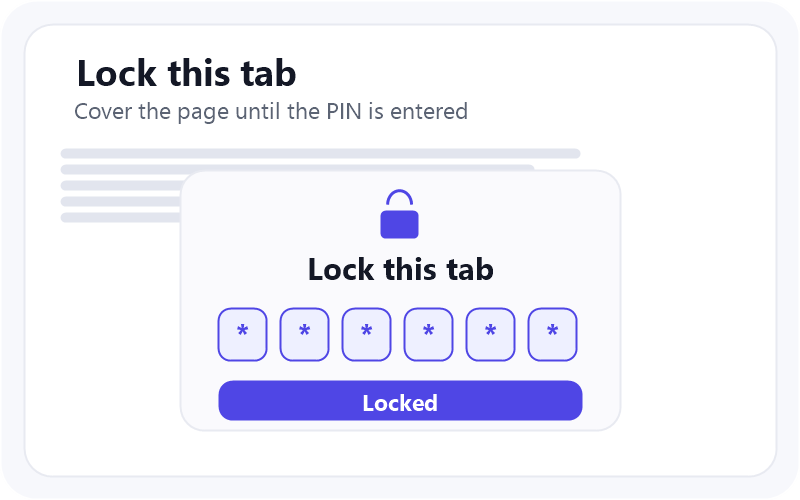
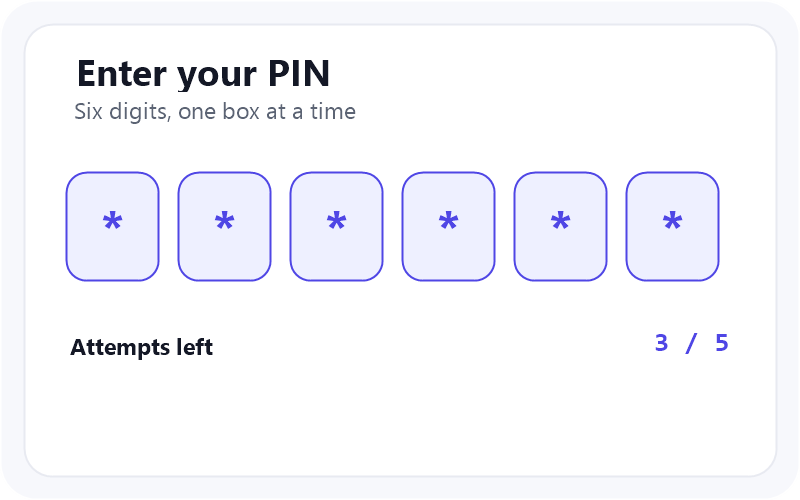
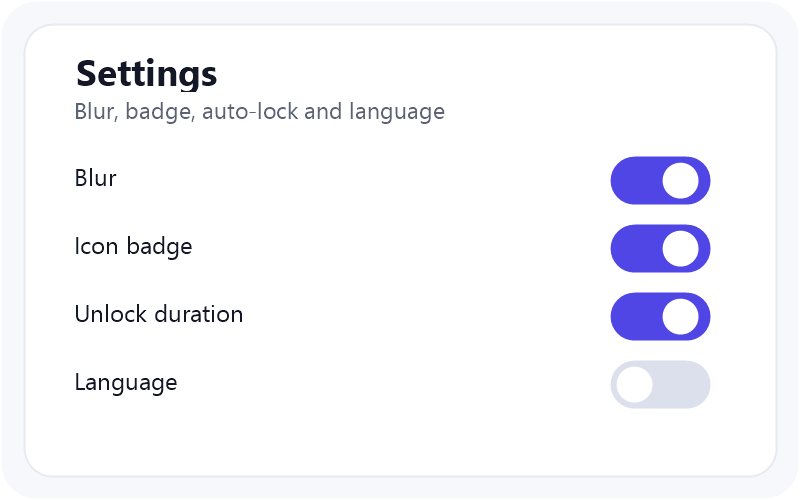

<p align="center">
  
</p>

<h1 align="center">LockTab — Your Tabs, Your Eyes Only</h1>

<p align="center">Lock any tab in one click with a 6-digit PIN. Add a private PIN for one site, get a one-time recovery code, and walk away knowing no one can read what is on your screen. Eight interface languages, full Arabic RTL, and absolutely no cloud.</p>

<p align="center">
  <a href="https://github.com/el9a7rawi/LockTab/releases"></a>
  <a href="https://github.com/el9a7rawi/LockTab/blob/main/LICENSE"></a>
  <a href="https://github.com/el9a7rawi/LockTab/pulls"></a>
  <a href="https://developer.chrome.com/docs/extensions"></a>
  
  
</p>

<p align="center">
  <a href="README.ar.md">العربية</a> · <a href="README.es.md">Español</a> · <a href="README.fr.md">Français</a> · <a href="README.de.md">Deutsch</a> · <a href="README.pt-BR.md">Português (Brasil)</a> · <a href="README.ru.md">Русский</a> · <a href="README.zh-CN.md">中文（简体）</a>
</p>

<h3 align="center">Download for your browser — click the icon</h3>

<div align="center">

| [<br><b>Chrome</b>](https://github.com/el9a7rawi/LockTab/releases/latest) | [<br><b>Edge</b>](https://github.com/el9a7rawi/LockTab/releases/latest) | [<br><b>Firefox</b>](https://github.com/el9a7rawi/LockTab/releases/latest) | [<br><b>Brave</b>](https://github.com/el9a7rawi/LockTab/releases/latest) | [<br><b>Opera</b>](https://github.com/el9a7rawi/LockTab/releases/latest) |
|---|---|---|---|---|

</div>

Firefox 121 or newer uses a dedicated archive with a Firefox-specific manifest.

---

## 1. Why LockTab?

| Without LockTab | With LockTab |
| --- | --- |
| Anyone can read an open tab | Your tab is covered until the PIN is entered |
| One shared password for every site | A dedicated PIN for the pages that matter |
| Lose the PIN, lose access | One-time recovery code clears every lock |
| Extensions that phone home | Fully offline, no account, no tracking |

A locked tab stays covered until the PIN is entered. No cloud account, no shared password, and no request leaves the device.

---

## 2. How it works — three steps

1. Create a 6-digit PIN and save the recovery code it shows once.
2. Open the tab you want to protect and press Lock this tab.
3. Enter the PIN to read it again, or grant a temporary unlock.

---

## 3. Interface tour — every part of the extension

### 3.1 Header — everything in reach
<p align="center"></p>

The title, theme toggle, language picker and GitHub link sit in one quiet row.

### 3.2 One primary action
<p align="center"></p>

A single gradient button covers the active page. Temporary unlock and lock removal ask for the PIN first.

### 3.3 Tab status
<p align="center"></p>

A flat status plate shows whether the tab is locked, open, or open for a while.

### 3.4 PIN entry
<p align="center"></p>

Six OTP-style boxes appear one after another, stop exactly at six, and centre the asterisk.

### 3.5 Recovery code
<p align="center"></p>

Shown once after setup. Store it somewhere safe; a used code can never be replayed.

### 3.6 Locked sites
<p align="center"></p>

Numbered rows list every locked domain. Past five sites, arrows page through the list.

### 3.7 Settings
<p align="center"></p>

Blur with three strengths, icon badge, unlock duration, theme and language — all in one place.

### 3.8 Support
<p align="center"></p>

LockTab is free and open source. PayPal and a highlighted InstaPay option help keep it independent.

---

## 4. What the PIN protects

The PIN never leaves your device. It is stored as a PBKDF2 hash with a unique salt, and the lock gate is reattached in place instead of reloading the page.

<div dir="ltr">

```text
PBKDF2-HMAC-SHA256 · 600,000 iterations · 16-byte salt · closed shadow root · 30s / 60s / 300s / 900s backoff
```

</div>

The query string and fragment are ignored, so a redirect cannot shed a lock. Every action that widens
access asks for the PIN again, including the temporary unlock and lock removal.

---

## 5. Install

1. Download the release archive for your browser from [Releases](https://github.com/el9a7rawi/LockTab/releases).
2. Extract it into a folder.
3. Chrome, Edge, Brave and Opera: open `chrome://extensions`, enable **Developer mode**, choose **Load unpacked** and select the folder.
4. Firefox 121+: open `about:debugging#/runtime/this-firefox`, choose **Load Temporary Add-on** and select `manifest.json` in the folder.

Privacy is covered in section 7 below and in privacy.html.

---

## 6. Development

No bundler and no npm dependencies. Run `python tools/build.py` to validate all eight
locale bundles and write the release archives, then `node --test tests/core.test.mjs` for the
unit tests. The interface follows a fixed visual contract in the design reference.

---

## 7. Privacy

See privacy.html. The PIN is stored only as a PBKDF2 hash with a unique salt. The query string and fragment are dropped, page content is never read, and no request leaves the extension. Fonts are bundled locally.

---

## 8. License

The project is open source and free for everyone under the Apache-2.0 license — use it, modify it, and share it freely; the full text is in LICENSE. Bundled fonts are licensed separately under SIL OFL 1.1. See CHANGELOG.md for the release history.

<p align="center">Made with care ❤️ <b>Ahmed Yousry</b> · <a href="https://github.com/el9a7rawi/LockTab">LockTab</a> · <a href="LICENSE">Apache-2.0</a></p>
