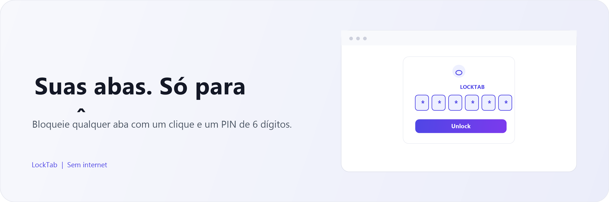
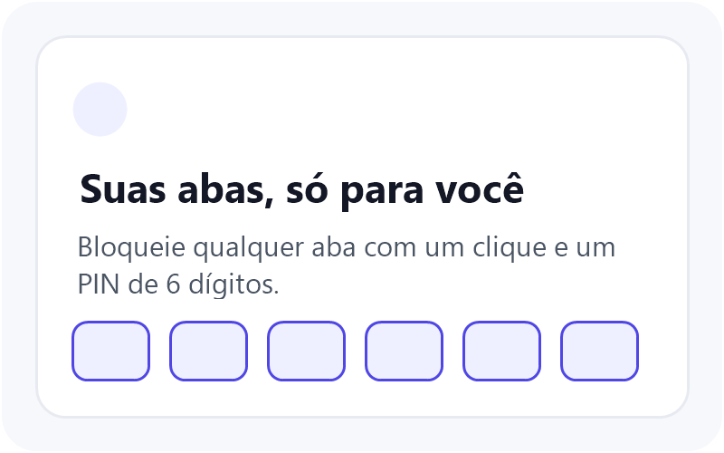
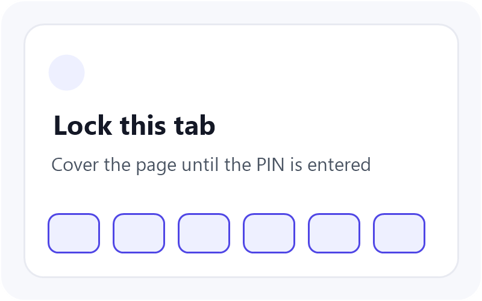
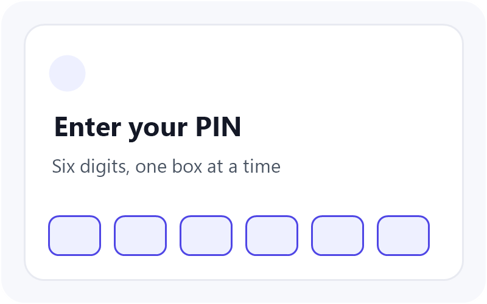
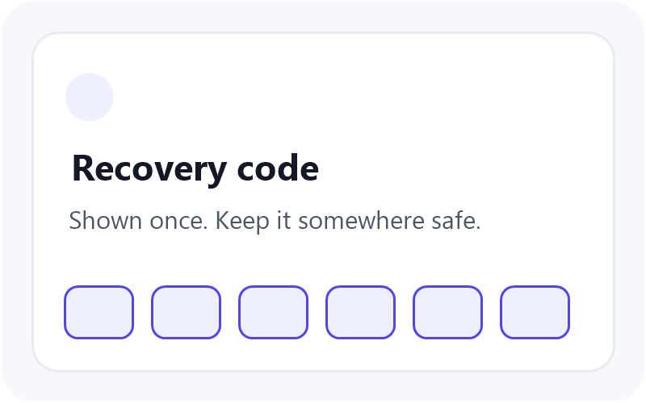
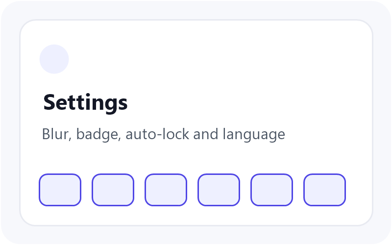

  

<h1 align="center">LockTab — Suas abas, só para você</h1>

Bloqueie qualquer aba com um clique e um PIN de 6 dígitos. Defina um PIN privado para um site, guarde um código de recuperação de uso único e saia sabendo que ninguém pode ler sua tela. Oito idiomas, RTL árabe completo e nenhuma nuvem.

  
  
  
  
  
  

<h4 align="center">
  <a href="README.md">English</a> · <a href="README.ar.md">العربية</a> · <a href="README.es.md">Español</a> · <a href="README.fr.md">Français</a> · <a href="README.de.md">Deutsch</a> · <a href="README.pt-BR.md"><b>Português (Brasil)</b></a> · <a href="README.ru.md">Русский</a> · <a href="README.zh-CN.md">中文（简体）</a>
</h4>

<h3 align="center">Baixe para seu navegador — clique no ícone</h3>

| [ <b>Chrome</b>](https://github.com/el9a7rawi/LockTab/releases/latest) | [ <b>Edge</b>](https://github.com/el9a7rawi/LockTab/releases/latest) | [ <b>Firefox</b>](https://github.com/el9a7rawi/LockTab/releases/latest) | [ <b>Brave</b>](https://github.com/el9a7rawi/LockTab/releases/latest) | [ <b>Opera</b>](https://github.com/el9a7rawi/LockTab/releases/latest) |
|---|---|---|---|---|

Firefox 121 ou superior usa um arquivo dedicado com um manifesto específico.

---

## 1. Por que o LockTab?

| Without LockTab | With LockTab |
| --- | --- |
| Qualquer pessoa pode ler uma aba aberta | Sua aba fica coberta até o PIN ser digitado |
| Uma senha compartilhada por todos os sites | Um PIN dedicado às páginas que importam |
| Perder o PIN é perder o acesso | Um código de recuperação único desfaz tudo |
| Extensões que enviam seus dados | Totalmente offline, sem conta e sem rastreamento |

The page you left open stays private without a shared password or a cloud account. Nothing leaves
the device, so the promise holds even when you are offline.

---

## 2. Como funciona — três passos

1. Crie um PIN de 6 dígitos e guarde o código de recuperação mostrado uma vez.
2. Abra a aba que deseja proteger e clique em Bloquear esta aba.
3. Digite o PIN para ler novamente, ou conceda um desbloqueio temporário.

---

## 3. Visita à interface — cada parte da extensão

### 3.1 Cabeçalho — tudo ao alcance

Título, tema, idioma e link do GitHub dividem uma linha discreta.

### 3.2 Uma ação principal

Um único botão em gradiente cobre a página ativa. Desbloqueio temporário e remoção pedem o PIN antes.

### 3.3 Estado da aba

Uma placa plana mostra se a aba está bloqueada, aberta ou aberta por um tempo.

### 3.4 Entrada do PIN

Seis campos aparecem um após o outro, param no sexto e centralizam o asterisco.

### 3.5 Código de recuperação

Mostrado uma única vez após a configuração. Um código usado nunca volta a funcionar.

### 3.6 Sites bloqueados

Linhas numeradas listam cada domínio. Após cinco sites, setas percorrem a lista.

### 3.7 Configurações

Desfoque em três níveis, contador no ícone, duração do desbloqueio, tema e idioma — em um só lugar.

### 3.8 Apoio

O LockTab é gratuito e de código aberto. PayPal e um InstaPay em destaque o mantêm independente.

---

## 4. What the PIN protects

PBKDF2-HMAC-SHA256 with 600,000 iterations and a unique 16-byte salt — the plaintext PIN is never
stored. The overlay runs in a closed shadow root, focus stays inside it, and the page underneath
cannot scroll. Wrong guesses escalate through 30s, 60s, 300s and 900s lock-outs, and opening another
tab does not reset the counter while the global PIN is in use. The query string and fragment are
dropped, so a redirect cannot shed a lock.

---

## 5. Install

1. Download the release archive for your browser from [Releases](https://github.com/el9a7rawi/LockTab/releases).
2. Extract it into a folder.
3. Chrome, Edge, Brave and Opera: open `chrome://extensions`, enable **Developer mode**, choose **Load unpacked** and select the folder.
4. Firefox 121+: open `about:debugging#/runtime/this-firefox`, choose **Load Temporary Add-on** and select `manifest.json` in the folder.

A privacidade está na seção 7 e em privacy.html.

---

## 6. Development

No bundler and no npm dependencies. Run `python tools/build.py` to validate all eight
locale bundles and write the release archives, then `node --test tests/core.test.mjs` for the
unit tests. The interface follows a fixed visual contract in the design reference.

---

## 7. Privacy

Veja privacy.html. O PIN é salvo apenas como hash PBKDF2 com um salt único. Query e fragmento são descartados, o conteúdo da página nunca é lido e nenhuma requisição sai da extensão. As fontes são locais.

---

## 8. License

O projeto é de código aberto e gratuito sob Apache-2.0 — use, modifique e compartilhe livremente; o texto completo está em LICENSE. As fontes têm licença SIL OFL 1.1. O histórico está em CHANGELOG.md.

Feito com carinho ❤️ <b>Ahmed Yousry</b> · <a href="https://github.com/el9a7rawi/LockTab">LockTab</a> · <a href="LICENSE">Apache-2.0</a>

