

  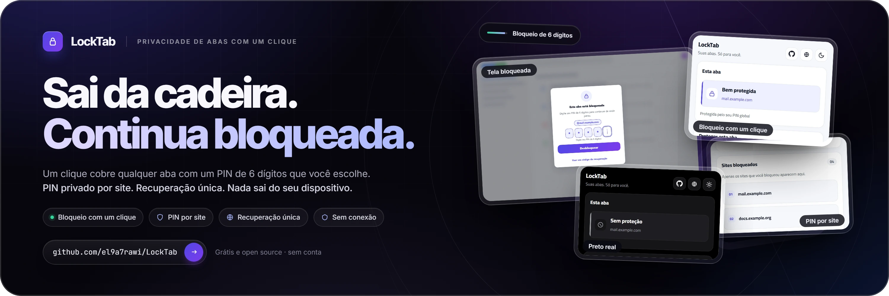

<h1 align="center">LockTab — Suas abas, só para você</h1>

Bloqueie qualquer aba com um clique e um PIN de 6 dígitos. Defina um PIN privado para um site, guarde um código de recuperação de uso único e saia sabendo que ninguém pode ler sua tela. Oito idiomas, RTL árabe completo e nenhuma nuvem.

  
  
  
  
  
  

<h4 align="center">
  <a href="README.md">English</a> · <a href="README.es.md">Español</a> · <a href="README.fr.md">Français</a> · <a href="README.de.md">Deutsch</a> · <a href="README.ru.md">Русский</a> · <a href="README.ar.md">العربية</a> · <a href="README.zh-CN.md">中文（简体）</a>
</h4>

<h3 align="center">Download for your browser — click the icon</h3>

| [ <b>Chrome</b>](https://github.com/el9a7rawi/LockTab/releases/latest) | [ <b>Edge</b>](https://github.com/el9a7rawi/LockTab/releases/latest) | [ <b>Firefox</b>](https://github.com/el9a7rawi/LockTab/releases/latest) | [ <b>Brave</b>](https://github.com/el9a7rawi/LockTab/releases/latest) | [ <b>Opera</b>](https://github.com/el9a7rawi/LockTab/releases/latest) |
|---|---|---|---|---|

Chrome e navegadores Chromium são o foco principal. Firefox 121+ é compatível por meio de um arquivo dedicado com seu próprio manifesto.

---

## 1. Por que o LockTab?

| Without LockTab | With LockTab |
|---|---|
| Qualquer pessoa pode ler uma aba aberta | Sua aba fica coberta até o PIN ser digitado |
| Uma senha compartilhada por todos os sites | Um PIN dedicado às páginas que importam |
| Perder o PIN é perder o acesso | Um código de recuperação único desfaz tudo |
| Extensões que enviam seus dados | Totalmente offline, sem conta e sem rastreamento |

undefined

---

## 2. Como funciona — três passos

1. Crie um PIN de 6 dígitos e guarde o código de recuperação mostrado uma vez.
2. Abra a aba que deseja proteger e clique em Bloquear esta aba.
3. Digite o PIN para ler novamente, ou conceda um desbloqueio temporário.

---

## 3. Visão geral da interface — todas as partes da extensão

### 3.1 Header — everything in reach

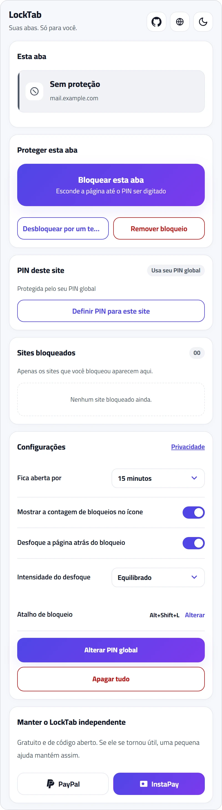

The title, theme toggle, GitHub link and language picker share one compact row.

### 3.2 One primary action

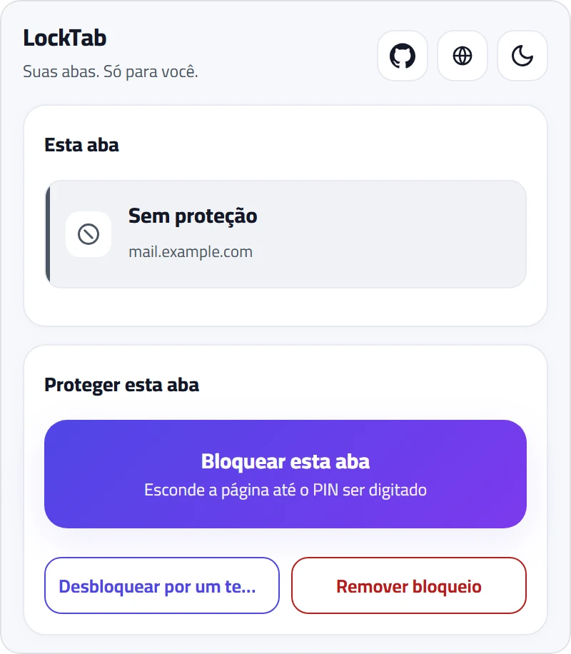

A single gradient button covers the active page. Temporary unlock and lock removal ask for the PIN first.

### 3.3 Tab status

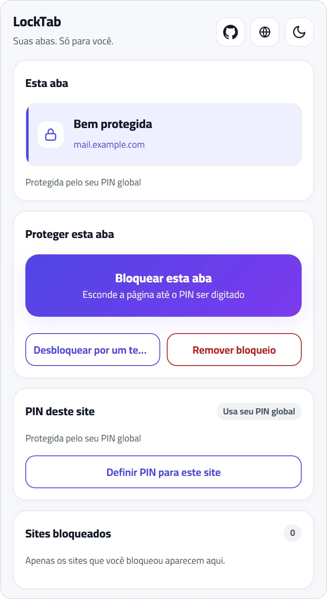

A flat status plate shows whether the tab is locked, open, or open for a while.

### 3.4 First run — create your PIN

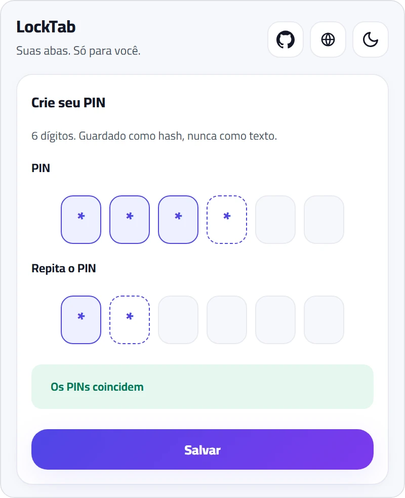

Six boxes appear one after another, stop exactly at six, and centre the asterisk.

### 3.5 Recovery code shown once

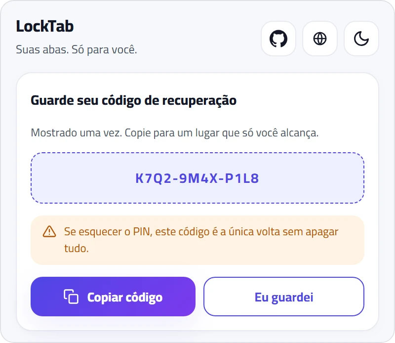

The code is displayed only at setup. Store it somewhere safe; a used code can never be replayed.

### 3.6 A PIN for one site

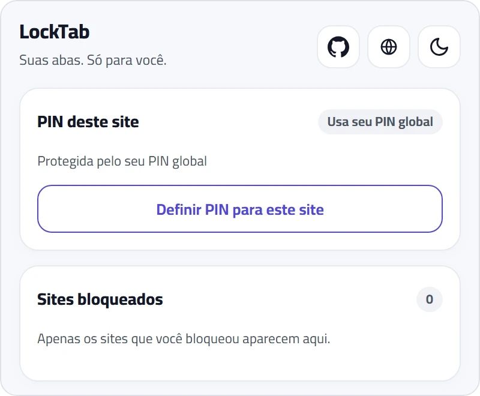

A site PIN overrides the global one on that domain, so sensitive pages can stay separate.

### 3.7 Locked sites

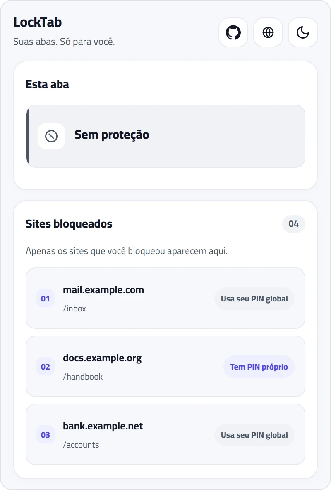

Numbered rows list every locked domain. Past five sites, arrows page through the list.

### 3.8 Lock from anywhere
The Alt+Shift+L shortcut locks the current tab without opening the popup.

### 3.9 Configurações

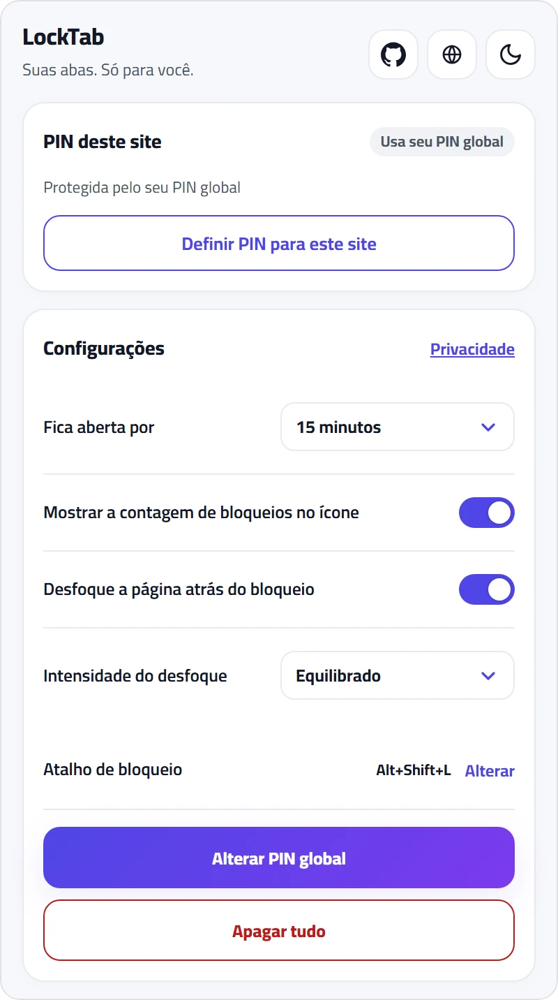

Desfoque, contador, duração, tema e idioma em um só cartão.

### 3.10 Oito idiomas, RTL real

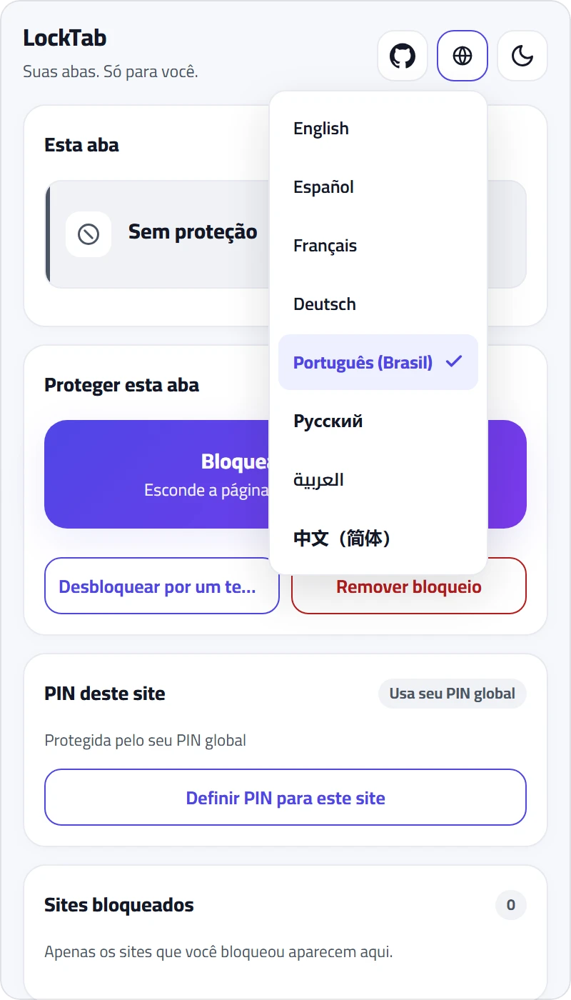

Troca instantânea; o árabe inverte o layout de forma lógica.

### 3.11 Tema escuro preto real

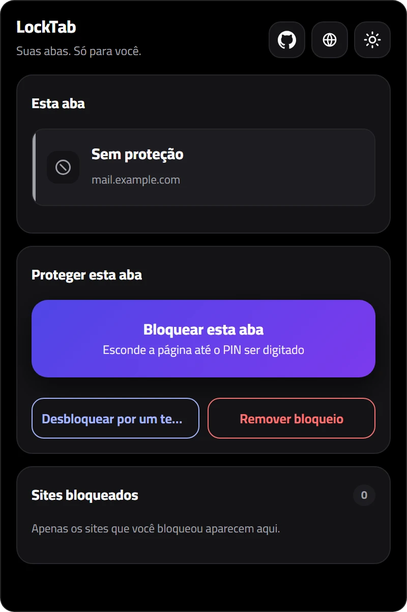

Fundo preto de verdade com contraste ajustado e lembrado.

### 3.12 Entrada do PIN

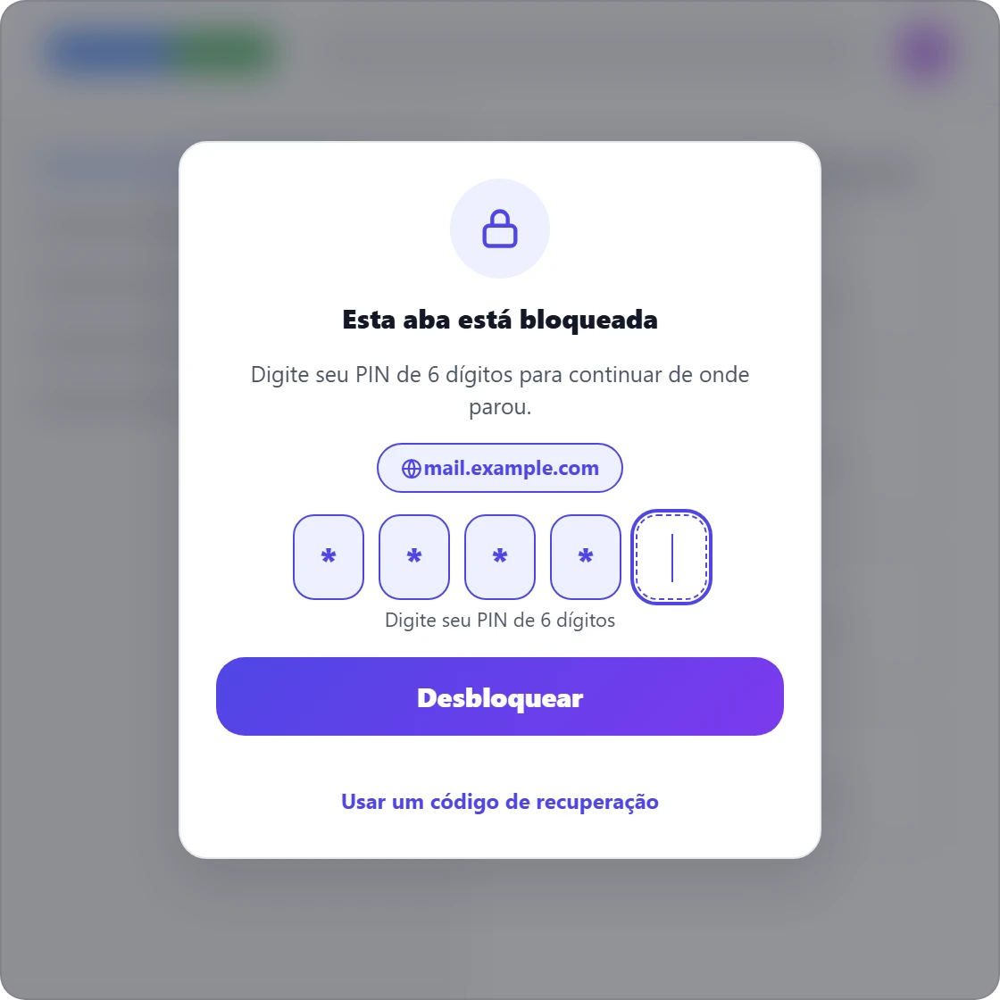

A capa usa uma shadow root fechada; o foco fica dentro.

### 3.13 Estado vazio

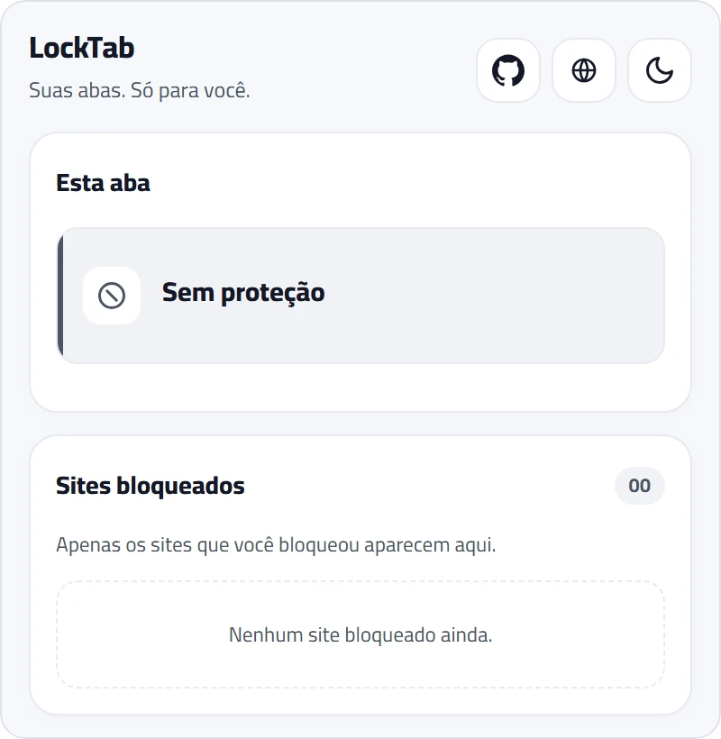

Um convite honesto para bloquear uma aba.

### 3.14 Apoio

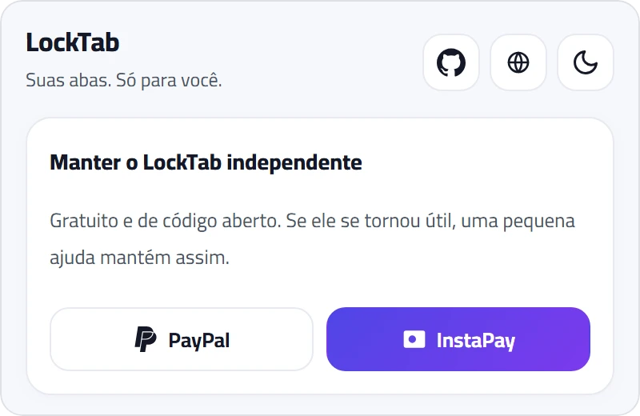

PayPal e InstaPay ajudam a manter o projeto independente.

## 4. O que a trava protege

1. **A 6-digit PIN.** Stored as a PBKDF2 hash with a unique 16-byte salt; the plaintext is never written to disk.
2. **A closed gate.** The overlay runs in a closed shadow root, traps focus and blocks scrolling underneath.
3. **A shared counter.** Wrong guesses escalate through 30, 60, 300 and 900 second lock-outs; switching tabs does not reset it.
4. **One-time recovery.** The code is shown once, consumed once, and clears every lock.

---

## 5. Instalar (sem empacotamento)

1. Open `chrome://extensions`.
2. Enable **Developer mode**.
3. Click **Load unpacked** and select the extracted release folder.
4. Click the LockTab icon in the toolbar.

A privacidade está na seção 7 e em `privacy.html`.

---

## 6. Desenvolvimento

O repositório publicado contém apenas a extensão e sua documentação. Scripts de captura e testes locais ficam de fora; o GitHub Actions valida o manifesto, o CSP e os idiomas.

---

## 7. Privacidade

Veja `privacy.html`. O PIN fica salvo apenas como hash PBKDF2 com salt único; o conteúdo da página nunca é lido e nenhuma requisição sai da extensão.

---

## 8. Licença

O projeto é de código aberto sob **Apache-2.0**; texto completo em [LICENSE](LICENSE). Fontes sob [SIL OFL 1.1](fonts/OFL.txt). Histórico em [CHANGELOG.md](CHANGELOG.md).

---

Feito com carinho ❤️ <b>Ahmed Yousry</b> · <a href="https://github.com/el9a7rawi/LockTab">LockTab</a> · <a href="LICENSE">Apache-2.0</a>

