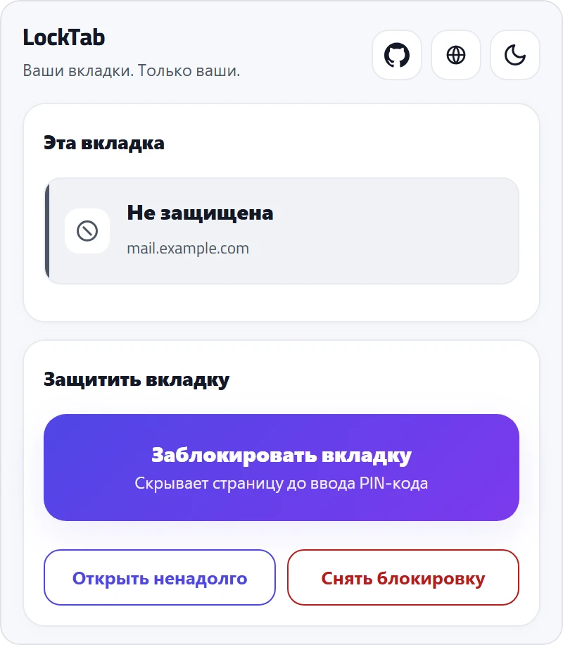
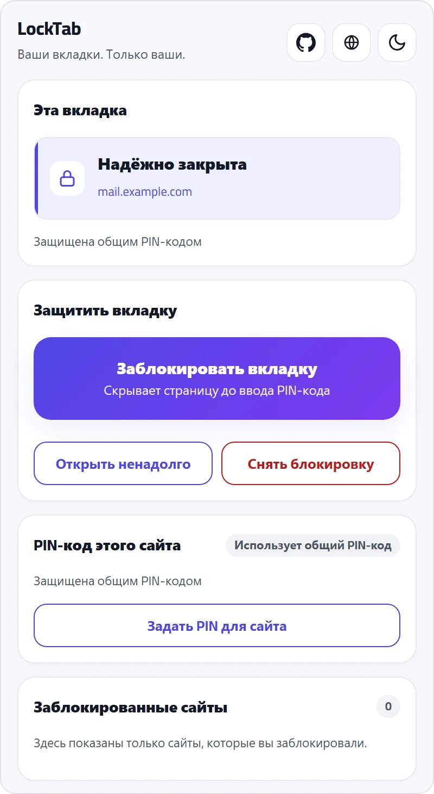
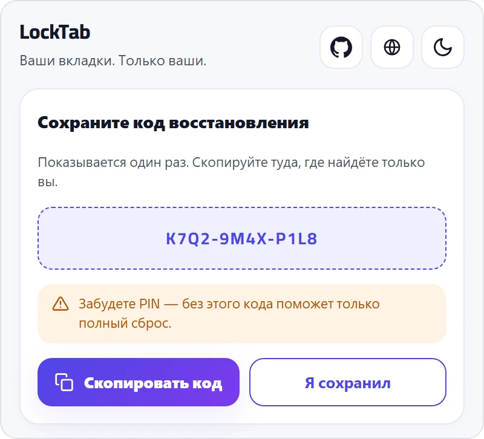
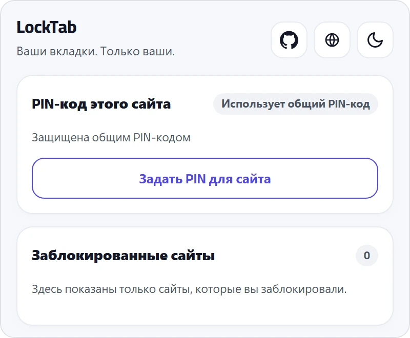
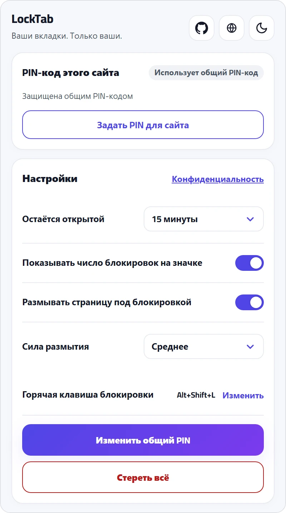
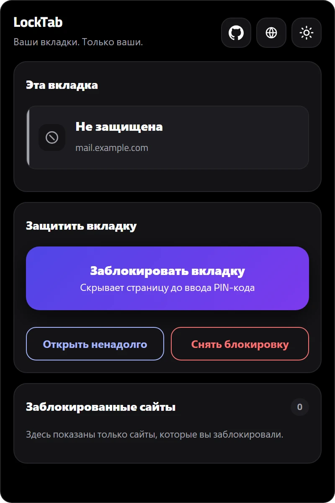
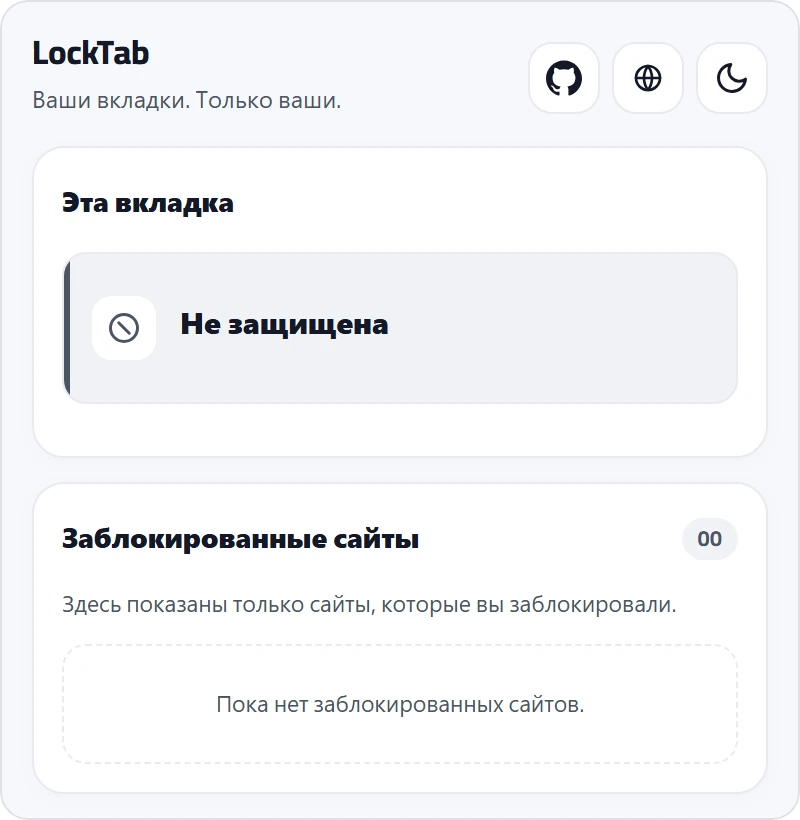

  

<h1 align="center">LockTab — Ваши вкладки. Только ваши.</h1>

Блокируйте любую вкладку в один клик PIN-кодом из 6 цифр. Назначьте отдельный PIN для сайта, сохраните одноразовый код восстановления и уходите, зная, что никто не прочитает ваш экран. Восемь языков, полноценное арабское RTL и ничего облачного.

  
  
  
  
  
  

<h4 align="center">
  <a href="README.md">English</a> · <a href="README.es.md">Español</a> · <a href="README.fr.md">Français</a> · <a href="README.de.md">Deutsch</a> · <a href="README.pt-BR.md">Português (Brasil)</a> · <a href="README.ar.md">العربية</a> · <a href="README.zh-CN.md">中文（简体）</a>
</h4>

<h3 align="center">Download for your browser — click the icon</h3>

| [ <b>Chrome</b>](https://github.com/el9a7rawi/LockTab/releases/latest) | [ <b>Edge</b>](https://github.com/el9a7rawi/LockTab/releases/latest) | [ <b>Firefox</b>](https://github.com/el9a7rawi/LockTab/releases/latest) | [ <b>Brave</b>](https://github.com/el9a7rawi/LockTab/releases/latest) | [ <b>Opera</b>](https://github.com/el9a7rawi/LockTab/releases/latest) |
|---|---|---|---|---|

Основная цель — Chrome и браузеры на Chromium. Firefox 121+ поддерживается через отдельный архив со своим манифестом.

---

## 1. Зачем LockTab?

| Without LockTab | With LockTab |
|---|---|
| Любой может прочитать открытую вкладку | Вкладка скрыта до ввода PIN-кода |
| Один пароль для всех сайтов | Отдельный PIN для важных страниц |
| Забыли PIN — потеряли доступ | Одноразовый код снимает все блокировки |
| Расширения, которые отправляют данные | Полностью офлайн, без аккаунта и слежки |

undefined

---

## 2. Как это работает — три шага

1. Создайте PIN из 6 цифр и сохраните показанный один раз код восстановления.
2. Откройте нужную вкладку и нажмите «Заблокировать вкладку».
3. Введите PIN, чтобы продолжить, или разрешите временную разблокировку.

---

## 3. Обзор интерфейса — все части расширения

### 3.1 Header — everything in reach

The title, theme toggle, GitHub link and language picker share one compact row.

### 3.2 One primary action

A single gradient button covers the active page. Temporary unlock and lock removal ask for the PIN first.

### 3.3 Tab status

A flat status plate shows whether the tab is locked, open, or open for a while.

### 3.4 First run — create your PIN

Six boxes appear one after another, stop exactly at six, and centre the asterisk.

### 3.5 Recovery code shown once

The code is displayed only at setup. Store it somewhere safe; a used code can never be replayed.

### 3.6 A PIN for one site

A site PIN overrides the global one on that domain, so sensitive pages can stay separate.

### 3.7 Locked sites

Numbered rows list every locked domain. Past five sites, arrows page through the list.

### 3.8 Lock from anywhere
The Alt+Shift+L shortcut locks the current tab without opening the popup.

### 3.9 Настройки

Размытие, счётчик, длительность, тема и язык в одной карточке.

### 3.10 Восемь языков, настоящий RTL

Мгновенное переключение; арабский логически зеркалит интерфейс.

### 3.11 Чёрная тёмная тема

Настоящий чёрный фон с подобранным контрастом и сохранением выбора.

### 3.12 Ввод PIN-кода

Блокировка использует закрытый shadow root; фокус остаётся внутри.

### 3.13 Пустое состояние

Честное приглашение заблокировать вкладку.

### 3.14 Поддержка

PayPal и InstaPay помогают сохранять независимость проекта.

## 4. Что защищает блокировка

1. **A 6-digit PIN.** Stored as a PBKDF2 hash with a unique 16-byte salt; the plaintext is never written to disk.
2. **A closed gate.** The overlay runs in a closed shadow root, traps focus and blocks scrolling underneath.
3. **A shared counter.** Wrong guesses escalate through 30, 60, 300 and 900 second lock-outs; switching tabs does not reset it.
4. **One-time recovery.** The code is shown once, consumed once, and clears every lock.

---

## 5. Установка (без сборки)

1. Open `chrome://extensions`.
2. Enable **Developer mode**.
3. Click **Load unpacked** and select the extracted release folder.
4. Click the LockTab icon in the toolbar.

Конфиденциальность описана в разделе 7 и в `privacy.html`.

---

## 6. Разработка

Опубликованный репозиторий содержит только расширение и документацию. Скрипты захвата и локальные тесты исключены; GitHub Actions проверяет манифест, CSP и полноту переводов.

---

## 7. Конфиденциальность

См. `privacy.html`. PIN хранится только как хеш PBKDF2 с уникальной солью; содержимое страницы не читается, ни один запрос не покидает расширение.

---

## 8. Лицензия

Проект с открытым кодом по лицензии **Apache-2.0**; полный текст в [LICENSE](LICENSE). Шрифты по [SIL OFL 1.1](fonts/OFL.txt). История в [CHANGELOG.md](CHANGELOG.md).

---

Создано с заботой ❤️ <b>Ahmed Yousry</b> · <a href="https://github.com/el9a7rawi/LockTab">LockTab</a> · <a href="LICENSE">Apache-2.0</a>

