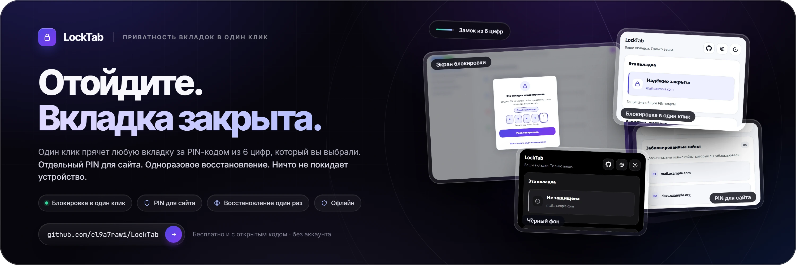
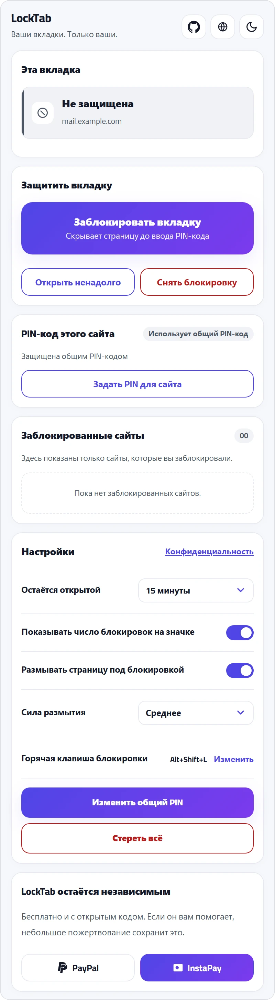
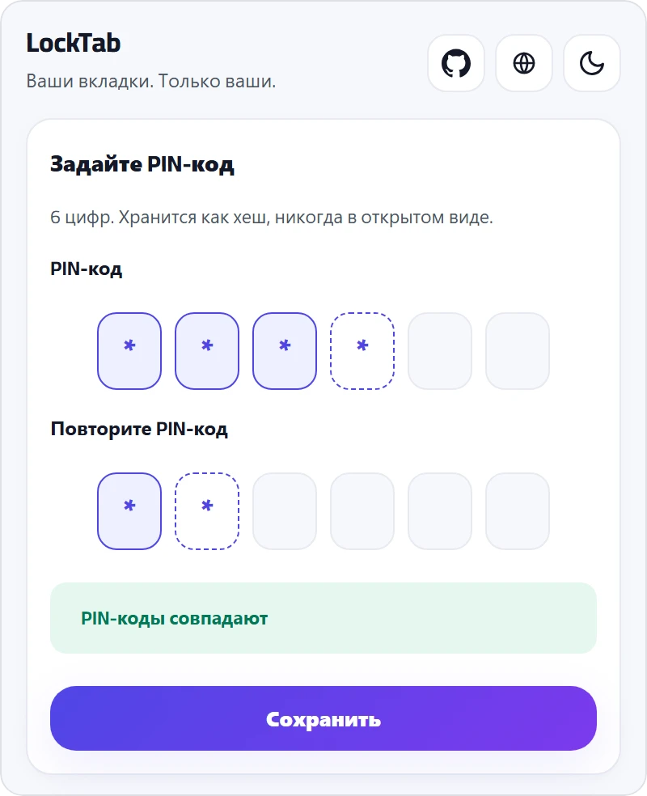
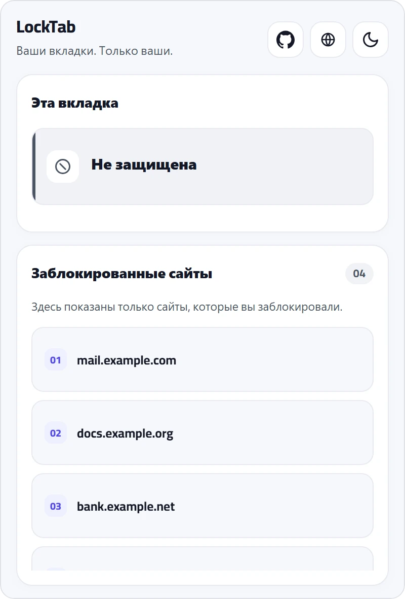
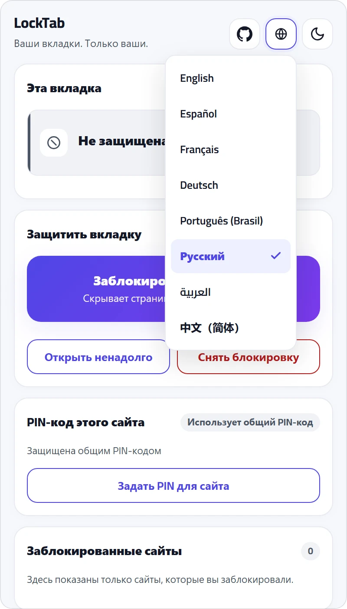
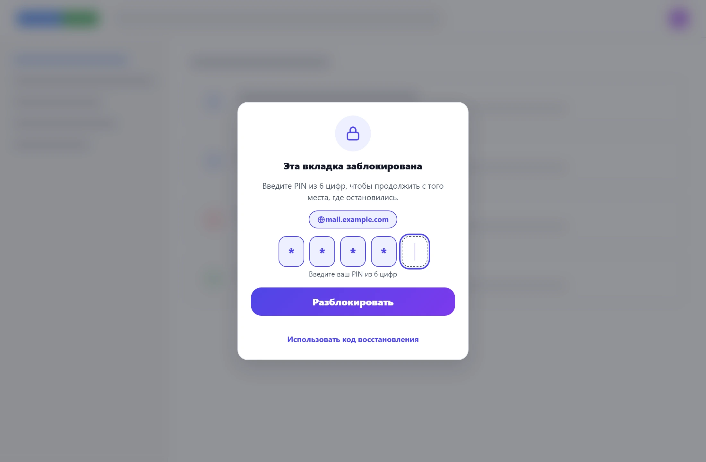
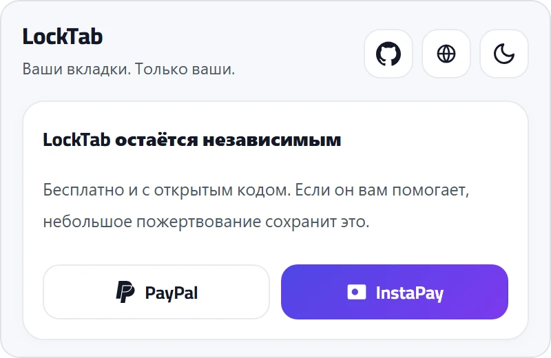

  

<h1 align="center">LockTab — Ваши вкладки. Только ваши.</h1>

Блокируйте любую вкладку в один клик PIN-кодом из 6 цифр. Назначьте отдельный PIN для сайта, сохраните одноразовый код восстановления и уходите, зная, что никто не прочитает ваш экран. Восемь языков, полноценное арабское RTL и ничего облачного.

  
  
  
  
  
  

<h4 align="center">
  <a href="README.md">English</a> · <a href="README.es.md">Español</a> · <a href="README.fr.md">Français</a> · <a href="README.de.md">Deutsch</a> · <a href="README.pt-BR.md">Português (Brasil)</a> · <a href="README.ar.md">العربية</a> · <a href="README.zh-CN.md">中文（简体）</a>
</h4>

<h3 align="center">Скачайте для своего браузера — нажмите значок</h3>

| [ <b>Chrome</b>](https://github.com/el9a7rawi/LockTab/releases/latest) | [ <b>Edge</b>](https://github.com/el9a7rawi/LockTab/releases/latest) | [ <b>Firefox</b>](https://github.com/el9a7rawi/LockTab/releases/latest) | [ <b>Brave</b>](https://github.com/el9a7rawi/LockTab/releases/latest) | [ <b>Opera</b>](https://github.com/el9a7rawi/LockTab/releases/latest) |
|---|---|---|---|---|

Основная цель — Chrome и браузеры на Chromium. Firefox 121+ поддерживается через отдельный архив со своим манифестом.

---

## 1. Зачем LockTab?

| Без LockTab | С LockTab |
|---|---|
| Любой может прочитать открытую вкладку | Вкладка скрыта до ввода PIN-кода |
| Один пароль для всех сайтов | Отдельный PIN для важных страниц |
| Забыли PIN — потеряли доступ | Одноразовый код снимает все блокировки |
| Расширения, которые отправляют данные | Полностью офлайн, без аккаунта и слежки |

LockTab скрывает вкладку от того, кто садится за ваше устройство. Это не шифрование диска и не защита от скомпрометированного браузера или администратора, удалившего расширение.

---

## 2. Как это работает — три шага

1. Создайте PIN из 6 цифр и сохраните показанный один раз код восстановления.
2. Откройте нужную вкладку и нажмите «Заблокировать вкладку».
3. Введите PIN, чтобы продолжить, или разрешите временную разблокировку.

---

## 3. Обзор интерфейса — все части расширения

### 3.1 Заголовок — всё под рукой

Название, тема, язык и ссылка на GitHub занимают одну спокойную строку.

### 3.2 Одно главное действие

Одна кнопка с градиентом скрывает активную страницу. Временная разблокировка и удаление требуют PIN.

### 3.3 Состояние вкладки

Плоская плашка показывает, заблокирована вкладка, открыта или открыта временно.

### 3.4 Ввод PIN

Шесть полей появляются одно за другим, останавливаются на шестом и центрируют звёздочку.

### 3.5 Код восстановления

Показывается один раз после настройки. Использованный код нельзя повторить.

### 3.6 Заблокированные сайты

Пронумерованные строки перечисляют все домены. После пяти сайтов стрелки листают список.

### 3.7 Настройки

Размытие в трёх уровнях, счётчик на значке, длительность разблокировки, тема и язык — в одном месте.

### 3.8 Поддержка
LockTab бесплатен и с открытым кодом. PayPal и выделенный InstaPay помогают ему оставаться независимым.

### 3.9 Настройки

Размытие, счётчик, длительность, тема и язык в одной карточке.

### 3.10 Восемь языков, настоящий RTL

Мгновенное переключение; арабский логически зеркалит интерфейс.

### 3.11 Чёрная тёмная тема

Настоящий чёрный фон с подобранным контрастом и сохранением выбора.

### 3.12 Ввод PIN-кода

Блокировка использует закрытый shadow root; фокус остаётся внутри.

### 3.13 Пустое состояние

Честное приглашение заблокировать вкладку.

### 3.14 Поддержка

PayPal и InstaPay помогают сохранять независимость проекта.

## 4. Что защищает блокировка

1. PIN-код из 6 цифр. Хранится как хеш PBKDF2 с уникальной солью; открытый код никогда не записывается на диск.
2. Закрытая перекрышка. Блокировка использует закрытый shadow root, удерживает фокус внутри и блокирует прокрутку страницы.
3. Общий счётчик. Ошибки увеличивают задержку до 30, 60, 300 и 900 секунд; переключение вкладок счётчик не сбрасывает.
4. Одноразовое восстановление. Код показывается один раз, используется один раз и снимает все блокировки.

---

## 5. Установка (без сборки)

1. Откройте `chrome://extensions`.
2. Включите **Режим разработчика**.
3. Нажмите **Загрузить распакованное расширение** и выберите извлечённую папку.
4. Нажмите на значок LockTab на панели инструментов.

Конфиденциальность описана в разделе 7 и в `privacy.html`.

---

## 6. Разработка

Опубликованный репозиторий содержит только расширение и документацию. Скрипты захвата и локальные тесты исключены; GitHub Actions проверяет манифест, CSP и полноту переводов.

---

## 7. Конфиденциальность

См. `privacy.html`. PIN хранится только как хеш PBKDF2 с уникальной солью; содержимое страницы не читается, ни один запрос не покидает расширение.

---

## 8. Лицензия

Проект с открытым кодом по лицензии **Apache-2.0**; полный текст в [LICENSE](LICENSE). Шрифты по [SIL OFL 1.1](fonts/OFL.txt). История в [CHANGELOG.md](CHANGELOG.md).

---

Создано с заботой ❤️ <b>Ahmed Yousry</b> · <a href="https://github.com/el9a7rawi/LockTab">LockTab</a> · <a href="LICENSE">Apache-2.0</a>

