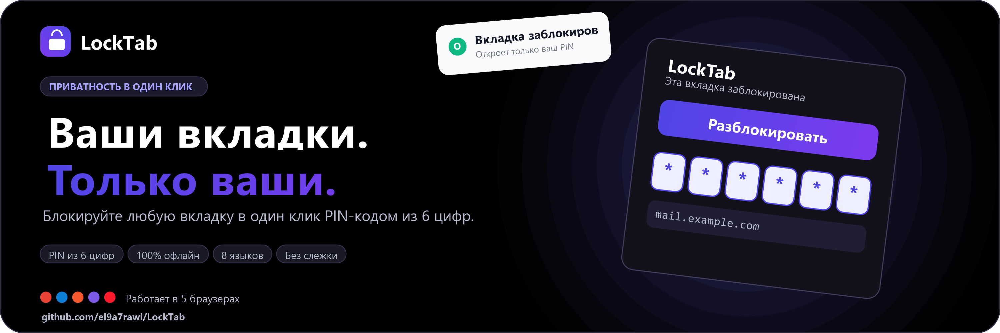
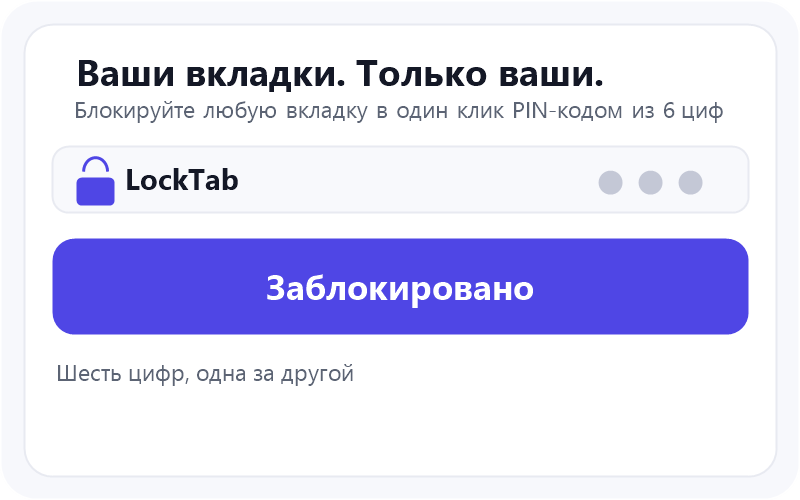
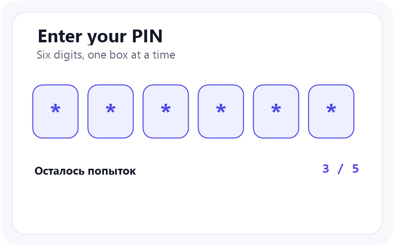
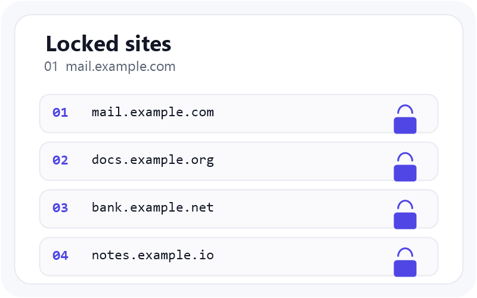
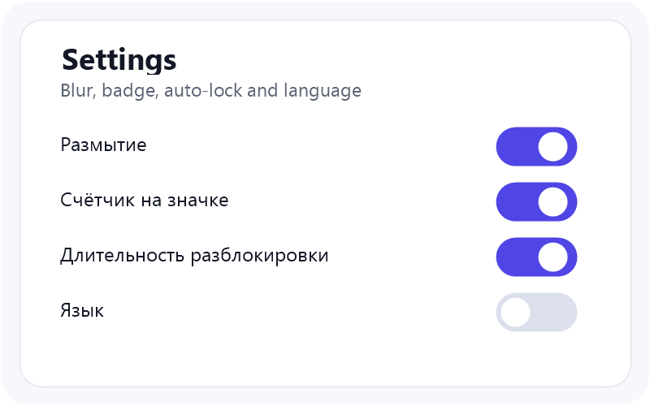

<p align="center">
  
</p>

<h1 align="center">LockTab — Ваши вкладки. Только ваши.</h1>

<p align="center">Блокируйте любую вкладку в один клик PIN-кодом из 6 цифр. Назначьте отдельный PIN для сайта, сохраните одноразовый код восстановления и уходите, зная, что никто не прочитает ваш экран. Восемь языков, полноценное арабское RTL и ничего облачного.</p>

<p align="center">
  <a href="https://github.com/el9a7rawi/LockTab/releases"></a>
  <a href="https://github.com/el9a7rawi/LockTab/blob/main/LICENSE"></a>
  <a href="https://github.com/el9a7rawi/LockTab/pulls"></a>
  <a href="https://developer.chrome.com/docs/extensions"></a>
  
  
</p>

<p align="center">
  <a href="README.md">English</a> · <a href="README.ar.md">العربية</a> · <a href="README.es.md">Español</a> · <a href="README.fr.md">Français</a> · <a href="README.de.md">Deutsch</a> · <a href="README.pt-BR.md">Português (Brasil)</a> · <a href="README.zh-CN.md">中文（简体）</a>
</p>

<h3 align="center">Скачайте для своего браузера — нажмите значок</h3>

<div align="center">

| [<br><b>Chrome</b>](https://github.com/el9a7rawi/LockTab/releases/latest) | [<br><b>Edge</b>](https://github.com/el9a7rawi/LockTab/releases/latest) | [<br><b>Firefox</b>](https://github.com/el9a7rawi/LockTab/releases/latest) | [<br><b>Brave</b>](https://github.com/el9a7rawi/LockTab/releases/latest) | [<br><b>Opera</b>](https://github.com/el9a7rawi/LockTab/releases/latest) |
|---|---|---|---|---|

</div>

Firefox 121 и новее использует отдельный архив со специфическим манифестом.

---

## 1. Почему LockTab?

| Without LockTab | With LockTab |
| --- | --- |
| Любой может прочитать открытую вкладку | Вкладка скрыта до ввода PIN-кода |
| Один пароль для всех сайтов | Отдельный PIN для важных страниц |
| Забыли PIN — потеряли доступ | Одноразовый код снимает все блокировки |
| Расширения, которые отправляют данные | Полностью офлайн, без аккаунта и слежки |

Заблокированная вкладка остаётся скрытой до ввода PIN-кода. Без облачного аккаунта, общего пароля и исходящих запросов.

---

## 2. Как это работает — три шага

1. Создайте PIN из 6 цифр и сохраните показанный один раз код восстановления.
2. Откройте нужную вкладку и нажмите «Заблокировать вкладку».
3. Введите PIN, чтобы продолжить, или разрешите временную разблокировку.

---

## 3. Обзор интерфейса — каждая часть расширения

### 3.1 Заголовок — всё под рукой
<p align="center"></p>

Название, тема, язык и ссылка на GitHub занимают одну спокойную строку.

### 3.2 Одно главное действие
<p align="center"></p>

Одна кнопка с градиентом скрывает активную страницу. Временная разблокировка и удаление требуют PIN.

### 3.3 Состояние вкладки
<p align="center"></p>

Плоская плашка показывает, заблокирована вкладка, открыта или открыта временно.

### 3.4 Ввод PIN
<p align="center"></p>

Шесть полей появляются одно за другим, останавливаются на шестом и центрируют звёздочку.

### 3.5 Код восстановления
<p align="center"></p>

Показывается один раз после настройки. Использованный код нельзя повторить.

### 3.6 Заблокированные сайты
<p align="center"></p>

Пронумерованные строки перечисляют все домены. После пяти сайтов стрелки листают список.

### 3.7 Настройки
<p align="center"></p>

Размытие в трёх уровнях, счётчик на значке, длительность разблокировки, тема и язык — в одном месте.

### 3.8 Поддержка
<p align="center"></p>

LockTab бесплатен и с открытым кодом. PayPal и выделенный InstaPay помогают ему оставаться независимым.

---

## 4. Что защищает PIN-код

PIN-код никогда не покидает устройство. Он хранится как хеш PBKDF2 с уникальной солью, а блокировка возвращается на место без перезагрузки страницы.

<div dir="ltr">

```text
PBKDF2-HMAC-SHA256 · 600 000 итераций · соль 16 байт · закрытый shadow root · задержка 30/60/300/900 с
```

</div>

The query string and fragment are ignored, so a redirect cannot shed a lock. Every action that widens
access asks for the PIN again, including the temporary unlock and lock removal.

---

## 5. Установка

1. Download the release archive for your browser from [Releases](https://github.com/el9a7rawi/LockTab/releases).
2. Extract it into a folder.
3. Chrome, Edge, Brave and Opera: open `chrome://extensions`, enable **Developer mode**, choose **Load unpacked** and select the folder.
4. Firefox 121+: open `about:debugging#/runtime/this-firefox`, choose **Load Temporary Add-on** and select `manifest.json` in the folder.

Конфиденциальность описана в разделе 7 и в privacy.html.

---

## 6. Разработка

No bundler and no npm dependencies. Run `python tools/build.py` to validate all eight
locale bundles and write the release archives, then `node --test tests/core.test.mjs` for the
unit tests. The interface follows a fixed visual contract in the design reference.

---

## 7. Конфиденциальность

См. privacy.html. PIN хранится только как хеш PBKDF2 с уникальной солью. Запрос и фрагмент отбрасываются, содержимое страницы не читается, ни один запрос не покидает расширение. Шрифты локальны.

---

## 8. Лицензия

Проект с открытым кодом и бесплатен по Apache-2.0 — используйте, изменяйте и делитесь свободно; полный текст в LICENSE. Шрифты имеют лицензию SIL OFL 1.1. История в CHANGELOG.md.

<p align="center">Создано с заботой ❤️ <b>Ahmed Yousry</b> · <a href="https://github.com/el9a7rawi/LockTab">LockTab</a> · <a href="LICENSE">Apache-2.0</a></p>
