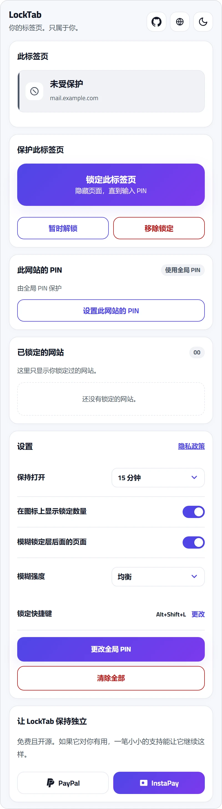
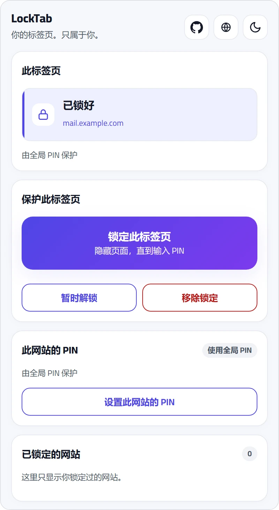
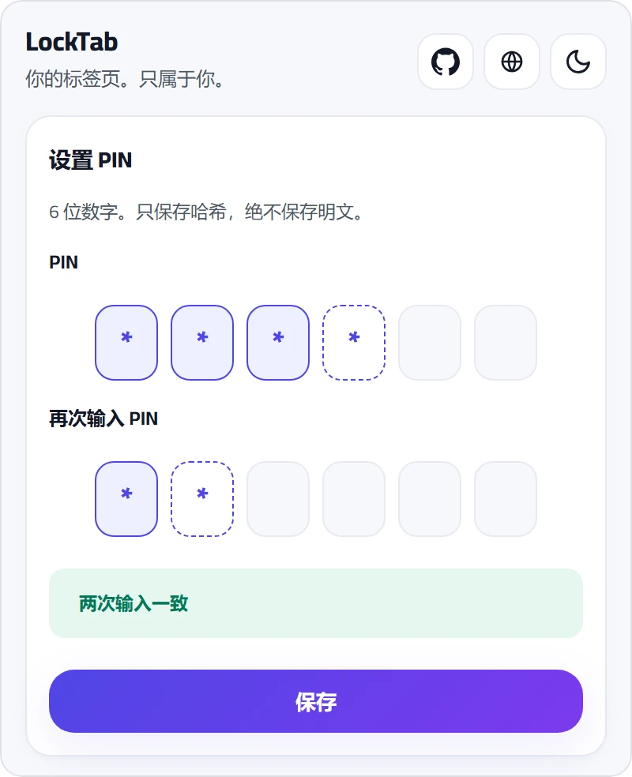
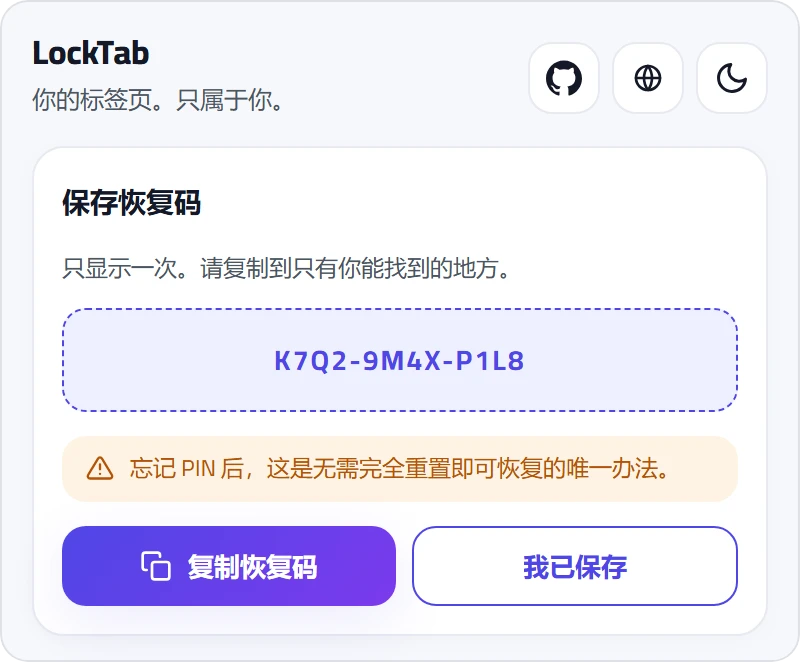
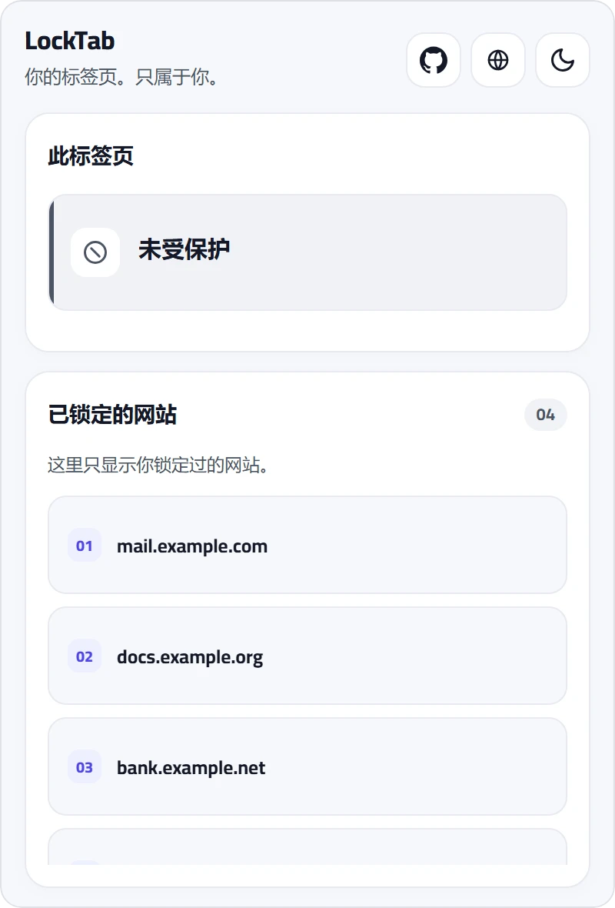
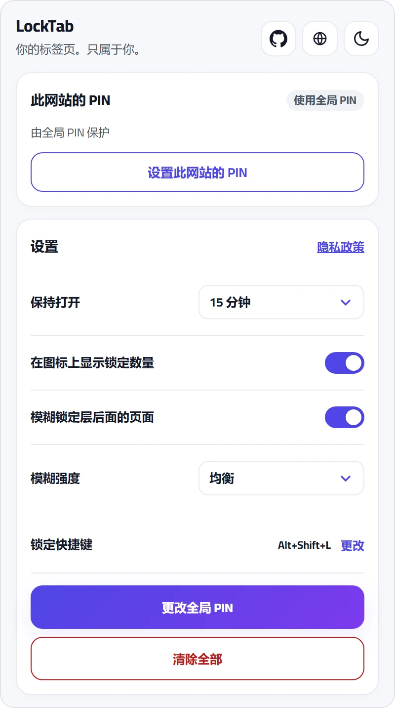
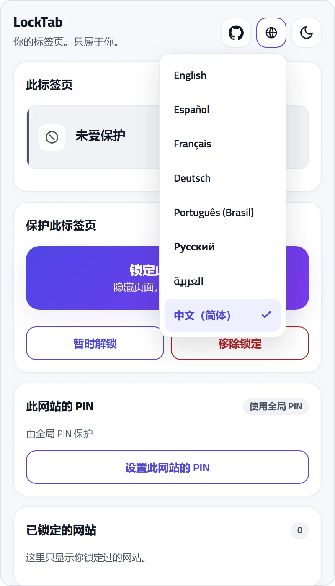

  

<h1 align="center">LockTab — 你的标签页，只属于你</h1>

一键用 6 位 PIN 锁定任意标签页。可为单个网站设置专属 PIN，获得一次性恢复码，然后放心离开——没人能读到你的屏幕。八种界面语言，完整的阿拉伯语 RTL，且完全不联网。

  
  
  
  
  
  

<h4 align="center">
  <a href="README.md">English</a> · <a href="README.es.md">Español</a> · <a href="README.fr.md">Français</a> · <a href="README.de.md">Deutsch</a> · <a href="README.pt-BR.md">Português (Brasil)</a> · <a href="README.ru.md">Русский</a> · <a href="README.ar.md">العربية</a>
</h4>

<h3 align="center">为你的浏览器下载 — 点击图标</h3>

| [ <b>Chrome</b>](https://github.com/el9a7rawi/LockTab/releases/latest) | [ <b>Edge</b>](https://github.com/el9a7rawi/LockTab/releases/latest) | [ <b>Firefox</b>](https://github.com/el9a7rawi/LockTab/releases/latest) | [ <b>Brave</b>](https://github.com/el9a7rawi/LockTab/releases/latest) | [ <b>Opera</b>](https://github.com/el9a7rawi/LockTab/releases/latest) |
|---|---|---|---|---|

Chrome 和 Chromium 浏览器是主要目标。从 121 版起通过带有专属清单的独立归档支持 Firefox。

---

## 1. 为什么选择 LockTab？

| 没有 LockTab | 使用 LockTab |
|---|---|
| 任何人都能看到打开的标签页 | 输入 PIN 前页面始终被遮盖 |
| 所有网站共用一个密码 | 重要页面使用专属 PIN |
| 忘记 PIN 就失去访问 | 一次性恢复码可清除所有锁定 |
| 会上传数据的扩展 | 完全离线，无账号、无追踪 |

LockTab 让坐在你设备前的人看不到标签页。它不是磁盘加密，也无法防御被入侵的浏览器或卸载扩展的管理员。

---

## 2. 如何使用 —— 三个步骤

1. 创建 6 位 PIN，并保存只显示一次的恢复码。
2. 打开要保护的标签页，点击「锁定此标签页」。
3. 输入 PIN 继续阅读，或授予临时解锁。

---

## 3. 界面导览 — 扩展的每个部分

### 3.1 顶栏 — 触手可及

标题、主题、语言与 GitHub 链接整齐地排在一行。

### 3.2 一个主操作

一个渐变按钮即可遮盖当前页面。临时解锁和移除锁定都需要先输入 PIN。

### 3.3 标签页状态

扁平状态条显示标签页是已锁定、已打开还是暂时打开。

### 3.4 PIN 输入

六个框依次出现，到第六个停止，星号居中显示。

### 3.5 恢复码

设置后只显示一次。已使用的恢复码无法再次使用。

### 3.6 已锁定的网站

带编号的行列出每个被锁定的域名。超过五个网站后可用箭头翻页。

### 3.7 设置

三档模糊、图标计数、解锁时长、主题和语言——尽在一处。

### 3.8 支持
LockTab 免费且开源。PayPal 和醒目的 InstaPay 帮助它保持独立。

### 3.9 设置

模糊、计数、时长、主题和语言都在同一张卡片中。

### 3.10 八种语言与真正的 RTL

即时切换；阿拉伯语会按逻辑镜像整个布局。

### 3.11 纯黑深色主题

真正的纯黑背景，对比度经过调整并会被记住。

### 3.12 PIN 输入

锁定层使用封闭的 shadow root，焦点始终留在内部。

### 3.13 空状态

诚实地邀请你锁定一个标签页。

### 3.14 支持

PayPal 和 InstaPay 帮助项目保持独立。

## 4. 锁定保护什么

1. 6 位 PIN。以带唯一盐值的 PBKDF2 哈希保存，明文永远不会写入磁盘。
2. 封闭的遮盖层。锁定界面使用封闭的 shadow root，焦点留在内部，页面无法滚动。
3. 共享计数器。错误会依次升级到 30、60、300 和 900 秒；切换标签页不会重置计数。
4. 一次性恢复码。代码只显示一次、只能使用一次，并会清除所有锁定。

---

## 5. 安装（未打包）

1. 打开 `chrome://extensions`。
2. 启用**开发者模式**。
3. 点击**加载已解压的扩展程序**，选择解压后的文件夹。
4. 点击工具栏中的 LockTab 图标。

隐私说明见下方第 7 节及 `privacy.html`。

---

## 6. 开发

发布的仓库只包含扩展及其文档。截图脚本和本地测试套件有意不纳入仓库；GitHub Actions 校验清单、CSP 和语言覆盖。

---

## 7. 隐私

请参阅 `privacy.html`。PIN 仅以带唯一盐值的 PBKDF2 哈希保存；页面内容从不读取，没有任何请求离开扩展。

---

## 8. 许可

本项目基于 **Apache-2.0** 开源；全文见 [LICENSE](LICENSE)。字体采用 [SIL OFL 1.1](fonts/OFL.txt)。发布历史见 [CHANGELOG.md](CHANGELOG.md)。

---

用心打造 ❤️ <b>Ahmed Yousry</b> · <a href="https://github.com/el9a7rawi/LockTab">LockTab</a> · <a href="LICENSE">Apache-2.0</a>

