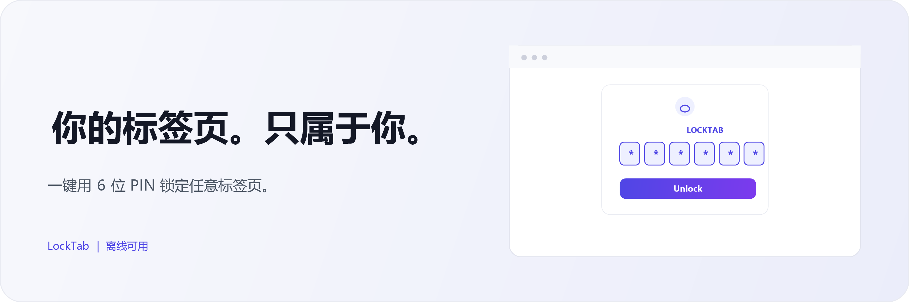
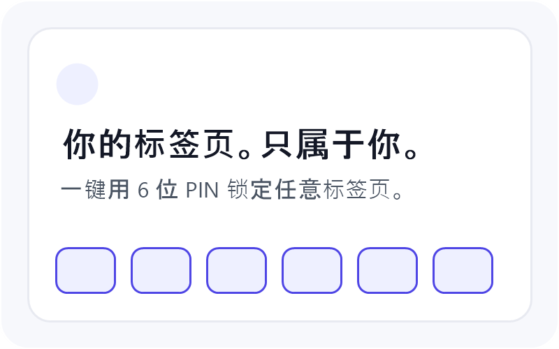
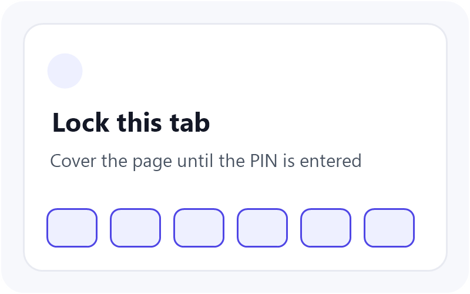
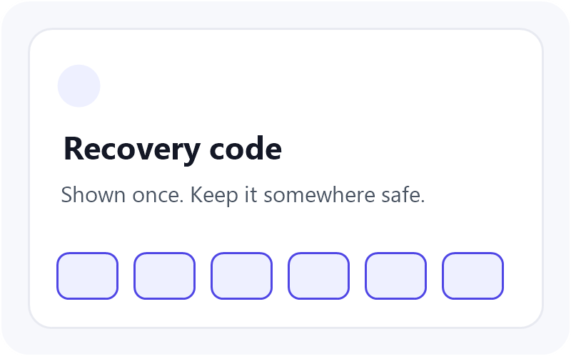

  

<h1 align="center">LockTab — 你的标签页，只属于你</h1>

一键用 6 位 PIN 锁定任意标签页。可为单个网站设置专属 PIN，获得一次性恢复码，然后放心离开——没人能读到你的屏幕。八种界面语言，完整的阿拉伯语 RTL，且完全不联网。

  
  
  
  
  
  

<h4 align="center">
  <a href="README.md">English</a> · <a href="README.ar.md">العربية</a> · <a href="README.es.md">Español</a> · <a href="README.fr.md">Français</a> · <a href="README.de.md">Deutsch</a> · <a href="README.pt-BR.md">Português (Brasil)</a> · <a href="README.ru.md">Русский</a> · <a href="README.zh-CN.md"><b>中文（简体）</b></a>
</h4>

<h3 align="center">为你的浏览器下载 — 点击图标</h3>

| [ <b>Chrome</b>](https://github.com/el9a7rawi/LockTab/releases/latest) | [ <b>Edge</b>](https://github.com/el9a7rawi/LockTab/releases/latest) | [ <b>Firefox</b>](https://github.com/el9a7rawi/LockTab/releases/latest) | [ <b>Brave</b>](https://github.com/el9a7rawi/LockTab/releases/latest) | [ <b>Opera</b>](https://github.com/el9a7rawi/LockTab/releases/latest) |
|---|---|---|---|---|

Firefox 121 及以上使用带有专属 manifest 的独立压缩包。

---

## 1. 为什么选择 LockTab？

| Without LockTab | With LockTab |
| --- | --- |
| 任何人都能看到打开的标签页 | 输入 PIN 前页面始终被遮盖 |
| 所有网站共用一个密码 | 重要页面使用专属 PIN |
| 忘记 PIN 就失去访问 | 一次性恢复码可清除所有锁定 |
| 会上传数据的扩展 | 完全离线，无账号、无追踪 |

The page you left open stays private without a shared password or a cloud account. Nothing leaves
the device, so the promise holds even when you are offline.

---

## 2. 如何使用 — 三个步骤

1. 创建 6 位 PIN，并保存只显示一次的恢复码。
2. 打开要保护的标签页，点击「锁定此标签页」。
3. 输入 PIN 继续阅读，或授予临时解锁。

---

## 3. 界面导览 — 扩展的每个部分

### 3.1 顶栏 — 触手可及

标题、主题、语言与 GitHub 链接整齐地排在一行。

### 3.2 一个主操作

一个渐变按钮即可遮盖当前页面。临时解锁和移除锁定都需要先输入 PIN。

### 3.3 标签页状态

扁平状态条显示标签页是已锁定、已打开还是暂时打开。

### 3.4 PIN 输入

六个框依次出现，到第六个停止，星号居中显示。

### 3.5 恢复码

设置后只显示一次。已使用的恢复码无法再次使用。

### 3.6 已锁定的网站

带编号的行列出每个被锁定的域名。超过五个网站后可用箭头翻页。

### 3.7 设置

三档模糊、图标计数、解锁时长、主题和语言——尽在一处。

### 3.8 支持

LockTab 免费且开源。PayPal 和醒目的 InstaPay 帮助它保持独立。

---

## 4. What the PIN protects

PBKDF2-HMAC-SHA256 with 600,000 iterations and a unique 16-byte salt — the plaintext PIN is never
stored. The overlay runs in a closed shadow root, focus stays inside it, and the page underneath
cannot scroll. Wrong guesses escalate through 30s, 60s, 300s and 900s lock-outs, and opening another
tab does not reset the counter while the global PIN is in use. The query string and fragment are
dropped, so a redirect cannot shed a lock.

---

## 5. Install

1. Download the release archive for your browser from [Releases](https://github.com/el9a7rawi/LockTab/releases).
2. Extract it into a folder.
3. Chrome, Edge, Brave and Opera: open `chrome://extensions`, enable **Developer mode**, choose **Load unpacked** and select the folder.
4. Firefox 121+: open `about:debugging#/runtime/this-firefox`, choose **Load Temporary Add-on** and select `manifest.json` in the folder.

隐私说明见下方第 7 节及 privacy.html。

---

## 6. Development

No bundler and no npm dependencies. Run `python tools/build.py` to validate all eight
locale bundles and write the release archives, then `node --test tests/core.test.mjs` for the
unit tests. The interface follows a fixed visual contract in the design reference.

---

## 7. Privacy

请参阅 privacy.html。PIN 仅以 PBKDF2 哈希和唯一盐值保存。查询字符串与片段会被丢弃，页面内容从不读取，没有任何请求离开扩展。字体全部本地打包。

---

## 8. License

本项目基于 Apache-2.0 开源且免费——可自由使用、修改与分享；全文见 LICENSE。内置字体采用 SIL OFL 1.1。发布历史见 CHANGELOG.md。

用心打造 ❤️ <b>Ahmed Yousry</b> · <a href="https://github.com/el9a7rawi/LockTab">LockTab</a> · <a href="LICENSE">Apache-2.0</a>

