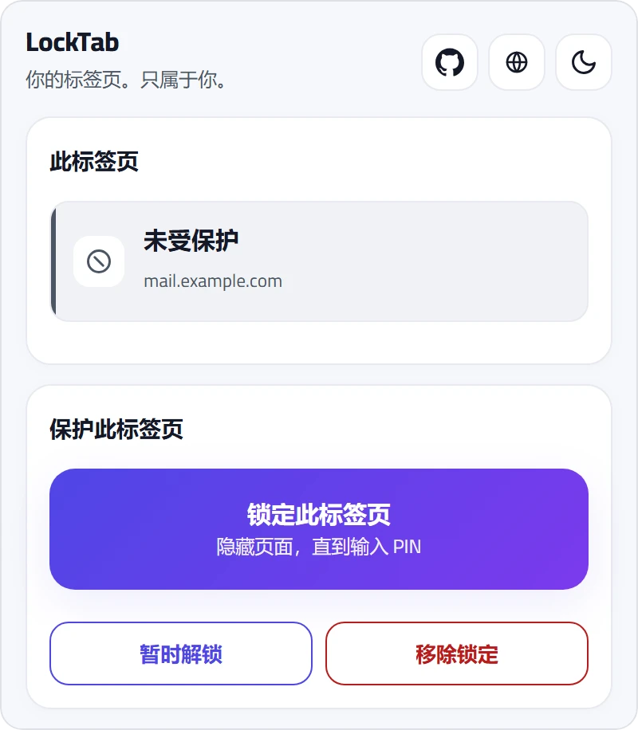
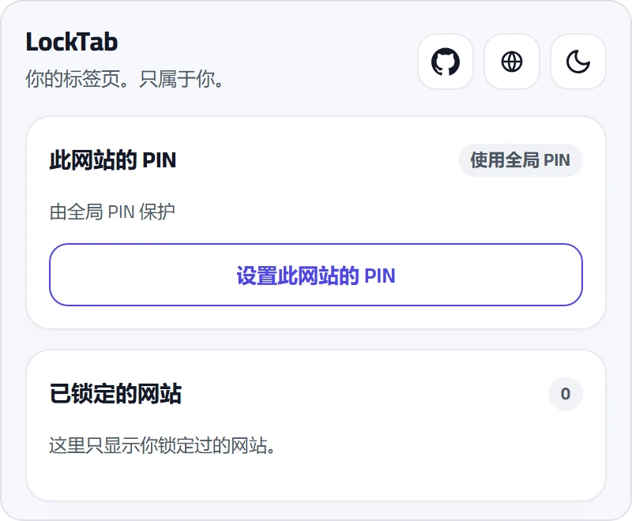
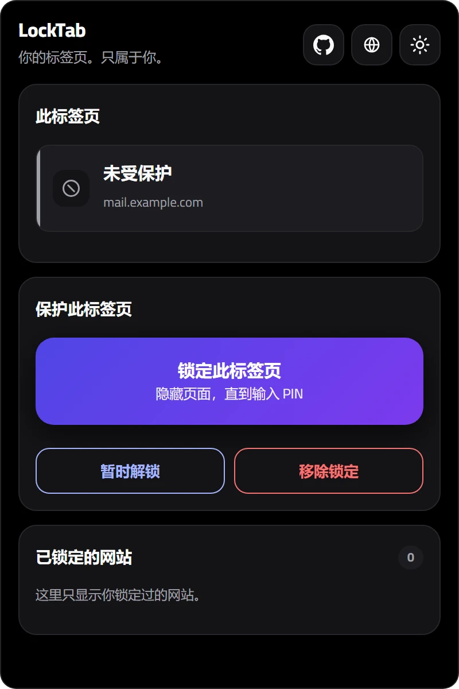
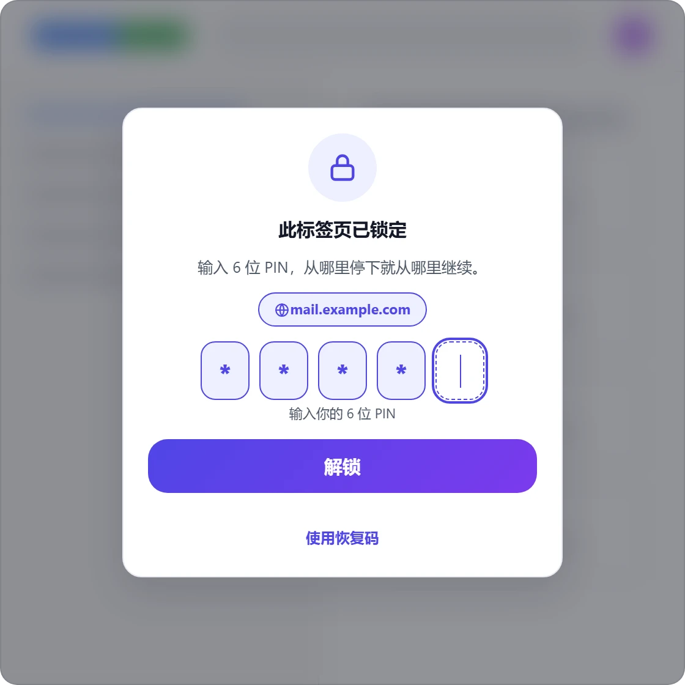
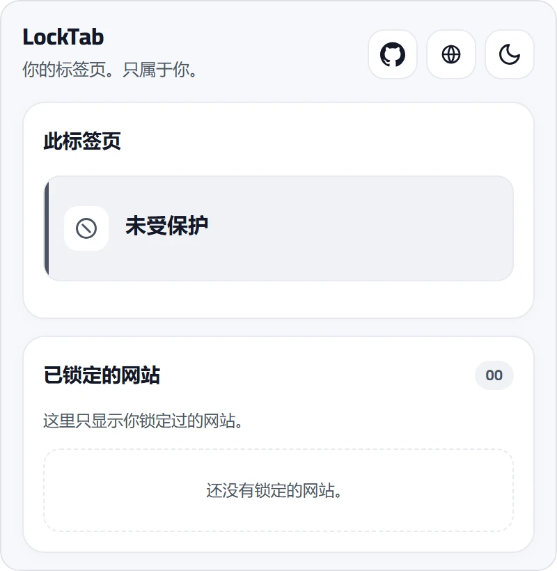
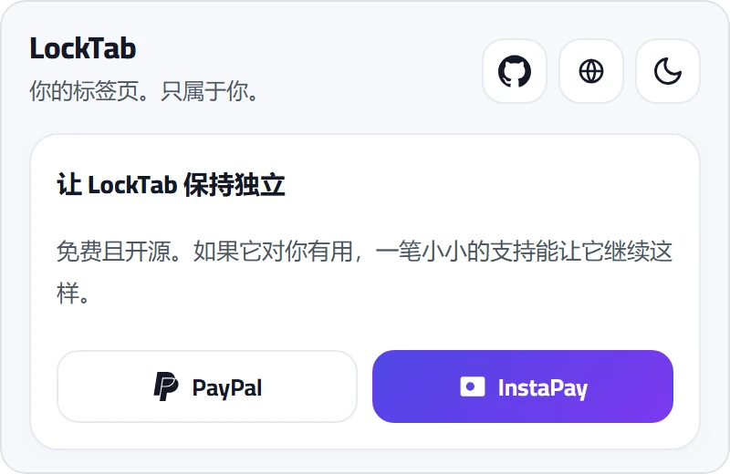

  

<h1 align="center">LockTab — 你的标签页，只属于你</h1>

一键用 6 位 PIN 锁定任意标签页。可为单个网站设置专属 PIN，获得一次性恢复码，然后放心离开——没人能读到你的屏幕。八种界面语言，完整的阿拉伯语 RTL，且完全不联网。

  
  
  
  
  
  

<h4 align="center">
  <a href="README.md">English</a> · <a href="README.es.md">Español</a> · <a href="README.fr.md">Français</a> · <a href="README.de.md">Deutsch</a> · <a href="README.pt-BR.md">Português (Brasil)</a> · <a href="README.ru.md">Русский</a> · <a href="README.ar.md">العربية</a>
</h4>

<h3 align="center">Download for your browser — click the icon</h3>

| [ <b>Chrome</b>](https://github.com/el9a7rawi/LockTab/releases/latest) | [ <b>Edge</b>](https://github.com/el9a7rawi/LockTab/releases/latest) | [ <b>Firefox</b>](https://github.com/el9a7rawi/LockTab/releases/latest) | [ <b>Brave</b>](https://github.com/el9a7rawi/LockTab/releases/latest) | [ <b>Opera</b>](https://github.com/el9a7rawi/LockTab/releases/latest) |
|---|---|---|---|---|

Chrome 和 Chromium 浏览器是主要目标。从 121 版起通过带有专属清单的独立归档支持 Firefox。

---

## 1. 为什么选择 LockTab？

| Without LockTab | With LockTab |
|---|---|
| 任何人都能看到打开的标签页 | 输入 PIN 前页面始终被遮盖 |
| 所有网站共用一个密码 | 重要页面使用专属 PIN |
| 忘记 PIN 就失去访问 | 一次性恢复码可清除所有锁定 |
| 会上传数据的扩展 | 完全离线，无账号、无追踪 |

undefined

---

## 2. 如何使用 —— 三个步骤

1. 创建 6 位 PIN，并保存只显示一次的恢复码。
2. 打开要保护的标签页，点击「锁定此标签页」。
3. 输入 PIN 继续阅读，或授予临时解锁。

---

## 3. 界面导览 — 扩展的每个部分

### 3.1 Header — everything in reach

The title, theme toggle, GitHub link and language picker share one compact row.

### 3.2 One primary action

A single gradient button covers the active page. Temporary unlock and lock removal ask for the PIN first.

### 3.3 Tab status

A flat status plate shows whether the tab is locked, open, or open for a while.

### 3.4 First run — create your PIN

Six boxes appear one after another, stop exactly at six, and centre the asterisk.

### 3.5 Recovery code shown once

The code is displayed only at setup. Store it somewhere safe; a used code can never be replayed.

### 3.6 A PIN for one site

A site PIN overrides the global one on that domain, so sensitive pages can stay separate.

### 3.7 Locked sites

Numbered rows list every locked domain. Past five sites, arrows page through the list.

### 3.8 Lock from anywhere
The Alt+Shift+L shortcut locks the current tab without opening the popup.

### 3.9 设置

模糊、计数、时长、主题和语言都在同一张卡片中。

### 3.10 八种语言与真正的 RTL

即时切换；阿拉伯语会按逻辑镜像整个布局。

### 3.11 纯黑深色主题

真正的纯黑背景，对比度经过调整并会被记住。

### 3.12 PIN 输入

锁定层使用封闭的 shadow root，焦点始终留在内部。

### 3.13 空状态

诚实地邀请你锁定一个标签页。

### 3.14 支持

PayPal 和 InstaPay 帮助项目保持独立。

## 4. 锁定保护什么

1. **A 6-digit PIN.** Stored as a PBKDF2 hash with a unique 16-byte salt; the plaintext is never written to disk.
2. **A closed gate.** The overlay runs in a closed shadow root, traps focus and blocks scrolling underneath.
3. **A shared counter.** Wrong guesses escalate through 30, 60, 300 and 900 second lock-outs; switching tabs does not reset it.
4. **One-time recovery.** The code is shown once, consumed once, and clears every lock.

---

## 5. 安装（未打包）

1. Open `chrome://extensions`.
2. Enable **Developer mode**.
3. Click **Load unpacked** and select the extracted release folder.
4. Click the LockTab icon in the toolbar.

隐私说明见下方第 7 节及 `privacy.html`。

---

## 6. 开发

发布的仓库只包含扩展及其文档。截图脚本和本地测试套件有意不纳入仓库；GitHub Actions 校验清单、CSP 和语言覆盖。

---

## 7. 隐私

请参阅 `privacy.html`。PIN 仅以带唯一盐值的 PBKDF2 哈希保存；页面内容从不读取，没有任何请求离开扩展。

---

## 8. 许可

本项目基于 **Apache-2.0** 开源；全文见 [LICENSE](LICENSE)。字体采用 [SIL OFL 1.1](fonts/OFL.txt)。发布历史见 [CHANGELOG.md](CHANGELOG.md)。

---

用心打造 ❤️ <b>Ahmed Yousry</b> · <a href="https://github.com/el9a7rawi/LockTab">LockTab</a> · <a href="LICENSE">Apache-2.0</a>

